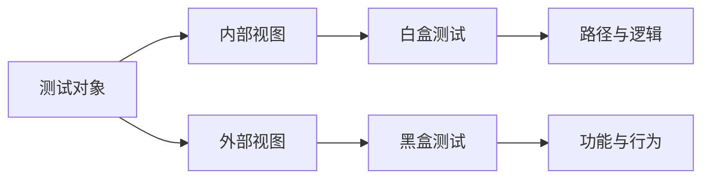

# 测试特征（Test Characteristics）与内部/外部视图（Internal and External Views）

## 测试特征与“好测试”

测试的目的不是证明程序正确，而是**发现错误**。因此，一个“好测试”应当有较高概率发现尚未暴露的错误，同时遵守测试用例设计的约束：以最少的工作量和时间获得尽可能充分的覆盖。测试用例还应能明确说明输入、执行条件和预期结果，使失败可以被定位和复现。

软件是否容易测试，取决于其 **testability（可测试性）**。课件中的主要特征如下：

| 特征 | 含义 | 对测试的帮助 |
|---|---|---|
| Controllability | 能控制程序状态、输入和执行条件，并使测试自动化、优化 | 容易构造目标场景 |
| Observability | 能观察输出、状态和中间结果 | 容易判断测试是否通过 |
| Simplicity | 架构和逻辑简单，避免不必要的复杂性 | 减少路径和测试难度 |
| Understandability | 设计容易被理解 | 便于确定预期结果 |
| Stability | 测试期间软件相对稳定 | 减少用例频繁失效 |

> [!IMPORTANT]
> 考试选择题若问可测试软件的特征，看到 **observability、simplicity、stability**，应选 **all of the above**。可测试性不是“测试人员的能力”，而是软件设计和实现本身的属性。

## 内部视图与外部视图

任何工程产品都可以从两种视图测试：一种了解内部结构，检查“所有齿轮是否啮合”；另一种只依据外部规格，检查产品是否表现出正确行为。这分别对应白盒测试和黑盒测试。

| 对比项 | White-Box Testing | Black-Box Testing |
|---|---|---|
| 依据 | 代码、控制结构、数据结构 | 需求规格、输入输出、用户行为 |
| 是否了解内部实现 | 是 | 否 |
| 典型目标 | 执行语句、判定、路径和循环 | 检查功能、接口及初始化和终止错误 |
| 典型方法 | Basis Path Testing、Data Flow Testing、Loop Testing | Equivalence Partitioning、Boundary Value Analysis、Graph-Based Testing |

==白盒测试验证“内部怎么做对”，黑盒测试验证“外部是否做对”==。二者互补，不能相互替代：代码全部执行过，不代表遗漏的需求功能会被发现；功能测试通过，也不代表所有内部路径都已执行。

## 为什么不能穷举，如何选择测试

白盒测试希望执行独立路径、覆盖判定的真与假两侧，并在边界及正常范围内执行循环。但穷举通常不可行。例如，一个约 100 行的程序含两个各执行 20 次的嵌套循环，内层还有 4 个 `if-then-else`，课件估算其可能执行路径约为 $10^{14}$ 条。因此实际只能采用 **Selective Testing**：选择重要逻辑路径，并检查重要数据结构的有效性。

> [!WARNING]
> “覆盖所有语句”不等于“覆盖所有路径”，更不等于“没有错误”。未执行的路径可能隐藏排印错误；低执行概率的路径也可能集中逻辑错误和错误假设。

## 一个做对的例子：等价类划分

**Equivalence Partitioning** 将输入域划分为若干等价类，并假设同一类中的输入会以相似方式暴露错误，于是从每类选取代表值，减少重复测试。

若有效输入为整数 $1\le x\le100$，可划分为：

| 等价类 | 示例 | 预期 |
|---|---:|---|
| $x<1$，无效 | $0$ | 拒绝 |
| $1\le x\le100$，有效 | $50$ | 接受 |
| $x>100$，无效 | $101$ | 拒绝 |

> [!TIP]
> 等价类划分负责“减少代表输入”，边界值分析负责“重点攻击边界”。大量故障集中在输入定义域或输出值域边界，因此还应补测 $1、100$ 及其邻近值，不能只测 $50$。
