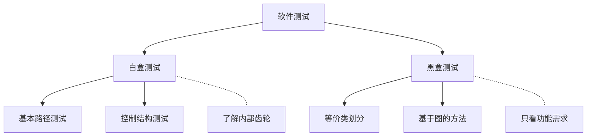

# 测试的目标（Goal of Testing）与软件可测试性（Testability）

---
requires: [软件工程/软件过程]
---

## 测试的目标

很多人直觉上认为“测试是为了证明程序没 Bug”。如果带着这个想法去写用例，你只会挑那些肯定能跑通的数据。但课件里给出的定义恰恰相反：

> [!IMPORTANT]
> ==The goal of testing is to find errors, and a good test is one that has a high probability of finding an error.==

一个“好测试”不是让程序顺利通过的测试，而是**最有可能把隐藏错误揪出来**的测试。同时受现实约束（CONSTRAINT），我们必须在最少的时间与精力（with a minimum of effort and time）内发现最多的错误。

由此引出一个常见判断题陷阱：

> [!CAUTION]
> “With thorough testing it is possible to remove all defects from a program prior to delivery.” —— **False**。
> 穷尽测试（Exhaustive Testing）对大型系统是不可能的，我们只能做选择测试（Selective Testing），挑选重要的逻辑路径和数据结构进行验证。

## 软件可测试性

既然目标是高效找错，我们在设计和实现软件时就必须带着“可测试性”（Testability）的思维。课件强调了两个核心特征：

- **Observability（可观察性）**：每个测试用例的结果必须能被轻易观察到。如果程序内部状态像黑盒一样看不见，就无法判断对错。
- **Understandability（可理解性）**：设计本身必须易于理解。代码越晦涩，越难设计出高命中率的测试。

| 特性 | 关注点 | 反面教材 |
| :--- | :--- | :--- |
| Observability | 结果是否易见 | 日志缺失、无返回值 |
| Understandability | 设计是否易懂 | 逻辑耦合、命名混乱 |

## 怎么做：从目标到方法

明确了“找错”目标和“可测试性”要求后，具体怎么测？课件将测试分为两大视角：

- **White-Box Testing（白盒测试）**：Knowing the internal workings。就像检查钟表“所有齿轮是否咬合”，确保内部操作符合规范且组件被充分执行。典型方法是 Basis Path Testing（基本路径测试）。
- **Black-Box Testing（黑盒测试 / behavioral testing）**：不关心内部结构，只关注 functional requirements。它试图回答：什么类别的输入能构成好的测试用例？数据类的边界如何隔离？

## 算对了的例子：基本路径测试

以典型例题中“计算绝对值”的代码为例，演示白盒测试的基本路径步骤：

1. **绘制流图（Flow Graph）**：根据代码前面的序号画出节点与边。
2. **计算环路复杂性（Cyclomatic Complexity）**：$V(G) = E - N + 2$（或数判定节点数加 $1$）。若流图有 2 个判定节点，则 $V(G) = 3$。
3. **确定独立路径（Basis set of paths）**：找出 $V(G)$ 条线性无关的路径。例如：
   - Path 1: `1 -> 2(真) -> 3`
   - Path 2: `1 -> 2(假) -> 4 -> 5`
4. **准备测试用例**：设计输入强制程序分别执行上述每条路径。

> [!TIP]
> 记忆口诀：**画图 → 算复杂度 → 找路径 → 造数据**。这四步是基本路径测试的固定套路，考试必考。

## 常见的坑

> [!WARNING]
> 别把“测试目标”和“调试（Debugging）”搞混。Testing 负责**发现**错误，Debugging 负责**定位并修复**错误。

> [!NOTE]
> 在面向对象测试（OOT）中，继承并不会减少测试工作量，反而会 complicating the testing process。派生类必须重新彻底测试；Partition Testing 可根据操作是否能改变类的状态来分类，从而减少测试用例数量。
