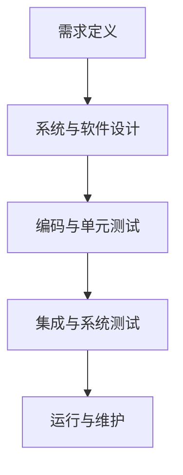

# 瀑布模型（The Waterfall Model）

好的，这是为你准备的《软件工程（双语）》“瀑布模型”知识点的讲解正文。

---

## 瀑布模型（The Waterfall Model）

想象你正在建造一座大桥。你会先完成全部设计图纸，然后才开始一砖一瓦地施工；你绝不会一边设计桥墩，一边铺设桥面。瀑布模型正是将这种“先完整设计，再严谨施工”的理念应用于软件开发。

### 它是什么？

瀑布模型是一种==经典的、文档驱动的生命周期模型==，它将软件开发过程划分为一系列顺序执行的阶段。

- **阶段性与连续性**：项目从一个阶段“流动”到下一个阶段，就像瀑布一样，不可逆转。
- **里程碑驱动**：每个阶段结束时必须产出一份正式文档（如需求规格说明书、设计文档），作为该阶段的里程碑和下一阶段的工作基础。核心思想是：==在编码前完成所有的分析与设计==。

> [!IMPORTANT]
> 瀑布模型的核心是**文档驱动**和**严格的顺序性**。上一个阶段彻底完成并通过审批后，才能进入下一个阶段。

### 为什么需要它？

当你的项目具备以下特征时，瀑布模型就有用武之地：

- **需求极其明确且稳定**：在项目初期，客户和开发团队能就“软件究竟要做什么”达成完全一致的理解，并且预计在开发过程中不会发生改变。
- **项目规模较小或风险较低**：对于一个简单、易于理解的小型项目，瀑布模型的线性结构能让整个过程变得非常清晰。
- **追求流程的严谨性与可预测性**：模型定义了明确的检查点和文档交付物，使项目的进度、成本和质量更易于管理和度量。

### 优点与缺点

| **优点**                     | **缺点**                                                    |
| :--------------------------- | :---------------------------------------------------------- |
| **易于理解与计划**           | ==不善于应对需求变更==，这种模型僵化、缺乏灵活性          |
| 适用于==需求明确==的小项目 | 客户只能在项目开始时提供需求，在项目结束时**才能看到可运行软件** |
| **分析**与**测试**阶段直截了当 | 缺陷的发现和修复被**推迟到测试阶段**，修正成本高昂        |

### 常见的坑

> [!WARNING]
> **最大的陷阱：盲目使用**
> 许多人将瀑布模型视为默认或“教科书”式流程，直接套用在需求尚不清晰的Web应用或创业项目上。结果往往是项目后期发现与用户期望严重偏离，导致项目延期、超支甚至失败。**瀑布模型是解决“已知问题”的利器，却不适用于探索“未知领域”**。

> [!CAUTION]
> **高危误区：阻塞状态**
> 在瀑布模型中，测试团队在设计和编码阶段是完全“阻塞”的，而开发团队在测试阶段可能也仅忙于修复Bug。这种僵化分工是资源闲置和团队士气低落的源头。

### 相近概念辨析：V模型

V模型是瀑布模型的一个变种，它与瀑布模型一样强调顺序性。==关键区别在于，V模型更强调测试与开发阶段的对应关系==。它的左侧是分解和设计过程，右侧是集成和验证过程，明确建立了“每个开发阶段都对应一个测试级别”的思想（例如，需求分析对应验收测试，概要设计对应系统测试）。这解决了瀑布模型中测试被严重滞后的问题，但从应对变更的角度看，它同样僵化。

### 考题解析

让我们用这个模型知识来解一道考题：
“The waterfall model of software development is（）

- A. A reasonable approach when requirements are well defined.
- B. A good approach when a working program is required quickly.
- C. The best approach to use for projects with large development teams.
- D. An old fashioned model that is rarely used any more.”

解题思路：
- 选项 B：快速交付一个能工作的程序，是增量模型或敏捷开发的优势，不是瀑布模型。
- 选项 C：大型开发团队并不是选择瀑布模型的充分条件，大型项目往往需求复杂且多变，使用瀑布模型风险反而更高。
- 选项 D：瀑布模型并非“过时且不再使用”。在需求固化、生命攸关或大型军工系统中，它依然是严谨且有效的方案。
- 选项 A：==当需求被良好定义时，瀑布模型的弊端——不善于应对变更——就不复存在，而其流程清晰、易于管理的优点得以凸显，因此它是一个合理的选择。==

因此，这道题的**正确答案是 A**。
