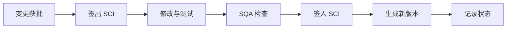

# SCM过程2：版本控制（Version Control）

## 版本控制是什么

版本控制（Version Control）是 SCM 过程中负责==保存、标识和追踪软件配置项（SCI）所有历史版本==的机制。它把每次变更后的结果作为一个新版本保存下来，使团队能够有效管理产品发布，并在需要时回到以前的版本。

它不只是“保存代码历史”：需求规格说明、设计模型、源代码、测试用例等 SCI，都可能需要版本管理。

## 为什么需要版本控制

软件开发中，变更经常并行发生。如果没有版本控制，容易出现以下问题：

- 无法确定某个发布版本包含哪些修改；
- 出现缺陷后，难以恢复到稳定的旧版本；
- 两名开发者同时修改同一 SCI，后提交的内容覆盖先提交的内容；
- 多个文件相互依赖，却被组合成不一致的版本。

因此，版本控制需要同时解决三个问题：**版本能否追溯、发布能否重建、并行修能否协调**。

> [!IMPORTANT]
> 版本控制的核心考点是：保存全部版本以支持发布管理和版本回退，并通过==同步控制（Synchronization Control）==防止不同人员的并行修改相互覆盖。

## 版本控制怎么做

版本控制通常嵌入变更控制过程，而不是脱离变更流程单独进行：

其中，**签出（check out）**是从项目数据库取得待修改的 SCI；修改并通过 SQA 程序后再**签入（check in）**。随后执行版本控制程序，生成软件的下一个版本。

同步控制常采用两种方式：

| 方式 | 基本做法 | 适用特点 |
|---|---|---|
| 加锁 | 修改期间限制他人修改同一对象 | 简单，但并行度较低 |
| 复制—合并 | 各自修改副本，签入时检测冲突并合并 | 并行度高，但必须处理冲突 |

> [!WARNING]
> “允许两人同时修改”不等于“同步控制已经完成”。只有签入时能够检测冲突、协调合并，并避免修改被静默覆盖，才算真正实现同步控制。

## 与相近概念的区别

| 概念 | 关注对象 | 主要作用 |
|---|---|---|
| 变更控制 | 一次变更能否实施、如何实施 | 评估、批准、执行并跟踪变更 |
| 版本控制 | SCI 的各个版本 | 保存历史、生成新版本、支持回退 |
| 配置管理 | 一组相互匹配的 SCI 版本 | 管理里程碑或生产发布所对应的完整配置 |
| 基线 | 经评审确认的 SCI 或配置 | 作为后续变更的正式基础 |

配置管理跟踪代表项目里程碑或生产发布的一系列配置；**版本管理提供所需版本，链接管理（link management）记录版本之间的相互依赖关系**。例如，某发布版本不仅要知道使用哪个源文件版本，还要知道它与哪些库、数据文件和文档版本相匹配。

## 一个做对了的例子

SafeHome 系统的 `ControlPanel` 已发布为 $V1.2$。甲修改报警逻辑，乙同时修改界面提示：

1. 两人分别提交变更请求，经 CCA 批准后获得对应 ECO；
2. 按访问控制参数签出相关 SCI，并分别修改；
3. 修改结果经过测试和 SQA 检查；
4. 甲先签入，乙签入时系统发现并行修改，执行冲突检测与合并，而不是直接覆盖甲的结果；
5. 版本控制程序生成 $V1.3$，保存 $V1.2$，并记录各 SCI 的版本及依赖关系。

若 $V1.3$ 的报警功能出现异常，团队可以回到 $V1.2$，同时仍能追查 $V1.3$ 中每次修改的来源。

> [!CAUTION]
> 常见失分点是把版本控制写成“定期备份”，或把“生成下一版本”误当成同步控制。==备份侧重保存副本；版本控制还要管理版本标识、演化关系、发布组合和并行修改。==
