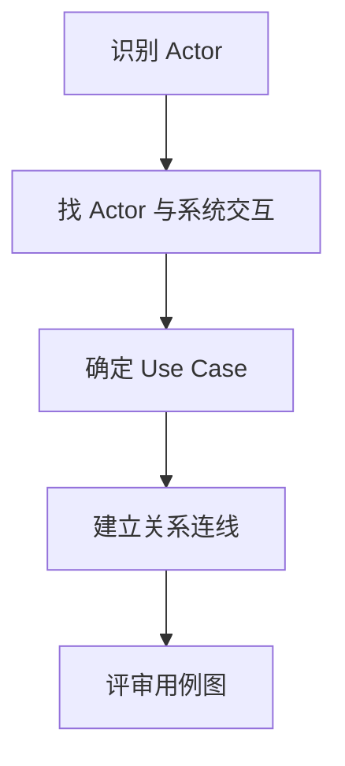

# 开发用例（Developing Use Cases）与绘制用例图

## 用例是什么

需求分析要回答两个问题：**系统外面有什么**（actors，参与者）和**系统该做什么**（use cases，用例）。用例（Use Case）就是一份"行为契约"（contract for behavior），它比用户故事（User Story）更正式，捕获的是信息的生产者/消费者与系统之间的交互。

> [!IMPORTANT]
> 用例图（Use Case Diagram）从**用户视角**描绘系统，属于需求模型的场景类元素（Scenario-based elements）。图中一个圈 = 一个场景，每个符号都不是多余的——向前反应需求，向后体现在代码中。

## 怎么画用例图

画之前必须明确三件事：

| 要素 | 含义 | 示例（教务系统） |
|---|---|---|
| Actor | 系统外部的角色（人/设备） | 学生、教师、教务员 |
| Use Case | 系统提供的功能场景 | 选课、查成绩 |
| 关系 | 关联 / `<<include>>` / `<<extend>>` | 见下 |

开发步骤：

## `<<include>>` 与 `<<extend>>` 的区别

这是最容易考混的点：

| | `<<include>>` | `<<extend>>` |
|---|---|---|
| 语义 | 强制性包含 | 可选性扩展 |
| 执行 A 时 | **必然**执行 B | 满足条件**才**执行 B |
| 用途 | 提取公共功能 | 描述条件/可选行为 |
| 方向 | 基础用例 → 被包含用例 | 扩展用例 → 基础用例 |

> [!WARNING]
> 箭头方向常被画反！`<<include>>` 箭头从基础用例指向被包含用例；`<<extend>>` 箭头从扩展用例指向基础用例。

## 典型例题

题目给出用例图："Reserve Seat" 与 "Check Seat Availability"、"Install Seat" 之间是 `<<include>>`；"Queue" 与 "Reserve Seat" 之间是 `<<extend>>`；"Process Transaction" `<<include>>` "Generate Payment"。

**`<<include>>` 描述的需求（Mandatory Behavior）：**
"Reserve Seat" 包含 "Check Seat Availability" 和 "Install Seat"——用户每次预订座位，**必然**涉及检查座位可用性和安装座位；"Process Transaction" 包含 "Generate Payment"，说明生成支付是处理交易的必需步骤。

**`<<extend>>` 描述的需求（Optional Behavior）：**
"Queue" 扩展 "Reserve Seat"——当座位全部订满时，用户**可以选择**排队等待，但这不是每次预订都必须发生的步骤。

> [!TIP]
> 记忆口诀：include 是"**没它不行**"，extend 是"**有它更好**"。

## 用例在开发中的位置

面向对象的软件开发是**用例驱动**的：先画用例图，再逐步细化到分析模型、设计模型和代码。需求验证（Requirements Validation）阶段还要用分析模型检查需求陈述的**一致性**（consistency），确保用例之间没有矛盾。
