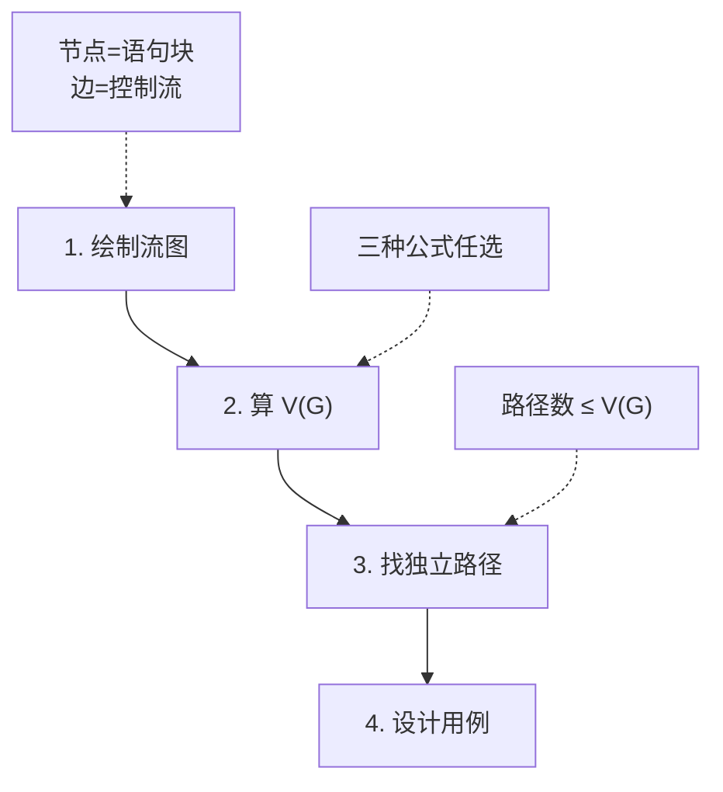
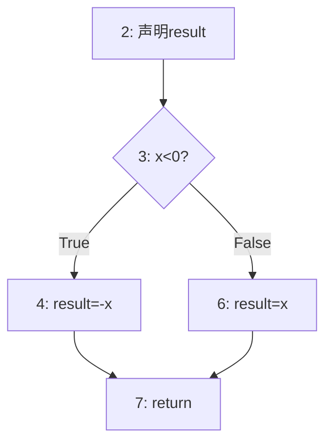

# 白盒测试（White-Box Testing）与基本路径测试（Basis Path Testing）

## 白盒测试与基本路径测试

如果黑盒测试关注“软件做了什么”，那么白盒测试（White-Box Testing）关注的就是“==软件内部是如何做的==”。它要求测试者了解模块的内部逻辑结构，通过设计测试用例来执行代码中的特定路径。但面对成千上万条可能的执行路径，我们不可能进行穷举测试（Exhaustive Testing），这时就需要一种系统化的方法来保证测试的充分性——这就是基本路径测试（Basis Path Testing）。

### 为什么需要基本路径测试

直接看代码写测试容易遗漏分支。基本路径测试提供了一种量化指标，确保测试用例至少覆盖程序中所有独立的线性路径。其核心度量是==环路复杂度 $V(G)$==，它定义了独立路径数量的上界。$V(G)$ 越高，程序逻辑越复杂，潜在错误的可能性也越大。

> [!IMPORTANT]
> 环路复杂度 $V(G)$ 决定了基本路径测试所需的最少测试用例数，也是衡量模块可测试性的关键指标。

### 如何计算与执行

基本路径测试通常分为四步：绘制流图、计算复杂度、确定独立路径、设计测试用例。



**计算 $V(G)$ 的三种等价方法：**

| 方法 | 公式 | 说明 |
| :--- | :--- | :--- |
| 边-节点法 | $V(G) = E - N + 2$ | $E$为边数，$N$为节点数 |
| 判定节点法 | $V(G) = P + 1$ | $P$为判定节点（谓词）数量 |
| 区域法 | $V(G) = R$ | 流图中封闭区域数+外部区域 |

> [!TIP]
> 考试中推荐优先使用 $V(G)=P+1$，只需数 `if`、`while`、`for`、`&&`、`\|\|` 等判定节点个数即可，最不易出错。

### 综合示例：绝对值函数

以下面这段带编号的代码为例，演示完整解题流程：

```c
1 int abs(int x) {
2     int result;
3     if (x < 0)      // 判定节点
4         result = -x; 
5     else            
6         result = x;  
7     return result;   
8 }
```

**Step 1：绘制流图**
将连续的顺序语句合并为一个节点，每个判定和汇合点单独成节点。



**Step 2：计算环路复杂度**
- 判定节点法：$P=1$（仅一个if），故 $V(G) = 1 + 1 = ==2==$
- 验证：$E=5, N=5 \Rightarrow V(G)=5-5+2=2$ ✓

**Step 3：列出独立路径**
独立路径是指至少包含一条之前未使用过的边的路径。本例 $V(G)=2$，需列出2条：
- ==路径1==：2 → 3 → 4 → 7（True分支）
- ==路径2==：2 → 3 → 6 → 7（False分支）

**Step 4：设计测试用例**
针对每条路径选择能触发该路径的输入数据，如路径1选 `x=-5`，路径2选 `x=3`。

### 常见误区与辨析

> [!WARNING]
> - **节点划分错误**：复合条件 `if(a && b)` 应拆分为==两个==判定节点，而非一个。
> - **忽略隐式分支**：`switch-case` 中每个 case 及 default 都是独立分支；循环的进入/退出也是判定。
> - **混淆覆盖标准**：基本路径测试保证的是==路径覆盖==，不等于条件组合覆盖，两者目标不同。

> [!NOTE]
> 白盒测试常与黑盒测试互补：白盒验证内部逻辑正确性，黑盒验证外部行为符合需求。在单元测试阶段以白盒为主，集成与系统测试阶段逐步转向黑盒与场景测试（Scenario Testing）。
