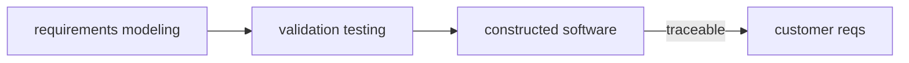

# 需求确认（Validation）涉及的问题

## 它是哪一步、要解决什么

在 requirements engineering 过程里，inception、elicitation、elaboration、negotiation、specification 之后，还要回答一个关键问题：**我们是不是在做正确的产品？** 这就是 `validation`（确认）。它不是检查代码有没有 bug，而是检查已构造的软件能否回溯到 customer requirements。

> [!IMPORTANT]
> 核心定义一句话：==Validation: Are we building the right product?==

课件里还写了另一句：Validation ensures the built software is **traceable to customer requirements**。所以它关心的不是“实现是否无误”，而是“客户要的东西是否被实现了”。

## 为什么需要 validation

先想一个问题：如果需求文档写得很漂亮、设计也照文档做，但客户真正想要的是别的功能，项目算成功吗？不算。  
validation 的作用，是在 requirements modeling 建立的需求，和已经构造出来的 software 之间做对照：

## 怎么做：一致性检查视角

需求确认检查表里，一个重要问题是 **consistency（一致性）**。使用 analysis model 时会问：模型中的各个元素有没有互相矛盾？比如两个 stakeholders 对同一功能的描述冲突，就是一个不一致点。

常见动作是拿需求项去和已实现系统做 validation testing，看是否能 trace 回原始需求；若 trace 不回去，就是不一致或遗漏。

## 和相近概念的区别

| 概念 | 英文 | 关心的问题 | 南邮课件说法 |
|---|---|---|---|
| 确认 | validation | 做对了产品吗 | right product |
| 验证（常对应 verification） | verification | 做对产品了吗 | built correctly |

> [!TIP]
> 记法：`validation=right product`；别把“确认”写成“测试找 bug”。

## 常见坑

> [!WARNING]
> 坑 1：把 validation 当成单元测试。单元测试看代码对错，不是判断是否满足客户。

> [!CAUTION]
> 坑 2：忽略 traceability。若需求在系统里找不到对应实现，validation 就失败。

## 一个算对了的例子

题目 donnée：给 terms 判断 validation。  
学生答卷写：`validation - ensure software traceable to requirements; ask "building the right product"。`  
这就对了，因为匹配课件 P(103) 两句定义，没写成 verification。

> [!NOTE]
> validation 是 requirements engineering 通向 design 的一座 bridge：只有确认“是客户要的”，后续 design 才有意义。
