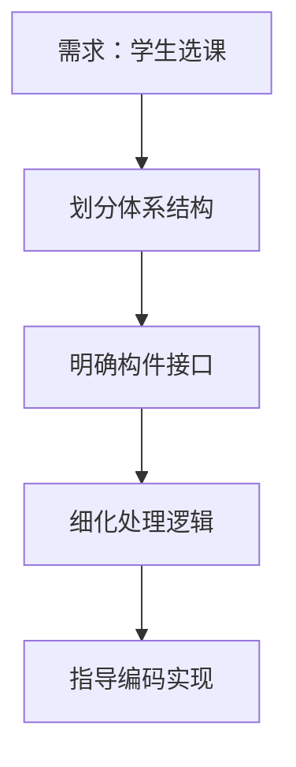
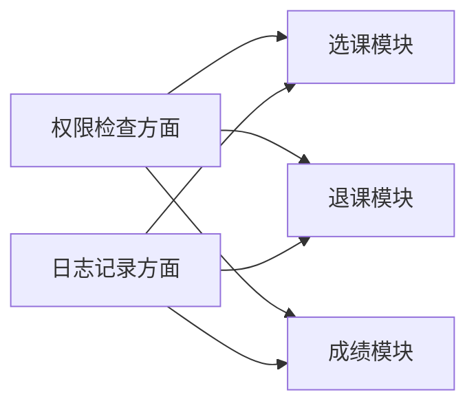

# 精化（Refinement）与方面（Aspects）

## 精化与方面：把“怎么做”逐步说清楚

需求模型回答“做什么”，设计模型回答“怎么做”。但设计不可能一次就细化到代码层面，因此需要**精化（refinement）**；同时，日志、安全、事务等需求会散布在多个模块中，因此需要关注**方面（aspects）**。

## 精化（Refinement）

精化是一种==自顶向下、逐步补充细节==的设计策略：先给出较抽象的方案，再逐层明确数据、接口和处理过程，直到可以指导实现。课件中的 **refining the architecture**，就是把初始体系结构逐步精化为更具体的设计。

例如设计“网上选课系统”：

1. **体系结构层**：划分为用户界面、选课控制、课程管理、数据访问等部分。
2. **构件层**：明确“选课控制”负责检查选课资格、课程容量和时间冲突。
3. **详细设计层**：进一步规定接口参数、数据库访问及异常处理。
4. **实现层**：将容量判断写成具体逻辑，如  
   $$\text{可选课}\iff \text{已选人数}<\text{课程容量}$$

精化也常表现为**逐步精化（stepwise refinement）**：把一个复杂过程分解为若干子过程，再继续分解，直到每一步都足够明确。

> [!IMPORTANT]
> 精化不是简单“多写一些细节”，而是在保持需求不变的前提下，==逐层降低抽象程度、提高可实现性==。

## 方面（Aspects）

需求通常可分为两类：

- **核心关注点**：系统的主要业务功能，如选课、下单、借阅。
- **横切关注点（crosscutting concerns）**：跨越多个构件的关注点，如日志、权限检查、事务、安全和性能监测。

当某个关注点会影响多个构件，并在多处产生相似代码时，就形成了一个**方面**。例如“每次选课、退课、修改成绩前都检查权限”，若把权限代码直接复制到各业务模块，就会造成代码分散、重复，修改时也容易遗漏。

设计时应先识别方面，再考虑用统一接口、公共机制或面向方面的方法集中描述，避免横切逻辑破坏模块的功能独立性。

## 与相近概念的区别

| 概念 | 主要回答 | 典型作用 |
|---|---|---|
| 抽象 abstraction | 暂时忽略哪些细节 | 抓住本质，控制复杂度 |
| 精化 refinement | 下一步补充哪些细节 | 从抽象方案走向实现 |
| 重构 refactoring | 如何改善现有内部结构 | 不改外部行为，提高质量 |
| 方面 aspects | 哪些关注点横切多个模块 | 集中处理横切逻辑 |
| 模块化 modularity | 系统如何划分 | 分解系统、降低复杂度 |

> [!WARNING]
> **精化不等于重构**：精化发生在设计逐步展开的过程中；重构通常针对已有设计或代码，在不改变外部行为的前提下改善结构。方面也不等于普通业务模块，它强调的是==横切多个模块的关注点==。

## 例题与易错点

**判断题：** When using structured design methodologies the process of stepwise refinement is unnecessary.（ ）

答案：**B. False**。

结构化设计恰恰常采用自顶向下、逐步精化的方法：先确定总体结构，再细化模块及其处理过程。因此，“不需要逐步精化”错误。

答题时抓住两个判断标准：**是否逐层增加实现细节**，是则属于精化；**是否横切多个模块**，是则应考虑方面。
