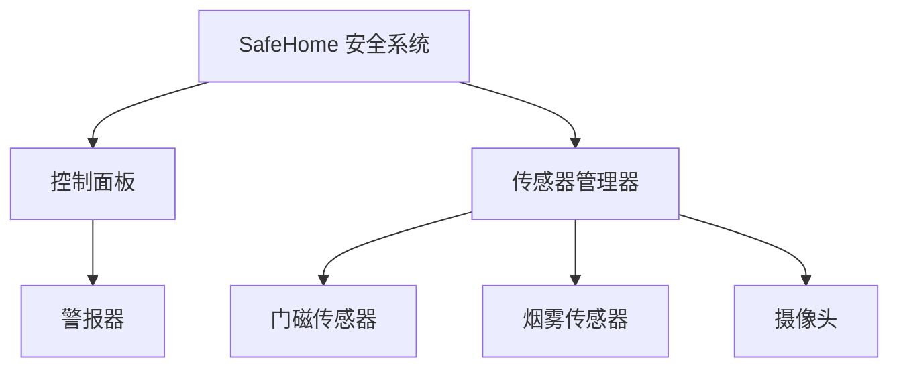

# 将体系结构精化为构件（Refining into Components）与描述系统实例

## 从体系结构到构件

体系结构设计完成后，我们得到的是一张"高层蓝图"——比如 SafeHome 的 SafeHome 安全功能体系结构原型集，它只告诉你系统由哪些子系统、哪些原型（Archetype）组成。但蓝图本身还不能运行，必须**精化为构件（Refining the Architecture into Components）**，把每个原型实例化为具体的类或模块。

> [!IMPORTANT]
> **体系结构原型（Archetype）≈ 模式（Pattern）**：它是目标系统中一个稳定的核心抽象，是类或模式的抽象表示，可以基于系统行为被反复实例化出不同形式。原型可从需求模型中的分析类导出。

## 精化的具体做法

以 SafeHome 为例，安全功能体系结构原型集包含若干原型，精化时要回答两个问题：

- **这个原型对应哪些具体构件？** 例如"传感器"原型可实例化为门磁传感器、烟雾传感器、摄像头等具体类。
- **构件之间如何协作？** 用组合（Composite）模式把叶子构件和组合构件统一对待，形成树状的"部分-整体"层次。

## 描述系统实例

精化完成后，要**描述系统实例**——即把构件组合成更大的体系结构块，展示系统在特定配置下的实际形态。例如家庭安保系统实例：控制面板 + 3 个门磁 + 1 个烟雾传感器 + 2 个摄像头。

> [!TIP]
> 组合模式（Composite）是这里的关键：它让客户端**一致地处理单个对象和对象组合**，新增传感器类型时无需修改控制面板代码。

## 易混辨析

| 概念 | 层次 | 作用 |
|------|------|------|
| 体系结构原型（Archetype） | 抽象层 | 稳定的核心抽象，可反复实例化 |
| 构件（Component） | 设计层 | 原型的具体实现，如类、模块 |
| 系统实例（Instance） | 部署层 | 构件的特定组合，可实际运行 |

> [!WARNING]
> 判断题常考："Once selected, archetypes always need to be refined further as architectural design proceeds." 答案为 **True**。原型不是终点，必须随设计推进不断精化为更具体的构件。

> [!CAUTION]
> 不要把"精化为构件"理解为"写代码"。它仍属设计阶段，产出的是模块划分、接口定义和协作关系，而非源代码。
