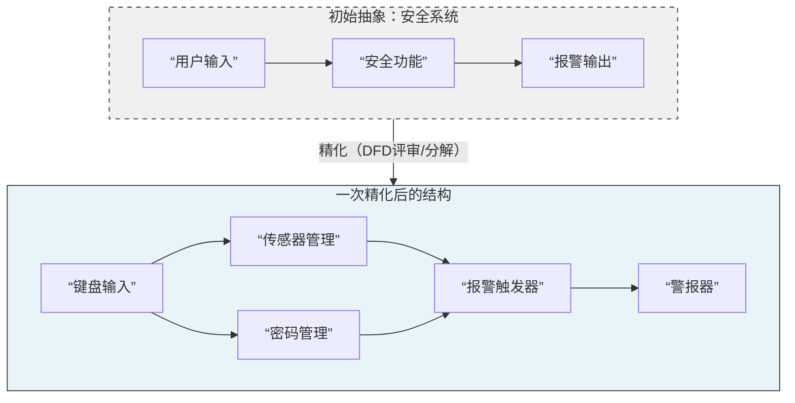

# 体系结构的组织与精化（Organization and Refinement）

好的，我们开始讲解“体系结构的组织与精化”。

## 为什么需要组织与精化？

设想你要建造一栋房子。你肯定不会一开始就敲定每个插座的位置和每块瓷砖的颜色。你会先有一个**整体蓝图**：房子是几层的？有几间卧室？楼梯和走廊如何连接各个房间？

软件架构设计也是如此。我们不能一上来就深入到代码细节。我们需要一种方法，在宏观层面将系统组织成可理解的模块，并逐步细化，直到能够指导具体实现。

这，就是 ==体系结构的组织与精化== ——它解决的核心问题是：**如何从一个高层次的设计概念，逐步得到一个具体、可实施的软件结构蓝图？**

[!IMPORTANT]
> 架构组织与精化的根本目的，是在设计变更成本还较低的时候，探索并确定系统的整体结构、组件间的协作方式，并逐步将模糊的设计构思，转化为清晰、可实现的软件组件。

## 什么是组织与精化？

体系结构的组织与精化是一个由粗到细、持续决策的过程，包含两个核心步骤：

1.  **组织（Organization）**：这一步回答“骨架是什么样？”的问题。我们需要做出关键的结构性决策，建立一个协调的、良好规划的顶层结构模型。这包括：
    *   **识别外部实体**：系统需要和哪些“人”或“系统”交互？如用户、外部数据库等（相当于上图的 `User Keypad` 和 `Alarm`）。
    *   **选择架构风格/模式**：是选择分层架构、客户端-服务器，还是微服务？这为整个系统奠定了基调和约束。
    *   **确立顶层组件与职责**：系统主要分为哪几个大的部分？它们之间是什么样的控制层次（Control Hierarchy）？谁控制谁？

2.  **精化（Refinement）**：这一步回答“骨架中的每个部分，其内部如何运转？”的问题。我们将每个顶层组件，迭代地分解为更小、功能更单一的子组件。
    *   **过程**：精化并非一步到位。比如，一个“用户认证”模块，可能在一次迭代中，通过进一步评审数据流图（DFD），被精化为 `Sensor Management`、`Password Management`等多个更细粒度的构件。
    *   **启发与方法**：我们会应用如“高内聚、低耦合”等设计启发式方法和度量，来评估和优化每一步精化的结果。

上图清晰地展示了“安全功能”这一抽象，是如何在一次迭代中被精化为多个功能更专一、==高内聚==的构件的。

## 如何组织与精化？

这是一个系统性的过程，可以用以下步骤来指导：

| 步骤 | 活动 | 关键思考点 |
| :--- | :--- | :--- |
| **1. 建立根基** | 导出需求、约束和环境描述，作为设计决策的依据。 | 系统要做什么？边界在哪？ |
| **2. 选择风格** | 描述为解决场景和需求而选择的架构风格/模式。 | 整体骨架是“分层”还是“事件驱动”？ |
| **3. 确定顶层** | 确定系统中主要的顶层组件（如子系统、模块），定义其职责和接口。 | 核心的“大块头”有哪些？（如：数据库组件、通信组件、任务管理组件） |
| **4. 逐步精化** | 使用设计度量（如内聚/耦合）和启发式规则，迭代地将顶层组件分解为更细粒度的结构。 | 这个组件是否还可再分？它是否只承担了单一职责？ |
| **5. 评审与归档** | 对候选架构进行评审，选择合适的架构描述语言（ADL）来记录组织的设计决策和最终结构。 | 当前结构能很好地处理数据和控制流的交互吗？ |

[!WARNING]
> **常见的坑：精化不足与过度设计**
> 1.  **精化不足**：架构停留在模糊的宏观描述上，关键的组件接口和交互细节缺失，导致开发人员各自为战，系统集成时“爆炸”。
> 2.  **过度设计**：过早陷入对非关键路径或细节的无限精化中，导致分析瘫痪，迟迟无法进入实现阶段。一个好的评判标准是：==精化后的每个构件，都应该具备单一、清晰的功能（高内聚）。==

## 算对了一个例子

**题目**：假设在一个初步的体系结构中，一个“数据处理”模块负责接收原始数据、校验格式、计算统计值并写入数据库。请运用精化原则，对其进行一次合理的分解，并说明理由。

**解答思路与答案**：

1.  **评审与识别**：分析“数据处理”模块的职责，我们发现它做了四件逻辑不同的事情：接收、校验、计算、持久化。这违背了“单一职责”的高内聚原则。

2.  **一次精化分解**：我们可以将“数据处理”这个顶层构件，精化为以下结构：
    *   `数据接收器`: 负责从外部源接收原始数据。
    *   `格式校验器`: 负责检查数据是否符合预定义规则。
    *   `统计算法引擎`: 负责执行核心的计算逻辑。
    *   `数据库访问器`: 负责处理所有与数据库的读写交互。

3.  **理由**：这样精化后，每个构件都有==单一、清楚的功能==，内部高度相关（高内聚）。构件之间通过接口交互，而非纠缠在一起（低耦合）。当数据校验规则需要变更时，我们只需修改 `格式校验器`，不会影响计算逻辑或数据库操作，极大地提升了系统的可维护性和可扩展性。
