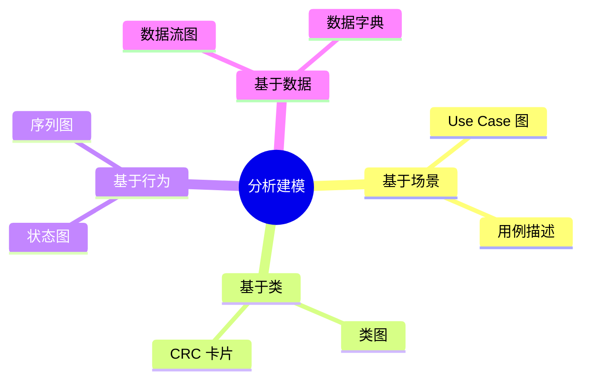
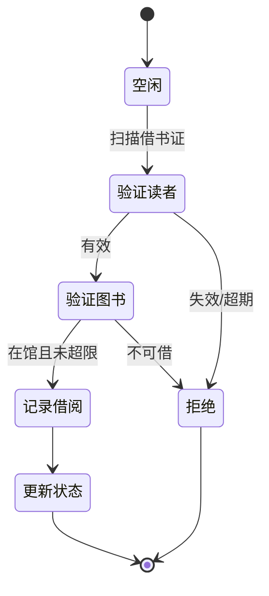

# 需求细化（Elaboration）与分析建模

## 什么是需求细化

拿到一个模糊的“用户想要什么”之后，你不能直接开始写代码。需求工程要经过 **起始（Inception）→ 获取（Elicitation）→ 细化（Elaboration）→ 协商（Negotiation）→ 规格说明（Specification）→ 验证（Validation）→ 需求管理（Requirements Management）** 这一串流程。其中 **细化（Elaboration）** 的任务是：把在获取阶段得到的粗略需求，加工成==足够精确、一致、可为设计提供可靠基础==的需求描述。

> [!IMPORTANT]
> 细化的目标不是“把需求写完”，而是让问题描述**牢靠到可以支撑后续设计**。一旦超过了这个边界，你做的就已经是设计了，而不是需求分析。

课件里那句原话值得反复体会：

> Elaboration is a good thing, but you have to know when to stop. The key is to describe the problem in a way that establishes a firm base for design. If you work beyond that point, you're doing design.

换句话说：细化是“把**问题**说清楚”，设计是“决定**怎么解决**”。细化阶段讨论的是“系统要做什么”，不是“系统内部用什么类、什么数据库表、什么框架”。

---

## 为什么需要细化

获取阶段的信息往往来自不同 **利益相关者（stakeholders）**，表达方式各异：

- 管理者说：“我们要提升用户体验。”
- 一线操作员说：“那个页面能不能别刷新，太烦了。”
- 客户代表说：“数据要能导出成 Excel。”

这些原始陈述里存在冲突、遗漏、歧义。如果不细化就直接设计，团队会各自脑补，最终交付物和用户期望南辕北辙。

**细化做的事：**

| 活动 | 回答的问题 |
|---|---|
| 精化需求 | 这个需求到底指什么？边界在哪？ |
| 建立分析模型 | 系统从外部看有哪些功能、数据、行为？ |
| 补充非功能约束 | 响应时间多少？并发多少？安全等级？ |
| 消除冲突与歧义 | 两个角色说法不一致，以谁为准？ |
| 为设计铺路 | 需求描述是否足够清晰，能作为设计输入？ |

---

## 怎么做：细化与分析建模

细化通常同时进行 **分析建模（Analysis Modeling）**，用多种视角把系统“画”出来，检验理解是否一致。

这几类模型里，南邮课程中最先落地的是 **用例（Use Cases）**。一个用例不是一段流程文字，而是**一组场景（scenarios）的集合**——主成功路径加上各种分支、异常路径。

> [!TIP]
> 判断一个需求是否“细化够了”：闭着眼问“如果拿这份描述直接交给设计师，他会不会不得不反过来替我做需求决定？”如果答案是“会”，说明还要继续细化。

---

## 和相近概念的区别

| 概念 | 阶段 | 核心问题 | 产出 |
|---|---|---|---|
| 获取 Elicitation | 前期 | 用户想要什么？ | 原始需求清单、访谈记录 |
| **细化 Elaboration** | 承上启下 | 这些需求**确切指什么**？ | 精化后的需求、分析模型 |
| 规格说明 Specification | 后期 | 怎么**正式记录**下来？ | SRS（软件需求规格说明） |
| 设计 Design | 下一阶段 | 系统**内部怎么实现**？ | 体系结构、类设计、数据库设计 |

最容易混的是 **Elaboration 和 Specification**：

- **细化**是把“模糊需求”打磨成“清楚认识”，是认知活动；
- **规格说明**是把“清楚认识”**写进正式文档**，是记录活动。

实际过程里两者经常交替进行，但职责不同。

---

## 常见的坑

> [!WARNING]
> **把细化做到设计层**：需求文档里出现“系统应采用观察者模式”“数据库用三张表 JOIN”——这就越界了。需求文档应写“当订单状态改变时，相关用户能在 1 秒内收到通知”，而不是指定实现机制。

> [!CAUTION]
> **用实现细节代替业务语义**：需求写成“点击保存按钮后调用 `POST /api/save` 接口”而不是“用户保存草稿后，系统应持久化该草稿并在下次登录时可恢复”。前者绑死了技术方案，后期换用离线存储或桌面端时需求文档就失效了。

> [!NOTE]
> 分析模式（Analysis Patterns）是复用已有领域分析经验的模板，能帮助加快细化，但别把“用了模式”误当“完成了需求分析”。

---

## 一个算对了的例子

**场景**：图书馆管理系统，获取阶段得到一句需求：“读者可以借书。”

细化前，这根本没法实施。借多久？一次几本？超期了怎么办？续借行不行？

**细化后的用例描述（主成功路径）：**

1. 读者在终端扫描借书证；
2. 系统验证读者证状态为“有效”；
3. 读者扫描图书条码；
4. 系统验证该书可借状态为“在馆”；
5. 系统记录借阅记录，借期定为 30 天；
6. 系统更新该书状态为“已借出”。

**同时列出必须覆盖的扩展场景：**

- **3a. 读者已借满上限 10 本**：系统提示“已达最大借阅数量”，用例结束；
- **3b. 存在超期未还图书记录**：系统提示“请先归还超期图书”，用例结束；
- **5a. 图书被预约**：系统提示读者“该书已被预约”，并询问是否加入预约队列。

再看设计阶段的问题——“借阅记录存哪张表、状态字段叫 `status` 还是 `state`”——这些在细化阶段出现就是越界。

这个例子说明：细化没有“算出”一个数字答案，但它的“算对”体现在——**当设计师拿到这份用例时，不需要再追问业务规则，就可以开始做架构与数据设计**。这就是 Elaboration 的完成标准。
