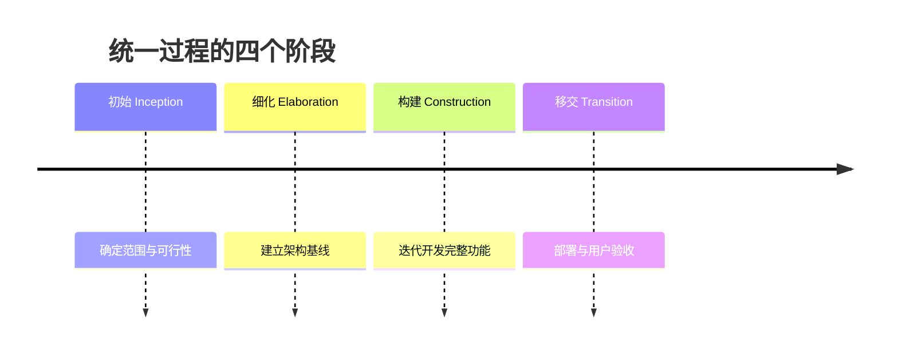
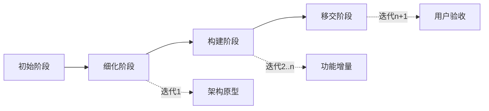

# 专用过程模型：统一过程（Unified Process, UP）

## 统一过程（Unified Process, UP）

先回忆一个场景：如果从第一天就把全部需求写成厚厚的文档，冻结后开始设计、编码、测试，直到最后才把软件交给用户——这就是瀑布模型的思路。可现实中，用户往往在见到可运行的软件之后才发现“这不是我想要的”。有没有一种过程，既允许逐步修正认识，又不至于像极端编程那样把文档压到几乎为零？

统一过程的回答是：==以用例为驱动、以架构为中心、采用迭代和增量方式开发==。它最早由 Rational 公司的 Jacobson、Booch、Rumbaugh 于 1998 年前后提出，与 UML 紧密绑定，所以常被称为 RUP（Rational Unified Process）。

### 四个阶段：时间维度上的节奏

UP 把一个项目划分为四个阶段，注意“阶段”不是“活动”——每个阶段内部都会发生需求、设计、实现、测试等活动，只是侧重点不同。

| 阶段 | 核心问题 | 主要产出 |
|---|---|---|
| 初始（Inception） | 这个系统值得做吗？范围多大？ | 愿景文档、粗略用例、风险评估 |
| 细化（Elaboration） | 架构能支撑关键需求吗？ | 架构基线、细化用例、可执行原型 |
| 构建（Construction） | 如何高效完成所有功能？ | 可交付的软件增量 |
| 移交（Transition） | 用户是否接受？ | 部署、文档、培训 |

> [!IMPORTANT]
> 考试中常把“Validation phase”混入选项。UP 的阶段名是 Inception、Elaboration、Construction、Transition，==没有独立的 Validation phase==。

### 迭代与增量：时间维与内容维的交叠

UP 推荐把每个阶段再切分为若干次迭代。每次迭代都走过一遍“需求—设计—实现—测试”的微型生命周期，产出一个可运行的增量。这样做的好处在于：风险高的用例（例如核心交易流程）在早期迭代中就被实现和验证，而不是等到项目末期才第一次集成。

### 用例驱动与架构中心

传统过程可能以“功能分解”或“数据流”为主线，UP 则把==用例==作为贯穿全过程的需求载体。每个用例描述用户与系统的一次有意义的交互（如“预订座位”），它既是分析的对象，也是测试用例的来源。

与此同时，UP 强调先稳定架构。细化阶段的里程碑就是“架构基线”——把全局性、高风险的技术决策（如分层方式、消息中间件选型、安全策略）在大量功能开发之前定下来，避免后期推倒重来。

### 与相近过程的区别

| 过程 | 驱动主线 | 迭代性 | 文档程度 |
|---|---|---|---|
| 瀑布模型 | 文档驱动 | 顺序执行 | 重 |
| 螺旋模型 | 风险驱动 | 迭代 | 较重 |
| 统一过程 | 用例驱动、架构中心 | 迭代+增量 | 中 |
| 敏捷（XP/Scrum） | 用户故事驱动 | 短迭代 | 轻 |

UP 常被批评“文档仍然偏重”，于是有了简化版：==敏捷统一过程（Agile Unified Process, AUP）==。AUP 保留 UP 的四个阶段活动（inception、elaboration、construction、transition），但大幅裁剪工件，使团队能看清整体流程又不被文档淹没。

> [!WARNING]
> 判断题中常见的说法“Agile Unified Process uses the classic UP phased activities”是正确的。它没有抛弃“阶段”这个词，只是让每个阶段内的实践更轻量。

### 一个具体的例子

某在线影院选座系统采用 UP。初始阶段团队只确定了 8 个核心用例，其中“预留座位”被评为最高风险——因为它涉及并发锁座、支付回调、座位图实时刷新。

细化阶段第一次迭代就围绕“预留座位”用例展开：搭建 Spring Boot 主体架构，设计座位状态机（可用 → 锁定 → 已售/超时释放），完成一个可运行原型并演示给业务方。第二次迭代细化“处理交易”用例，确定它与“生成支付”是 `<<include>>` 依赖关系——任何交易处理都必须生成支付单。

进入构建阶段后，每次迭代加入几个普通用例（如影评、收藏），直到全部功能完成。因为架构在早期已经验证，后期迭代很少出现结构性返工。

> [!TIP]
> 选择题若问“UP 阶段名不包括哪个”，直接回忆四个英文单词：==Inception、Elaboration、Construction、Transition==，见到 Validation、Deployment、Maintenance 这类词要警惕。

统一过程的本质不是某一套固定流程，而是一个可裁剪的框架：阶段和核心工作流相对稳定，具体工件数量和迭代长度按项目风险与规模调整。这正是它既能用于大型组织，也能演化为敏捷统一过程的原因。
