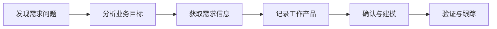
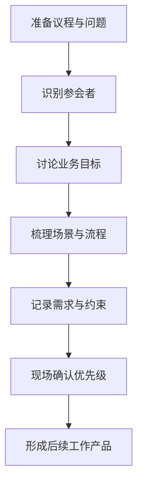
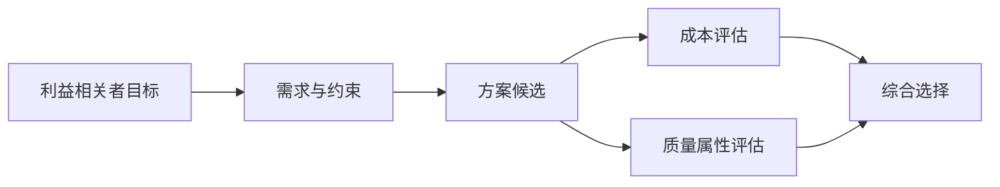

# 需求获取（Elicitation）与需求收集会议

## 需求获取与需求收集会议

### 什么是需求获取

需求获取（Elicitation）是需求工程中通过访谈、会议、问卷、观察、原型等方式，==从客户及其他利益相关者处发现、理解和记录需求==的过程。它不仅要让利益相关者“说出想要什么”，还要发现他们尚未明确表达的业务目标、约束和质量问题。

需求收集会议（Requirements Gathering Meeting）是常用的需求获取形式。团队与关键利益相关者共同讨论业务现状、目标、流程和期望结果，并将结论转化为可确认、可建模、可验证的需求。

> [!IMPORTANT]
> 需求获取是“从利益相关者到需求工作产品”的桥梁。设计不能替代需求获取，但必须以获得的需求为依据。

### 为什么需要需求获取

利益相关者往往关注不同侧面：客户强调业务收益，用户强调易用性，开发人员关注可实现性，管理者关注成本与期限，运维人员关注可靠性与安全。如果只依赖单一来源，容易得到片面甚至互相矛盾的需求。

需求获取还要回答三个关键问题：

1. **谁提出或受益于这项工作？**用于识别利益相关者及其代表是否合适。
2. **解决方案要解决什么问题？**用于从功能描述上升到业务目标。
3. **良好输出应具有什么特征？**用于形成验收标准和质量属性。

例如，“增加在线支付功能”是解决方案；“降低订单处理时间、减少人工差错”是业务问题；“支付结果准确、响应时间不超过两秒、失败可追溯”才是可验证的输出特征。

## 需求收集会议怎么做

会前应准备议程、问题清单、原型或场景说明，并邀请具有决策权、实际使用经验和领域知识的人参加。会上按“背景—目标—现状—期望—约束—确认”的顺序展开。

会议中应及时区分并记录：

| 信息 | 含义 | 后续作用 |
|---|---|---|
| 业务目标 | 为什么建设系统 | 决定方案取舍 |
| 功能需求 | 系统必须做什么 | 形成用例与功能规格 |
| 质量属性 | 输出做到多好 | 形成验收标准 |
| 约束 | 必须遵守的限制 | 限定技术选型 |
| 优先级与风险 | 哪些先做、哪里不确定 | 安排范围与迭代 |

会后应整理纪要和问题清单，明确已确认、待确认和存在冲突的事项，并获得关键利益相关者确认。

### 与相近概念的区别

| 概念 | 关注重点 | 与需求获取的关系 |
|---|---|---|
| 需求收集会议 | 获取需求的一种活动形式 | 属于 Elicitation |
| 需求分析 | 对需求进行分类、建模、优先级和冲突处理 | 获取后的深入加工 |
| 需求建模 | 用用例、模型等表达需求 | 分析结果的可视化表达 |
| 需求验证 | 检查需求是否正确、完整、一致、可验证 | 获取结束后的质量活动 |
| 需求谈判 | 对冲突、范围和优先级达成一致 | 常嵌入会议过程 |

> [!NOTE]
> 需求获取的产物可进一步形成 SRS、用例图、DFD、ERD、状态转换图、原型及需求跟踪矩阵（RTM）。这些不一定全部在同一次会议中直接完成，而是作为后续工作产品逐步建立。

## 对系统构建方案选择的影响

需求获取结果为架构设计、算法选择、技术栈和部署方式提供依据：

- **经济效益与预算约束**决定成本上限，可能偏向成熟、低成本技术。
- **实时性和吞吐量要求**影响并发模型、缓存、数据库及部署架构。
- **一致性和可靠性要求**影响事务机制、容灾与监控方案。
- **安全与合规要求**影响身份认证、权限、数据保护及审计设计。
- **利益相关者覆盖情况**决定方案是否真正适合业务，避免因错误信息造成返工。

### 常见坑

> [!WARNING]
> 不要把客户提出的“解决方案”直接当成需求；也不要把会议纪要直接等同于 SRS。

常见错误包括：只听业务负责人而忽略一线用户；把模糊形容词原样记录；追求技术细节而忽略业务目标；未确认优先级和验收标准；会后没有纪要、版本与确认记录。

### 完整例子

若项目希望实现“智能排课”，会议可得到：教务处希望降低人工排课时间；教师要求避免连续多节课；学生要求公平且及时收到通知；系统必须在十分钟内完成一万门课排布。上述信息分别转化为业务目标、约束和质量要求，再影响算法、算力、通知机制与验收标准。这样，需求获取才真正成为连接利益相关者与系统设计的桥梁。
