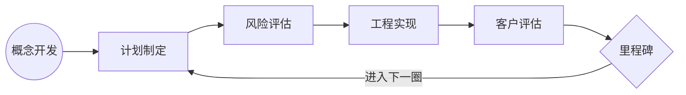

# 螺旋模型（The Spiral Model）

面对“需求一开始就说不全，或者中途总变，开发成本又高，风险还大”的软件项目，传统的瀑布模型（Waterfall Model）因其线性流程而难以适应。而**螺旋模型（The Spiral Model）**作为一种==演进式（Evolutionary）且风险驱动==的软件过程模型，正是为了解决这个问题而设计的。

## 它是什么

螺旋模型由 Barry Boehm 提出，它将快速原型模型（Prototyping）的迭代特征与瀑布模型（Waterfall Model）的系统性控制相结合。它的核心特征是在每一次迭代中引入==风险评估（Risk Assessment）==。

> [!NOTE]
> 沿着螺旋路径，每次演进都会到达一个**里程碑（Milestone）**，它是达到的工作产品和条件（如预算、进度）的结合体。

## 为什么需要它

螺旋模型不是为了应对需求简单的项目，而是大型系统和复杂软件的“理想方法”。

1. **应对需求变化**：像所有演进式模型一样，它本质上是迭代的，能够轻松适应产品需求的变化，且通常不会产出“一次性丢弃”的系统。
2. **控制巨大风险**：随着软件规模的扩大，技术失误、成本超支或市场变化的代价极大。螺旋模型通过在每一圈中显式地进行==风险分析和处理==，将风险消灭在摇篮里。
3. **全生命周期覆盖**：它能运用在应用开发的整个生命周期，从最初的概念开发（Concept Development）一直延伸到后期的维护（Maintenance）。

## 怎么做

螺旋模型沿着螺旋线的路径不断向外扩展，每旋转一圈，软件就演化出一个更完善的版本。

* **四个基本象限**：每一圈通常包含 计划制定（Planning）、风险分析（Risk Analysis）、工程实施（Engineering）、客户评估（Customer Evaluation）四个阶段。
* **动态调整**：螺旋模型的每一圈完成的时候，开发团队都将==重新计划并修改项目预算==，评估前一轮的成果以决定下一圈的范围。

> [!TIP]
> 考试答题时，看到选项中有“风险（Risk）”、“演化/迭代（Evolutionary/Iterative）”且描述了持续扩展的开发过程，几乎可以直接锁定螺旋模型。

## 相近模型的区别

为了帮助大家区分，以下是与几种常见规定性过程模型的对比：

| 维度 | 瀑布模型 (Waterfall) | 螺旋模型 (Spiral) | 增量模型 (Incremental) |
|---|---|---|---|
| **流程特征** | 线性，单向 | 演进式，风险驱动 | 演进式，功能叠加 |
| **风险处理** | 无显式风险评估 | ==每次迭代显式评估风险== | 风险分散在各增量中 |
| **需求变化** | 极难适应 | 极易适应 | 较易适应 |
| **客户可见性** | 直到项目晚期才可见工作版本 | 每一圈都有阶段性成果 | 每次交付一个可用的增量 |

## 常见的坑

> [!CAUTION]
> **不要把螺旋模型等同于原型开发（Prototyping）！** 原型开发往往是用来探索需求，做出“用完就扔”的废弃系统；而螺旋模型的每一圈演进都是在前一圈的基础上不断完善，最终产出的是正式的、可用的软件产品。

另一个常见的误区是认为螺旋模型适合所有项目。事实上，对于小型或内部软件项目，每一圈都进行风险分析和评审的开销过于高昂，往往得不偿失。

## 典型例题解析

> **题目：** Evolutionary software process models （）
> - A. Are iterative in nature.
> - B. Can easily accommodate product requirements changes.
> - C. Do not generally produce throwaway systems.
> - D. All of the above.

**解析：**
螺旋模型是典型的演进式过程模型（Evolutionary software process models）。
1. **选项A**：演进式模型（Evolutionary）的核心就是迭代（Iterative），软件在一圈圈螺旋中不断演化。**正确**。
2. **选项B**：正因为是迭代演进，中途如果客户需求发生变化，可以在下一圈螺旋的“计划制定”阶段轻易纳入。**正确**。
3. **选项C**：这与瀑布模型或抛弃式原型不同，螺旋模型每一轮产生的代码和工作产品都是渐进式积累的，**一般不会**产生一次性系统。**正确**。

因此，三个描述全部符合演进式模型的特征，**正确答案：D**。
