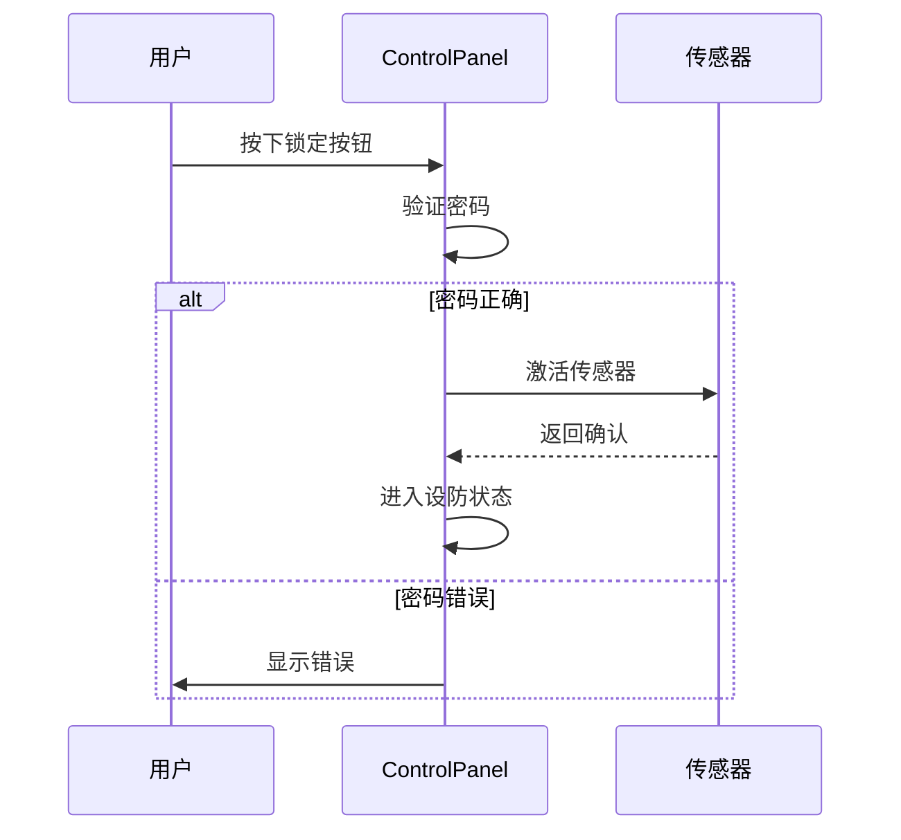
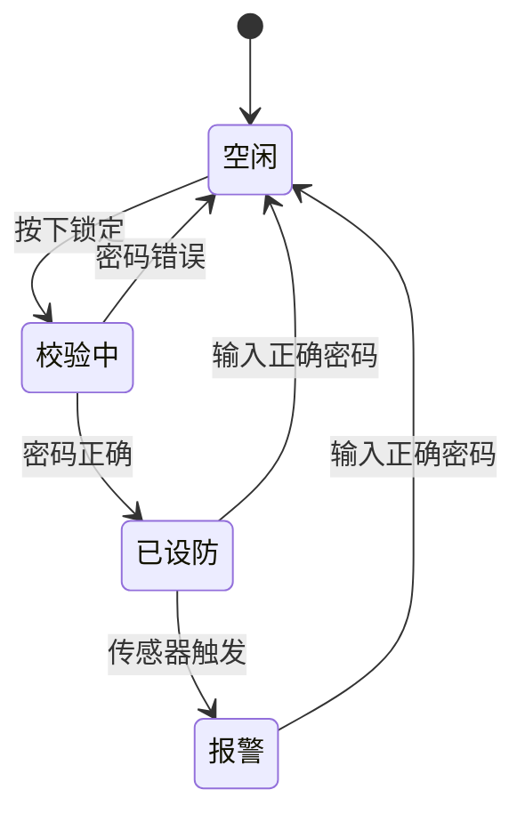

# 行为建模（Behavioral Modeling）：状态图与顺序图

## 行为建模：状态图与顺序图

需求分析不仅要回答“系统有哪些类、数据怎么流”，还要回答一个更实际的问题：==系统接收到外部事件后，到底会发生什么？== 这就是行为建模（Behavioral Modeling）的任务。UML 提供了两类核心行为图：**顺序图**（Sequence Diagram）和**状态图**（State Diagram），它们从不同角度刻画系统的动态行为。

---

### 从 SafeHome 场景出发

考虑家庭安保系统 SafeHome 的“安全功能”：用户按下“锁定”按钮后，控制面板（ControlPanel）验证密码、启动传感器、激活警报。这个过程涉及多个对象之间的消息传递，也涉及 ControlPanel 自身从“空闲”到“已设防”的状态转变。顺序图和状态图分别回答两个不同的问题：

> [!IMPORTANT]
> 顺序图关心：**一次交互中，哪些对象在什么时间点互相发了什么消息？**
> 状态图关心：**一个对象在自己的生命周期里，会在哪些状态之间因什么事件而迁移？**

---

### 顺序图：跨对象的交互视角

顺序图沿**时间轴纵向展开**，展示参与交互的对象（生命线）以及它们之间**消息的先后次序**。

**关键要素**：

- **生命线（Lifeline）**：纵向虚线，代表一个对象在交互时间内的存在。
- **激活条（Activation）**：虚线上的矩形，表示对象正在执行操作。
- **消息（Message）**：水平箭头，实心箭头表示同步调用，虚线箭头表示返回。

顺序图特别适合**补充用例描述**——一个用例本质上是“一系列交互步骤”，用顺序图能把文字化的场景转化为清晰的图形，便于开发者和客户确认理解是否一致。

---

### 状态图：单对象的生命周期视角

有些类的对象，其行为**高度依赖自身的当前状态**。例如 ControlPanel，同样一个“按下按钮”事件，在“空闲”状态下的响应和在“报警”状态下的响应完全不同。状态图刻画的就是这种“事件 → 状态迁移”的规律。

**关键要素**：

- **状态（State）**：对象在生命周期中满足某条件、执行某活动或等待某事件的情形。
- **转换（Transition）**：`事件[守卫条件]/动作` 形式的标注。例如 `已设防 -- 传感器触发 --> 报警` 表示“在已设防状态下，一旦发生传感器触发事件，就进入报警状态”。
- **初始/终止态**：实心圆点和带圈实心圆点。

==不是每个类都需要画状态图==。只有那些状态数量明确、状态转换规则复杂、行为随状态显著变化的类（如 ControlPanel、订单、连接）才值得建模。给简单的“数据类”硬画状态图，会徒增噪音。

---

### 两者的区别

| 维度 | 顺序图 | 状态图 |
|------|--------|--------|
| 观察视角 | ==横向跨对象==的交互流 | ==纵向单对象==的状态演变 |
| 核心要素 | 生命线、消息、时间顺序 | 状态、事件、转换 |
| 回答的问题 | “谁在什么时候做了什么” | “这个对象怎么就变了” |
| 时间表达 | 相对顺序（自上而下） | 不显式表达时间，只表达因果 |
| 典型用途 | 细化用例场景、验证协作 | 建模复杂有状态类 |

> [!NOTE]
> 顺序图与通信图（Communication Diagram）是**同构图**，包含相同信息，只是表达方式不同。顺序图强调时间先后，通信图强调对象间静态连接关系上消息的流动，二者可以相互转换。

---

### 常见误区

> [!WARNING]
> **把状态图当流程图用**：状态图描述“状态+事件→状态迁移”，不是“步骤1→步骤2”的过程流。如果图中节点全是动作而非状态，应该改用活动图。
>
> **给所有类画状态图**：只有行为显著依赖状态的类才值得。判断标准：如果你很难列举出这个对象有哪些“状态”，就别画。
>
> **顺序图和状态图混用**：一张顺序图里不该出现状态；一张状态图里不该出现多个对象的生命线。它们是互补的，不是互相替代的。
