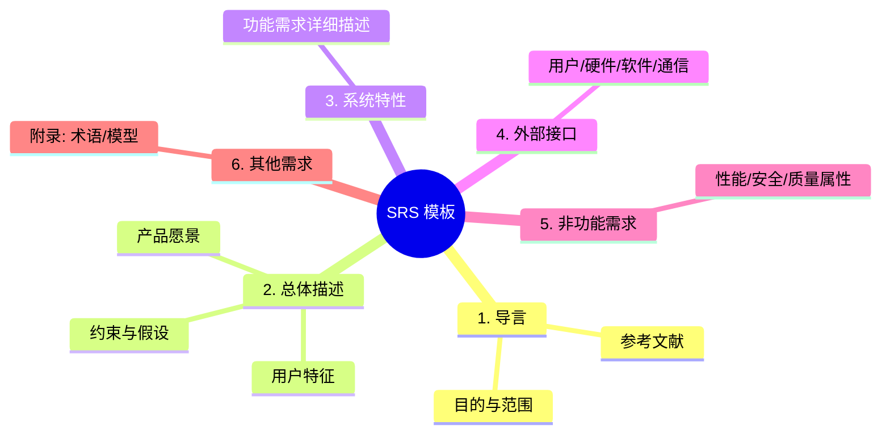

# 规格说明（Specification）与软件需求规格说明书（SRS）模板

## 规格说明与 SRS 模板

在软件工程中，**规格说明（Specification）**是将模糊的用户需求转化为精确、无歧义的技术文档的过程。其核心产出物是**软件需求规格说明书（SRS, Software Requirements Specification）**。它是开发团队与客户之间的“契约”，也是后续设计、编码和测试的基准。

> [!IMPORTANT]
> SRS 的核心价值在于它不仅是开发的输入，更是**质量评估的手段**。正如考题所述：分析模型和需求规格说明书为构建软件后的质量评估提供了一种手段（Answer: True）。

### 为什么需要 SRS？

如果没有清晰的规格说明，设计师往往只关注“如何解决问题”而忽略问题的全貌。记住 **FURPS** 属性（功能、易用性、可靠性、性能、可支持性）始终是问题的一部分。SRS 确保了：
1.  **一致性**：确认测试（Validation Testing）将直接对比软件行为与 SRS 描述是否一致。
2.  **可追溯性**：通过需求跟踪矩阵（RTM），确保每个需求都有来源且被实现。

### Karl Wiegers SRS 模板结构

南邮课程采用 Process Impact 公司 Karl Wiegers 提出的标准模板。该模板逻辑严密，分为以下关键部分：

*   **第 1-2 章（背景）**：明确“谁在看”、“看什么”以及系统的宏观边界（如操作环境、假设依赖）。
*   **第 3 章（核心功能）**：这是 SRS 的主体，需对每个系统特性进行详细的功能描述。
*   **第 4-5 章（接口与非功能）**：涵盖 UI、API 以及性能、安全性等 ==非功能需求==。

### 常见误区与辨析

| 概念 | 侧重点 | 常见错误 |
| :--- | :--- | :--- |
| **需求获取 (Elicitation)** | 从利益相关者处收集信息 | 混淆为直接编写代码逻辑 |
| **规格说明 (Specification)** | 形式化、结构化地记录需求 | 遗漏非功能需求（如性能） |
| **设计 (Design)** | 如何实现需求 | 在 SRS 阶段过早涉及具体算法 |

> [!WARNING]
> **易错点**：许多学生在编写 SRS 时，容易忽略**外部接口需求**（如硬件接口、通信协议）。切记，软件不是孤立存在的，必须定义清楚它与外界交互的边界。

### 实例分析：SafeHome 控制面板

以课件中的 SafeHome 项目为例，针对“控制面板”这一对象的小规格说明，不应只写“用户可以报警”，而应包含：
1.  **触发条件**：传感器检测到异常。
2.  **处理逻辑**：系统状态转换（从 `Monitor` 到 `Alarm`）。
3.  **输出结果**：声光报警并通知监控中心。

这种详细的描述使得后续的**确认测试**有据可依。如果最终软件无法在指定时间内发出警报，即可依据 SRS 判定为缺陷。

> [!TIP]
> **复习技巧**：记忆 SRS 目录结构时，想象一个软件从无到有的过程：先定范围（导言），再看整体（总体描述），接着细化功能（系统特性），最后考虑连接与环境（接口与非功能）。
