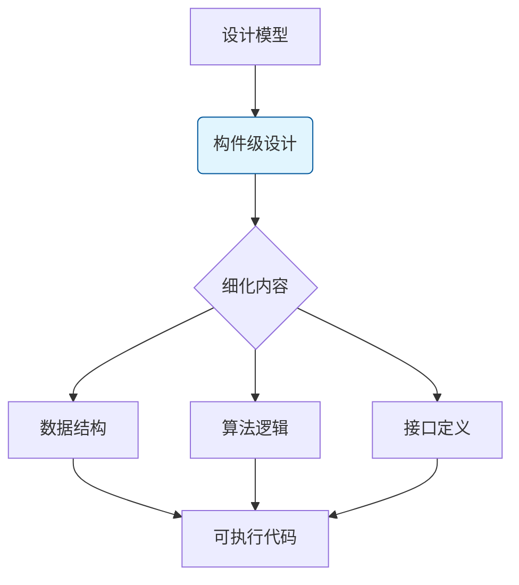

# 设计与质量（Design and Quality）的关系

## 设计与质量的关系

软件设计的重要性可以用一个词概括：==Quality==（质量）。良好的设计是高质量软件的基石，它直接决定了系统的可维护性、可扩展性和可靠性。在《软件工程》中，设计不仅是编码前的蓝图，更是连接需求分析与代码实现的桥梁。

> [!IMPORTANT]
> 核心结论：设计质量直接决定软件质量。好的设计应具备强内聚、低耦合，并完整实现分析模型中的需求。

## 构件级设计：从模型到代码

构件级设计（Component-Level Design）的目标是将设计模型转化为可工作的软件。它定义了每个构件的数据结构、算法、接口特征及通信机制。

- **OO 视角**：构件包含一组协作的类。
- **传统视角**：关注处理逻辑、内部数据结构及接口。

> [!TIP]
> 记忆技巧：构件设计是“落地”过程，关注点从“做什么”转向“怎么做”，特别是数据与接口的细节。

## 设计原则与质量属性

高质量的设计遵循以下核心原则，以降低耦合度并提高内聚性：

| 原则 | 含义 | 对质量的影响 |
| :--- | :--- | :--- |
| **单一职责 (SRP)** | 一个类只负责一项任务 | 降低修改风险，提高内聚 |
| **开闭原则 (OCP)** | 对扩展开放，对修改关闭 | 增强系统可扩展性 |
| **迪米特法则** | 只与直接朋友通信 | 降低耦合，减少依赖 |

> [!WARNING]
> 常见误区：违反开闭原则会导致每次新增功能（如加密算法）都需修改原有代码，引发回归错误。应通过抽象接口来隔离变化。

## 用户体验设计 (UX) 与质量

质量不仅指代码内部结构，还包括外部可用性（Usability）和可访问性（Accessibility）。UX 设计强调：
1. **易用性**：易学、易用、易记。
2. **迭代原型**：通过用户测试不断优化。

## 典型例题解析

**题目**：The importance of software design can be summarized in a single word （）
A. Accuracy  B. Complexity  C. Efficiency  D. Quality

**解析**：
选 **D**。
- **Accuracy** 是测试目标之一，非设计核心概括。
- **Complexity** 是设计试图降低的属性。
- **Efficiency** 是质量的一个子属性。
- **Quality** 涵盖了可维护性、可靠性、效率等所有非功能性需求，是设计的终极目标。

> [!NOTE]
> 延伸辨析：好设计的特征包括“实现所有分析模型需求”和“提供软件完整视图”，而非强耦合或包含测试用例。
