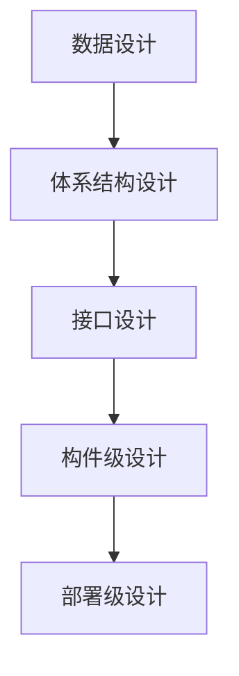

# 设计模型（The Design Model）：数据、体系结构、接口、构件级、部署级设计元素

## 什么是设计模型

设计模型（The Design Model）是软件从“需求与领域知识”走向“可编码系统”的桥梁。它不仅描述系统由哪些部分组成，还说明这些部分如何协作、数据如何流动以及软件最终运行在哪里。

需求模型主要回答“系统要做什么”，设计模型则要进一步回答：

- 数据如何组织？
- 系统采用什么体系结构？
- 构件之间如何通过接口交互？
- 每个构件内部如何实现？
- 软件如何部署到实际计算环境？

> [!IMPORTANT]
> 设计模型是多个设计表示的集合，不是一张单独的类图或流程图。

## 五类设计元素

| 设计元素 | 主要回答的问题 | 典型内容 |
|---|---|---|
| 数据设计 | 数据是什么，如何组织？ | 数据类型、类、数据库表、关系模型、数据约束 |
| 体系结构设计 | 系统由哪些主要部分构成？ | 子系统、构件、依赖关系、体系结构风格与模式 |
| 接口设计 | 外部如何访问系统服务？ | 类接口、操作、参数、返回值、异常、UI |
| 构件级设计 | 每个构件内部如何工作？ | 类的职责、方法、算法、协作类、局部数据结构 |
| 部署级设计 | 软件运行在哪里？ | 服务器、客户端、硬件、操作系统、构件实例位置 |

它们具有由抽象到具体的层次关系：

## 如何形成设计模型

设计不是一次性从需求“翻译”为代码，而是一个反复分析、选择和精化的过程。设计者首先根据需求和架构约束确定数据与整体结构，再为关键构件定义接口，随后完成构件内部设计，最后把构件实例映射到部署环境。

重构（refactoring）是在不改变外部可观察行为的前提下改善内部结构。例如，把过大的“Blob”类中的行为拆分到职责明确的数据对象中，从而提高可测试性和可复用性。

## 接口设计与构件级设计

接口是构件或类对外提供的服务契约，描述外部可见操作。接口应遵循**接口分离原则（ISP）**：客户端不应依赖它不需要的接口。

例如，原来的 `initiateJob` 同时承担创建、提交和启动任务等职责，可以拆分为：

- `buildJob`：组装任务或工作单；
- `submitJob`：提交任务；
- `initiateJob`：启动任务。

同时可引入 `WorkOrder`、`JobQueue`、`ProductionJob` 等专职类，使接口和类的职责更加专一。这能降低耦合，避免修改某一功能时影响无关客户端。

> [!TIP]
> 记忆口诀：==数据定内容，体系结构定骨架，接口定契约，构件定实现，部署定位置。==

## 部署设计与 UI 设计

部署级设计把体系结构中的构件进一步细化为运行实例，说明软件功能、子系统、硬件和操作系统之间的关系。例如，将 Web 应用分为浏览器端、服务器端和数据库端，并标明各构件包所在节点。

UI（用户界面）是接口设计的重要部分。UI 是人机交互发生的空间，其设计需要考虑可用性、可访问性和用户任务能否被正确完成。用户界面设计通常经过“建立用户模型—设计交互与视觉模型—制作原型—用户评价—迭代修改”的循环。

## 与相邻概念的区别

| 概念 | 关注重点 |
|---|---|
| 分析模型 | 用户视角的问题域、需求和系统职责 |
| 设计模型 | 软件实现层面的结构、契约、数据与运行方式 |
| 体系结构设计 | 主要构件及其关系的总体决策 |
| 构件级设计 | 某个构件内部的类、操作和协作细节 |
| 部署设计 | 构件实例在物理环境中的安装与分配 |

## 常见易错点

> [!WARNING]
> 不要把设计模型等同于“类图”。类图可以表达设计，但不能单独覆盖数据、体系结构、接口、构件内部设计和部署信息。

> [!CAUTION]
> 部署图属于体系结构设计的组成部分，但在构件级设计期间需要将其细化，例如补充具体构件实例、硬件节点、操作系统及构件包所在位置。

## 示例

某制造系统需要接收生产任务、检查优先级并启动生产。设计时不能只定义一个巨大的 `initiateJob` 方法，而应：

1. 用 `WorkOrder` 负责组装工作单；
2. 用 `JobQueue` 负责检查任务优先级；
3. 用 `ProductionJob` 负责把任务传递给生产设施；
4. 将对应能力分别定义为 `buildJob`、`checkPriority` 和 `initiateJob` 等窄接口。

这样既符合接口分离原则，也使职责边界清晰、耦合降低，单独测试和替换某一功能更加容易。
