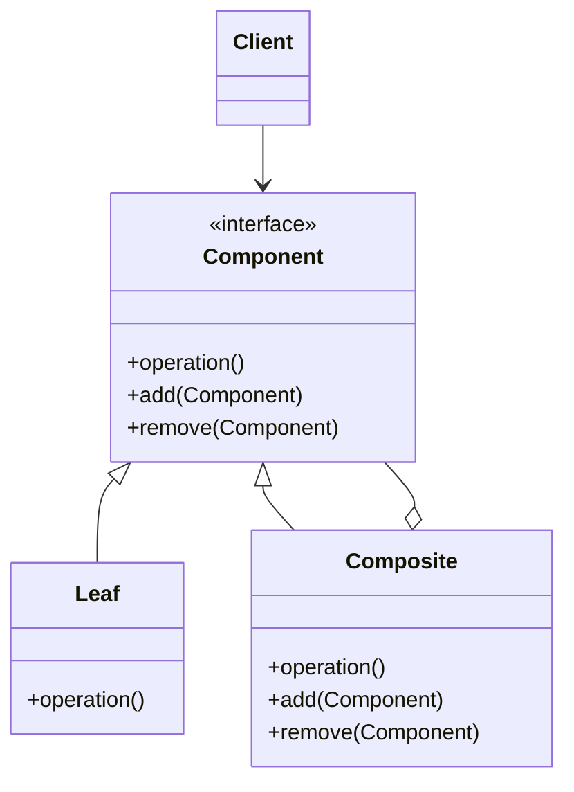

# 设计模式（Patterns）的名称与要素

## 设计模式的名称与要素

设计模式（Design Pattern）是对==特定、有界问题==的通用解决方案的抽象描述。它不是可直接粘贴的代码，而是一种**模板化思想**，用于在特定上下文中解决重复出现的设计问题。

> [!IMPORTANT]
> 描述一个完整的设计模式，通常包含四个核心要素：
> 1.  **模式名称（Pattern Name）**：简洁词汇，用于沟通（如“Composite”）。
> 2.  **问题（Problem）**：描述何时应用该模式（Context + Forces）。
> 3.  **解决方案（Solution）**：描述设计的组成成分、结构及协作（如类图结构）。
> 4.  **效果（Consequences）**：应用模式后的权衡（对耦合度、扩展性的影响）。

## 以 Top-level Navigation 为例

在 UI 设计中，`Top-level Navigation` 模式展示了如何通过固定结构描述方案：

| 要素 | 内容描述 | 对应模式要素 |
| :--- | :--- | :--- |
| **模式名称** | Top-level navigation | 名称（Name） |
| **概述** | 用于网站/APP 主要功能，提供高级菜单直达核心 | 问题与意图 |
| **详细资料** | 4~7个功能名横列于顶部，每个功能名提供链接 | 解决方案（结构） |
| **导航元素** | 功能名称代表链接，通常配合 Bread Crumbs 使用 | 协作与效果 |

> [!NOTE]
> **反面模式（Anti-patterns）**
> 描述对软件质量有**负面影响**的设计方案，即在错误环境中使用模式导致的后果。识别反面模式是避免过度设计的关键。

## 典型应用：组合模式（Composite）

考题常要求设计“资源管理器”或“水果盘组合”。以**水果盘系统**为例，分析为何选用组合模式：

**问题**：如何统一处理单个水果（Leaf）与水果盘（Composite，可包含水果或其他盘子）？
**方案**：构建树形结构，使客户端对单个对象和组合对象的使用具有一致性。

*   **Component**：抽象构件（如 `Fruit` 接口），声明公共操作。
*   **Leaf**：叶子构件（如 `Apple`），无子节点。
*   **Composite**：容器构件（如 `FruitPlate`），存储子节点并实现管理操作。

> [!TIP]
> **方案选择理由**
> 1. **统一性**：客户端无需区分处理的是“苹果”还是“水果盘”，均通过 `Component` 接口调用。
> 2. **递归组合**：目录套目录、盘内套盘的分层结构天然契合树形递归。
> 3. **扩展性**：新增水果类型（如 `Orange`）只需继承 `Component`，无需修改现有容器，符合 **OCP（开闭原则）**。

## 常见误区

> [!WARNING]
> **避免生搬硬套**
> 设计模式并非万能钥匙。在错误上下文中强行使用（如对简单线性结构使用组合模式），会导致 **过度设计**，增加系统复杂度和耦合度。务必先识别问题域是否具备模式所需的“特定、有界”特征（如树形层级、状态切换等），再匹配对应模式。
