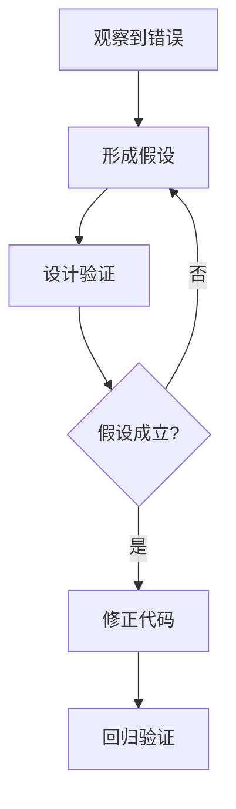

# 调试（Debugging）作为诊断过程：调试技术、错误类型与纠正错误

## 调试作为诊断过程

你已经写好了测试用例，运行后红灯亮起：期望值是 `27`，实际输出却是 `31`。现在该做什么？测试只能告诉你**出现了错误**，但无法告诉你**错误在哪里**。

==调试（Debugging）不是测试，但总是作为测试的结果而发生==。测试暴露缺陷，调试定位并消除缺陷。这一区别常被考察：

> [!IMPORTANT]
> Debugging is not testing, but always occurs as a consequence of testing.（✅ True）
> 测试是发现错误的活动；调试是诊断并修正错误的活动，二者目的不同、时机不同。

## 为什么调试如此困难

调试本质上是一个**推理过程**：从错误的外部表现反推内部原因。它困难的原因不在于写代码，而在于：

| 难度来源 | 解释 |
|---|---|
| 症状与原因相距甚远 | 崩溃点可能离真正的缺陷位置隔了十几个调用层 |
| 症状可能消失 | 加入打印语句后时序改变，bug 反而"消失"了 |
| 错误可能由多个缺陷叠加 | 修好一个，另一个才暴露 |
| 人为因素 | 程序员容易"看到"自己以为的代码，而不是真实的代码 |

正确调试的出发点很朴素：先**假设自己的代码是有错的**，而不是先怀疑编译器或操作系统。

## 错误类型：从症状到原因的分类

调试需要识别错误属于哪一类，不同类别对应不同定位策略：

| 错误类型 | 典型表现 | 定位策略 |
|---|---|---|
| 逻辑错误 | 输出值偏离预期，程序不崩溃 | 追踪关键变量取值 |
| 边界错误 | 数组下标越界、循环多/少一次 | 检查 `n` 与 `n-1`、`<` 与 `<=` |
| 状态错误 | 并发或交互后状态错乱 | 画出状态转移图 |
| 接口错误 | 传参顺序、类型、单位不符 | 检查函数签名与实际调用 |
| 资源错误 | 内存泄漏、文件未关闭 | 检查分配/释放配对 |

## 调试技术

**蛮力法（Brute Force）**：靠大量打印语句或单步执行硬找。优点是零门槛，缺点是效率低、易被信息淹没。适合小规模代码。

**回溯法（Backtracking）**：从错误发生处向上回溯源代码，沿控制流逐层检查。适合小型程序。

**原因排除法（Cause Elimination）**：列出一张"可能原因"清单，用实验逐个排除。这是最系统的策略——形成假设，设计验证。

调试的核心循环可以这样表达：

## 常见的坑

> [!WARNING]
> 边改边猜却不运行回归测试——修好了一个 bug，引入了两个新的。

> [!CAUTION]
> 在发现错误后，第一反应是"改一行试试"，而不是先理解错误产生的机制。调试的关键动作是**先诊断，后修改**。没诊断就修改，只是在代码里制造噪音。

## 一个校准过的例子

以那道常考判断题为例：

> Debugging is not testing, but always occurs as a consequence of testing.

**推理过程**：

1. 测试的执行产出结果是"通过"或"失败"；
2. 失败时，测试用例提供了**复现错误的环境**；
3. 调试从这个失败点开始，追查原因；
4. 没有测试暴露错误，就不会触发调试。

因此该陈述为 **True**。它强调了调试与测试之间的时序依赖与角色差异：==测试发现错误，调试消除错误==。

> [!TIP]
> 判断题关键词：题目说 "not testing but consequence of testing"——"不是测试，而是测试的结果"，两个判断必须同时成立才选 True。若反过来问 "Debugging is a kind of testing" 则为 False。
