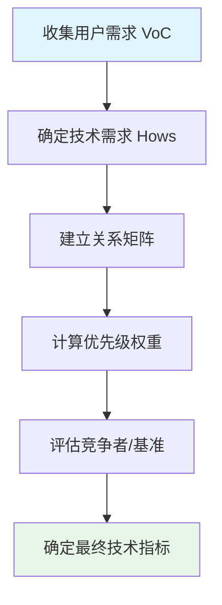

# 质量功能部署（Quality Function Deployment, QFD）

# 质量功能部署（Quality Function Deployment, QFD）

## 它是什么：从“用户想要”到“工程要做”

在需求工程（Requirements Engineering, RE）中，我们常面临一个核心挑战：**如何将模糊的用户需求（Voice of Customer, VoC）转化为具体的、可度量的软件技术规格？**

==QFD（质量功能部署）== 正是解决这一问题的结构化方法。它不仅仅是一个工具，更是一种**质量保证机制**，用于评估 RE 工作产品（Work Products）的质量。其核心载体是 **“质量屋”（House of Quality, HoQ）**矩阵。

> [!IMPORTANT]
> QFD 的本质是建立 **用户需求** 与 **技术需求** 之间的映射关系，确保开发出的软件真正满足用户期望，而非仅仅实现功能列表。

## 为什么需要：避免“做对了产品，但没做对产品”

试想：如果用户说“系统要快”，开发人员将其理解为“代码执行效率高”，而用户实际指的是“页面加载响应时间短”。这种偏差会导致后期巨大的返工成本。

QFD 的价值在于：
1.  **消除歧义**：将定性描述转化为定量指标。
2.  **优先级排序**：识别哪些技术特性对满足用户需求最关键。
3.  **跨部门沟通**：为市场、开发、测试提供统一的语言。

## 怎么做：构建“质量屋”四步法

构建 QFD 矩阵通常包含以下关键步骤，可通过 Mermaid 流程直观理解：

1.  **识别用户需求（Whats）**：通过 elicitation（诱导/获取）收集 Stakeholders 的需求。
2.  **定义技术需求（Hows）**：将 Whats 转化为工程语言（如：响应时间 < 2s）。
3.  **构建关系矩阵**：评估每个 How 对每个 What 的贡献度（通常用 1, 3, 9 表示弱、中、强相关）。
4.  **计算权重**：结合用户重要性评分，计算出技术需求的绝对权重。

## 常见误区与辨析

很多同学容易混淆 QFD 与其他 RE 活动。请注意以下区别：

| 概念 | 核心焦点 | 与 QFD 的区别 |
| :--- | :--- | :--- |
| **Validation** | 检查“是否做了正确的产品” | QFD 是 Validation 的一种**前置手段**，用于确保需求定义正确。 |
| **Deployment** | 软件交付、安装、培训 | 课件中的 Deployment 指**物理部署**阶段；QFD 中的 "Deployment" 指**质量的展开/映射**。 |
| **Specification** | 编写详细需求文档 | QFD 是生成 Specification 的**分析过程**，而非文档本身。 |

> [!WARNING]
> **高危误区**：不要将 QFD 中的 "Deployment" 误解为软件发布（Delivery）。在 QFD 语境下，它指的是**将质量要求层层分解部署**到设计、制造等环节。

## 算对了的例子：在线选课系统

假设用户对“选课系统”的核心需求是 **“操作简便”**（重要性权重 5/5）。

1.  **技术需求（Hows）**：
    *   $H_1$: 点击次数 $\le$ 3次
    *   $H_2$: 界面层级 $\le$ 2层
2.  **关系矩阵**：
    *   $H_1$ 对 “操作简便” 贡献度：9 (强)
    *   $H_2$ 对 “操作简便” 贡献度：3 (中)
3.  **计算绝对权重**：
    *   $W(H_1) = 5 \times 9 = 45$
    *   $W(H_2) = 5 \times 3 = 15$

==结论==：在资源有限时，应优先优化 $H_1$（减少点击次数），因为它对满足用户“操作简便”的需求贡献最大（45 > 15）。这就是 QFD 指导决策的力量。

> [!TIP]
> **记忆口诀**：QFD 就是“翻译官”，把用户的话（What）翻译成工程师的图（How），中间搭个“质量屋”，权重算清不迷路。
