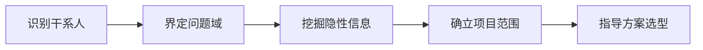

# 起始（Inception）与建立基础工作

## 起始与建立基础工作

在项目正式开发前，你是否想过：如果连“谁需要这个系统”和“解决什么问题”都没搞清楚，后续的设计与编码有何意义？==起始（Inception）与建立基础工作==正是需求工程的第一步，旨在通过初步沟通明确项目边界，为后续详细需求采集奠定根基。

### 它是什么与为什么需要

起始阶段是需求工程六步法（Inception, Elicitation, Elaboration, Negotiation, Specification, Validation）的起点。其核心目标不是获取完整需求，而是==建立对问题的初步理解==并识别关键利益相关者（Stakeholder）。

> [!IMPORTANT]
> 起始阶段的核心产出是“问题定义”而非“解决方案”。它充当了模糊的业务诉求与严谨的软件设计之间的==桥梁（Bridge to Design）==。

若跳过此阶段，极易陷入螺旋模型（Spiral Model）的典型陷阱：虽然该模型强调风险驱动和原型演化，但若起始时无法确定项目范围，后续迭代将失去锚点，导致成本失控。

### 怎么做：三个黄金问题

建立基础工作的实操抓手是向客户及利益相关者提出三类关键问题。以下结合真题解析其目标与对方案选择的影响：

| 提问内容 | 核心目标 (Goal) | 对系统构建方案的影响 (Effect) |
| :--- | :--- | :--- |
| Who is behind the request? | 识别真正的==利益相关者==与决策链 | 决定沟通对象与权限模型设计 |
| What problem(s) will this solution address? | 界定==问题域==与业务痛点 | 决定系统核心功能优先级与技术选型 |
| Can anyone else provide additional info? | 发现==隐性需求==与遗漏视角 | 完善非功能性需求与集成方案 |

> [!TIP]
> 答题时注意区分“目标”与“影响”：目标指向“弄清楚什么”，影响指向“如何改变技术或管理决策”。例如，“谁发起请求”的目标是找人，影响则是决定了系统是面向内部员工（B/S架构）还是外部公众（高并发CDN）。

### 与相近概念的区别

- **vs. 需求采集（Elicitation）**：起始是“定方向、圈范围”，输出粗粒度问题描述；采集是“挖细节、获数据”，输出用例与规格说明。
- **vs. 可行性分析**：可行性关注“能不能做”（技术/经济/社会等5方面）；起始关注“做什么”和“为谁做”。两者常并行，但逻辑上起始为可行性提供输入。

### 常见的坑与注意事项

> [!WARNING]
> 不要混淆沟通活动的适用范围。真题明确指出：==六个沟通动作并非仅适用于小项目==。无论项目规模大小，起始阶段的利益相关者识别与问题定义都是必须的，只是执行深度不同。

> [!CAUTION]
> 避免在起始阶段过早承诺技术方案。此阶段重点是理解问题，若客户问“能不能用AI”，应反问“您希望AI解决什么具体业务痛点”，防止被伪需求带偏。

### 算对了的例子：真题复盘

针对前述三个问题，满分回答逻辑如下：

1.  **Who**：目标是锁定Stakeholder；影响是若发现多方利益冲突，需采用协商式需求获取，并在架构中设计多角色权限隔离。
2.  **What**：目标是明确Problem Domain；影响是若问题涉及海量实时数据，方案需从传统CRUD转向流处理架构。
3.  **Anyone else**：目标是补全信息盲区；影响是若发现运维人员也是干系人，方案必须增加可观测性与自动化部署模块。

> [!NOTE]
> 建立基础工作是动态过程。随着对问题理解的加深，可能需要重新审视利益相关者列表，这与螺旋模型的“演化”思想一致，但必须在每次迭代前确保范围基线相对清晰。
