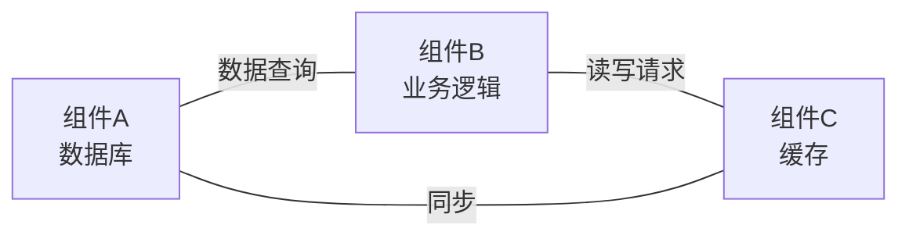

# 什么是体系结构（What is Architecture）及其重要性

## 什么是体系结构

在进入编码之前，你需要先回答一个问题：**如果要盖一栋房子，你是先画户型图，还是先搬砖？** 答案显然是先画图。软件工程中的“户型图”，就是**体系结构（Architecture）**。

> [!IMPORTANT]
> 软件体系结构的定义：系统的结构或结构集合，包含**软件组件**、这些组件**对外可见的属性**，以及组件之间的**相互关系**。

注意三个限定词的分量：

- **组件（components）**：执行系统所需功能的单元，如数据库、计算模块、消息队列。
- **对外可见的属性（externally visible properties）**：组件向外界暴露的行为、接口、性能特征，而不是内部实现细节。
- **关系（relationships）**：组件之间如何通信、协调与协作。

> [!NOTE]
> 体系结构**不是**可运行的软件本身。它是一种**表示（representation）**，让你在设计变更代价还很小的阶段，去分析方案、权衡备选、降低构建风险。

---

## 为什么体系结构重要

如果你跳过架构设计直接写代码，相当于**不画图纸直接砌墙**——墙砌歪了才发现承重有问题，拆墙返工的成本远高于画图时改一笔。

架构的重要性体现在三个层面：

| 层面 | 含义 |
| :--- | :--- |
| **沟通工具** | 架构提供了一种表示方式，**促进所有利益相关者之间的沟通**。用户、开发者、测试者、项目经理都在看同一张“图纸”。 |
| **早期决策** | 架构**凸显早期设计决策**，这些决策对后续所有软件工程工作产生深远影响，并决定系统作为可运行实体的成败。 |
| **可把握的模型** | 架构构成了一个**相对较小的、智力上可把握的模型**，描述系统如何组织、组件如何协同工作。 |

> [!TIP]
> 记住一句话：**架构最重要的作用是利益相关者之间的沟通**。考试选择题若问“架构最重要的价值是什么”，首选“促进沟通”。

---

## 与相近概念的区别

很多同学把“架构设计”和“详细设计”混为一谈。用建房类比：

| 概念 | 建筑类比 | 软件含义 |
| :--- | :--- | :--- |
| **架构设计** | 户型图：几室几厅、承重墙在哪、管线如何入户 | 组件的划分、组件间的关系、系统的整体结构 |
| **组件级设计（详细设计）** | 某个房间内的水电布线、插座位置 | 单个组件内部的类、方法、数据结构细节 |
| **数据设计** | 储物间怎么布局 | 数据结构的定义与存储组织 |

> [!WARNING]
> 考试选择题中“Which design is equivalent to the floor plan of a house?”的答案是 **Architectural design**，不是 Interface design 或 Data design。户型图对应的是整体结构设计。

---

## 一个算对了的例子

**题目**：需求工程阶段，为了确定最适合目标系统的架构风格或风格组合，应该去发现什么？

**分析**：架构风格描述的是系统类别，由四要素构成——一组组件、一组连接件、约束、语义模型。要选择哪种风格，必须先了解系统需要满足的**特征与约束（characteristics and constraints）**。

**答案**：选 **B. characteristics and constraints**。

> [!NOTE]
> 你可能会想选“algorithmic complexity”或“design patterns”——但算法复杂度是详细设计阶段的关注点，设计模式是局部解决方案，只有**特征和约束**是架构选型的依据。

---

## 常见的坑

> [!CAUTION]
> 一个常见误区：把架构当作**一次性交付物**。实际上架构是**逐步细化**的——应用领域和基础设施领域是组件推导的来源，而所有设计本质上都是迭代的。架构会在应用到具体问题时被实际实例化，没有一蹴而就的“完美架构”。

另一个坑：认为架构**只是技术问题**。其实架构决策必须回到利益相关者关注点（stakeholder concerns），需要多视图（multiple views）来描述，每个视图都是“从一组相关利益方关注点的视角对系统的整体表示”。设计架构时若只画一张图就想覆盖全部关注点，注定顾此失彼。
