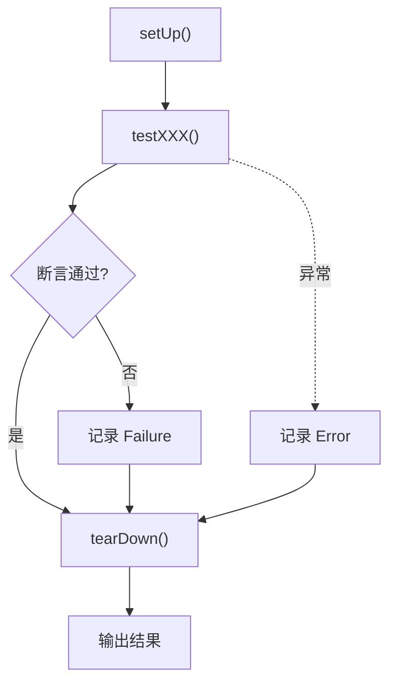

# 软件单元测试报告的撰写规范与环境配置（JDK、Eclipse、JUnit）

## 环境配置与项目结构

在动手写测试代码前，你是否确认过测试代码该放在哪里？很多初学者直接将测试类与业务类混在同一目录，导致交付时难以剥离。在南邮《软件工程（双语）》实验规范中，==测试源码必须与生产源码物理隔离==。

在 Eclipse 中，应在项目根目录下新建 `testsrc` 文件夹，并通过 Build Path 将其添加为 Source Folder。运行测试前，需确保 JUnit 库已正确引入：右键项目 → Build Path → Add Libraries → JUnit。若使用 Subclipse 进行版本管理，`testsrc` 同样需要纳入 SVN 管控，保证团队测试环境一致。

> [!IMPORTANT]
> 环境配置的核心原则是“隔离与可复现”。
> 测试代码不应打包进最终产品，但必须在版本库中可追溯。

## JUnit 核心机制与执行流

JUnit 由 Erich Gamma 和 Kent Beck 开发，其设计精髓在于区分 **Failure（失败）** 与 **Error（错误）**。Failure 指断言不通过（预期不符），Error 指代码抛出异常（逻辑崩溃）。理解这一区别是撰写合格报告的前提。



编写测试类需继承 `TestCase`（JUnit 3）或使用 `@Test` 注解（JUnit 4+）。每个测试方法应遵循“准备-执行-断言”三步走。Eclipse 提供了快捷入口：右键待测类 → New → JUnit Test Case，IDE 会自动生成骨架并关联 `junit.jar`。

> [!TIP]
> 记忆口诀：一设二测三清理，失败错误要分清。
> `setUp/tearDown` 保证测试间无状态污染，这是单元测试“独立性”的基石。

## 报告撰写规范与常见误区

实验报告不是代码截图的堆砌，而是对测试质量的论证。一份规范的单元测试报告应包含：测试目标、环境描述（JDK/Eclipse/JUnit 版本）、测试用例设计依据、执行结果分析及覆盖率数据。

| 维度 | 合格报告 | 不合格报告 |
| :--- | :--- | :--- |
| 结果描述 | 区分 Failure/Error，附堆栈摘要 | 仅写“测试通过/失败” |
| 用例设计 | 说明边界值、等价类选择理由 | 只贴代码无解释 |
| 环境信息 | JDK 1.8 + Eclipse 2020 + JUnit 4.13 | 未提及或模糊不清 |
| 改进分析 | 针对失败用例提出修复方案 | 无后续反思 |

> [!WARNING]
> 最常见的扣分点：将“编译错误”当作“测试失败”写入报告。
> 编译错误属于 Error 范畴，意味着测试本身无法运行，必须先修复代码再谈测试结果。

## 正确示例：HelloJUnit 测试分析

以课件中的 `HelloJUnit` 为例，假设 `Hello.say()` 应返回 "Hello World"。

```java
@Test
public void testSay() {
    Hello h = new Hello();
    String result = h.say();
    assertEquals("Hello World", result); // 期望值在前
}
```

若实际返回 "Hello world"（小写 w），JUnit 报 Failure 而非 Error。报告中应记录：“`testSay` 触发 Failure，期望 'Hello World'，实际 'Hello world'。原因：`say()` 方法未对首字母大写做处理。修复后重测通过。” 这种==基于证据的归因分析==才是实验文档规范考察的重点。

> [!CAUTION]
> 切勿在测试方法中使用 `System.out.println` 代替断言。
> 控制台输出无法被 JUnit 框架捕获，也无法自动生成结构化报告，违背自动化测试初衷。
