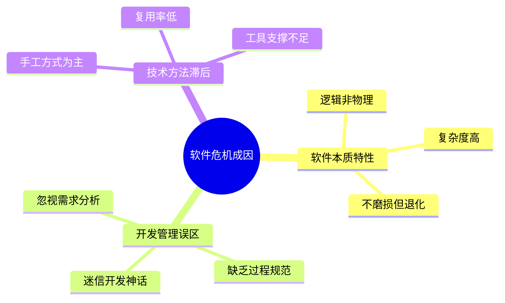

# 软件危机（Software Crisis）及其原因

## 软件危机及其成因

如果软件不会像硬件那样“磨损”（wear out），为什么我们还会频繁遭遇项目延期、预算超支甚至系统崩溃？这背后的根源并非物理损耗，而是软件开发与维护过程中一系列严重问题的集中爆发，即==软件危机（Software Crisis）==。

### 什么是软件危机

> [!IMPORTANT]
> 软件危机泛指在计算机软件的==研发、运行、维护和管理==全生命周期中遇到的一系列严重问题。它不仅是技术问题，更是管理与工程化缺失的综合症候群。

其典型表现包括：成本与进度估算严重失准、用户对交付产品不满意、质量不可靠、文档缺失导致无法维护、以及软件生产率跟不上硬件发展速度。理解这一概念时，需紧扣课件中“The Nature of Software”的核心观点：软件是逻辑实体而非物理实体，它是被“工程化”（engineered）出来的，而非传统意义上的“制造”（manufactured）。

### 为什么会产生软件危机

危机的产生源于软件本身的特殊性与早期开发模式的错位。我们可以通过以下三个维度剖析原因：

首先是==软件自身的特性==。软件具有高度的抽象性和复杂性，且随着环境变化会不断“退化”（deteriorate），这种非损及更新性使得维护成本远超开发成本。其次是==开发管理的误区==。许多团队陷入“软件开发神话”（Software Development Myths），例如管理者认为“加人就能赶进度”，或开发者认为“写完代码才算开始工作”，忽视了需求规格说明书（SRS）和设计文档的重要性。最后是==技术与组织的脱节==。早期开发过分依赖个人技巧，缺乏标准化的过程框架（Process Framework）和自动化工具支持。

### 如何应对：软件工程的诞生

解决软件危机不能仅靠单一手段，必须采取综合治理措施：

| 应对维度 | 核心内容 | 对应课件知识点 |
| :--- | :--- | :--- |
| 技术方法 | 结构化/面向对象方法、CBSE | Methods & Practice |
| 开发工具 | CASE工具、配置管理、自动化测试 | Tools & SCM |
| 组织管理 | 过程模型、质量保证、项目跟踪 | Process & Umbrella Activities |

这正是==软件工程（Software Engineering）==学科建立的初衷：应用计算机科学、数学及管理科学原理，以经济的方式获得可靠且高效的软件。

> [!TIP]
> 记忆口诀：**“三要素解危机”**。解决软件危机的钥匙就是软件工程三要素：==方法（Methods）、工具（Tools）、过程（Process）==。三者缺一不可，过程是骨架，方法是血肉，工具是加速器。

### 常见误区辨析

> [!WARNING]
> **误区**：“软件不会磨损，所以不需要维护。”
> **正解**：软件虽无物理磨损，但会因环境变更、业务调整而==退化（Deteriorate）==。Legacy Software（遗留软件）必须通过适配、增强、扩展或重构来维持生命力，否则就会陷入危机。

### 实例验证：从“神话”到“工程”

假设某项目原计划6个月完成，因前期未编写详细的SRS，开发中途用户频繁变更需求，导致3个月后进度仅完成20%。此时若依据“Management Myths”增加人手，只会因沟通成本激增而进一步延误。

**正确做法**应回归软件工程原则：
1.  暂停编码，补全需求规格说明书（Experiment 1）；
2.  建立软件配置管理（SCM）机制控制变更基线（Experiment 4）；
3.  采用增量（Increment）或原型（Prototyping）策略降低风险。

通过上述工程化手段，虽然短期内看似“慢下来”，实则消除了导致危机的无序状态，这才是对“软件危机”最根本的回应。
