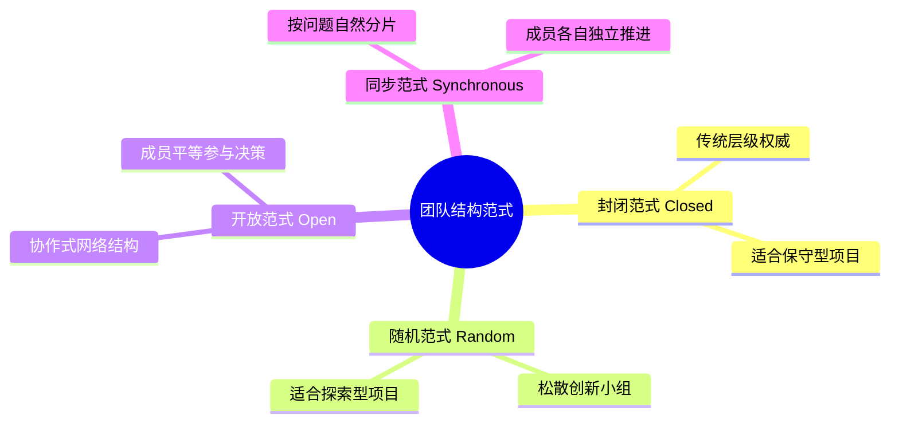

# 软件团队（Software Teams）与团队领导（Team Leader）

## 为什么需要专门的软件团队

先想一个问题：如果让 100 个程序员各自为战、没有分工地去写一个百万行代码的操作系统，会发生什么？

每个程序员只了解自己的模块，模块之间接口混乱，沟通成本爆炸——这正是 IBM System/360 操作系统（1963–1966）的教训：4000 多个模块、约 100 万条指令、投入 5000 人年，最终延期交付且残留 2000 多个错误。Brooks 总结道：**问题主要出在管理和团队构建上**。

> [!IMPORTANT]
> 软件不是个人英雄主义的产物。==软件工程的核心是人与人协作的工程==，团队结构的选择直接决定项目的成败。

## 团队领导的素质

优秀的团队领导（Team Leader）需要兼具**技术判断力**与**管理软技能**：

| 维度 | 关键素质 |
|------|----------|
| 技术能力 | 能评估技术方案的可行性，指导成员解决难题 |
| 沟通能力 | 在团队、客户、管理层之间有效传递信息 |
| 决策能力 | 在信息不完整时做出合理判断并承担责任 |
| 激励能力 | 让成员保持目标感和参与感 |
| 冲突管理 | 及时化解人际摩擦，维护心理安全感 |

## 团队结构的组织范式

软件工程团队有多种"organizational paradigms"，各有适用场景：

选择哪种结构？关键看这几个因素：

1. **待解决问题的难度**——越复杂越需要紧密协作
2. **最终程序的规模**——代码量越大，分层管理越必要
3. **团队生命周期**——长期团队更需要培养默契
4. **问题可模块化程度**——模块边界清晰才能有效分工
5. **质量与可靠性要求**——高可靠性项目需要更严格的评审机制
6. **交付日期的刚性**——时间越紧，沟通开销要越小
7. **项目所需的沟通程度**——成员间依赖越强，越需要同步范式

## 高效团队的属性与毒性因素

> [!TIP]
> 高效团队的五个关键词：**目标感、参与感、信任感、改进意识、技能多样性**。

反过来，以下"毒性"环境会摧毁团队：

| 毒性因素 | 避免措施 |
|----------|----------|
| 狂热工作氛围，精力耗散 | 确保团队获取全部必要信息 |
| 高度挫败感引发摩擦 | 除非必要，不随意修改主要目标 |
| 碎片化、协调不良的过程 | 允许团队自主选择过程模型 |
| 角色定义不明，互相推诿 | 团队建立内部问责机制 |
| 反复失败导致士气低落 | 建立基于团队的反馈与问题解决机制 |
| 人际特质互不兼容 | 合理配置互补型成员 |

## 一个算对了的例子

回到 IBM System/360 的考题。假设团队有 $N$ 名成员，两两之间都可能需要沟通，则通信路径数为：

$$
C(N) = \frac{N(N-1)}{2}
$$

当 $N=10$ 时，$C(10)=45$ 条路径；$N=50$ 时，$C(50)=1225$ 条。若每条路径每周平均消耗 0.5 小时沟通，50 人团队每周仅沟通就需 $1225 \times 0.5 = 612.5$ 人时——这还不包括会议中的信息衰减和误解成本。

> [!WARNING]
> ==Brooks 定律==：向已延期的项目增加人手，只会让它更加延期。新人需要培训、融入，反而加重原有成员的沟通负担。

因此，System/360 的教训不是"人不够"，而是**团队结构没有随规模调整**：应采用分层管理（如每 5–7 人一个小组长），配合清晰的接口规范和模块化分工，才能将通信开销控制在可承受范围内。
