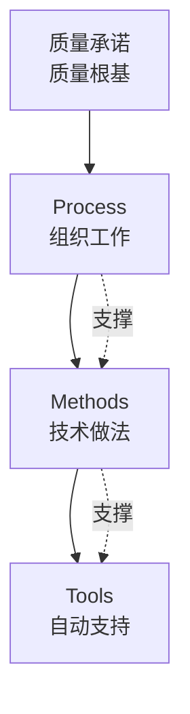

# 软件工程是一种层次化的技术（A Layered Technology）

软件工程不是“会写代码”这么简单，它是一项把质量、进度、成本和协作都管起来的层次化技术（A Layered Technology）。课件把软件工程画成三层：**质量承诺（a commitment to quality）是根基，过程（process）是黏合层，方法（methods）提供技术做法，工具（tools）提供自动化或半自动化支持**。考试常把三层简写为 ==Process、Methods、Tools==。

## 三层各管什么

| 层次 | 回答的问题 | 主要内容 | 例子 |
|---|---|---|---|
| Process 过程 | 工作怎样组织、推进和控制？ | 定义框架活动（framework activities）与普适性活动（umbrella activities），建立可管理、可改进的工作流程 | 沟通、策划、建模、构建、部署；配置管理、质量保证 |
| Methods 方法 | 每一项技术工作具体怎么做？ | 为沟通、需求分析、设计建模、编程、测试和维护提供技术途径 | 用例分析、UML 建模、设计评审、测试设计 |
| Tools 工具 | 如何减少重复劳动并留下可追踪结果？ | 支持过程和方法，形成工具链或集成环境 | Git、需求管理平台、建模工具、编译器、自动化测试 |

可以把它们想成建楼：过程规定先勘察、再设计、后施工及如何验收；方法说明怎样计算结构、绘制图纸；工具则是测量仪器和施工设备。只有工具而没有过程，团队可能“人人很忙，却无人知道做到哪一步”。

> [!IMPORTANT]
> ==过程是把各层结合起来的“黏合剂”==：它让方法在合适的时机被采用，让工具服务于明确的任务，并通过管理、度量和质量保证，使合理开发能够持续进行。

## 为什么需要分层

分层把“按什么流程做”“用什么技术做”“用什么工具做”分开讨论。需求建模方法更换，不一定推翻整个开发过程；引入自动化测试工具，也不等于团队已经掌握测试方法。三者应相互配合，而不是互相替代。

例如，团队使用 Git 只说明有了工具；规定分支、评审和发布流程属于过程；如何拆分模块、设计接口则属于方法。软件工程实践还遵循“理解问题—计划解决方案—执行计划—检查结果”的思路，分别对应沟通与分析、建模与设计、代码生成、测试与质量保证。

## 易混点与常见坑

- **过程不等于过程模型**：过程说明活动及其组织；瀑布模型、增量模型等是过程的具体组织方式。
- **方法不等于工具**：UML 建模思想是方法，绘图软件是工具；会用绘图软件不代表会建模。
- **三层不是只有三项活动**：沟通、策划、建模、构建、部署属于通用过程框架活动，不是与三层并列的另一套“三层”。
- 质量承诺虽常画在图底部，但选择题若问“software engineering layers”，通常按课件答 **Process、Methods、Tools**。

> [!WARNING]
> 看到 **Manufacturing（制造）** 不要选。软件可以复制分发，但软件工程关注开发、演化和质量，不把“制造”列为一个层次。

## 例题

**Which of the items listed below is not one of the software engineering layers?**

A. Process　B. Manufacturing　C. Methods　D. Tools

答案是 **B**。先回忆三层口诀“**过程定路线，方法给做法，工具来助力**”，A、C、D 正好对应三层，只有 Manufacturing 不属于软件工程层次。判断题“Software engineering layers: Process, Methods, Tools.”也应判 **True**。
