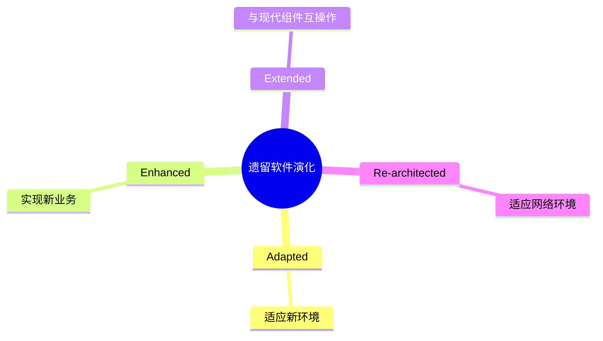

# 软件应用领域与遗留软件（Legacy Software）

> [!IMPORTANT]
> 核心定义：软件应用领域（Application Domains）指软件所服务的不同行业或场景分类；遗留软件（Legacy Software）指多年前开发、仍在运行但难以维护的老旧系统。

## 软件应用领域

思考一个问题：银行转账系统和实验室里的数据处理程序，它们面临的工程挑战一样吗？显然不同。这就是划分应用领域的意义——不同领域对可靠性、实时性、交互方式的要求差异巨大。

教材中列举了多种领域，其中 ==Engineering or Scientific Software==（工程与科学软件）是典型代表，这类软件通常涉及复杂的数值计算与算法（如 CAD 仿真、气象预测）。其他常见领域还包括系统软件、商业软件、嵌入式软件等。

| 应用领域 | 核心关注点 | 典型例子 |
| :--- | :--- | :--- |
| 工程/科学软件 | 算法精度、数值计算 | 信号处理、结构分析 |
| 商业软件 | 事务处理、数据安全 | ERP、银行系统 |
| 嵌入式软件 | 实时性、硬件约束 | 路由器固件、汽车控制 |

[!NOTE]
WebApp 和 Mobile App 虽然都是现代软件，但前者依赖浏览器和网络环境，后者受限于移动设备的算力与电量，设计策略截然不同。

## 遗留软件的本质

为什么我们需要关注“老”软件？因为大多数软件开发项目都是为了满足某种业务需求而发起的（A most software development projects are initiated to try to meet some business need. ==True==）。当业务还在跑，老代码就不能随便扔。

遗留软件通常具备以下特征：
- 质量较差（Poor quality），可能没有经过规范的软件工程方法开发。
- 缺乏文档，原始开发者早已离职。
- 架构陈旧，无法直接适应新环境。

> [!WARNING]
> 常见误区：认为遗留软件就是“没用的废弃代码”。实际上，它们往往承载着企业最核心的业务逻辑，一旦停机损失惨重。

## 遗留系统的演化策略

面对质量糟糕的遗留系统，我们该怎么做？推倒重写成本极高且风险大，因此必须通过演化（Evolution）来延续其生命。课件明确指出了四种演化方向：

1. **Adapted（适应）**：软件必须被调整以适应新的计算环境或技术。
2. **Enhanced（增强）**：软件必须被增强以实现新的业务需求。
3. **Extended（扩展）**：软件必须被扩展以使其能与更现代的系统组件进行互操作（Interoperable）。
4. **Re-architected（重构架构）**：软件必须被重新架构，使其在网络环境中依然可用。

> [!TIP]
> 记忆口诀：“适环、增需、扩作、构网”（适应环境、增加需求、扩展互操作、重构网络）。这四项常作为简答题或选择题的考点。

## 易混辨析与真题避坑

遗留软件的演化与日常维护紧密相关，这里有一个贯穿全课的核心辨析点：软件到底会不会“坏”？

硬件有物理磨损，遵循典型的浴盆曲线（Failure curves）；但软件是逻辑实体（Logical rather than a physical system element）。

> [!CAUTION]
> 高危误区：认为软件用久了会像机器零件一样产生物理磨损。

**真题演练：**
判断题：Software doesn’t wear out, but it does deteriorate.
**答案：True。**
**解析：** 软件不会发生物理意义上的磨损（wear out），但由于不断经历变更（Change）、引入新 Bug 以及环境变迁，它的实际失效率曲线会出现剧烈波动，导致整体质量退化（deteriorate）。软件工程方法的目标之一，正是降低这种退化曲线的斜率与波动幅度。
