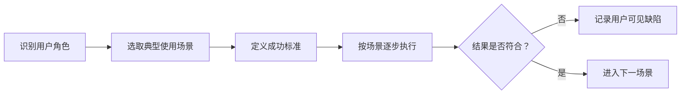

# 软件测试模式（Software Testing Patterns）
测试模式与设计模式用了同一套表达方式：它们都是**在特定情境下反复出现的问题及其可复用的解决方案**。设计模式解决“怎么构造软件”，测试模式则解决“怎么验证软件”。

> [!NOTE]
> 测试模式的描述结构通常包含：模式名（Pattern name）、摘要（Abstract）、适用场景、参与者、协作流程、结果与权衡。课件中以 **ScenarioTesting** 为例给出了范式。

### 为什么需要测试模式

单元测试和集成测试验证的是“模块内部对不对”和“模块之间能不能合起来工作”。但它们回答不了一个更根本的问题：

**软件从用户的角度看，能正常工作吗？**

这正是测试模式要解决的层次缺口。当单个组件都通过测试、模块间接口也都正常，整个应用仍可能在真实用户场景中“翻车”——因为用户不会按模块来使用软件，而是按**场景**来使用。

课件中给出的 ScenarioTesting 模式摘要写得非常直接：

> 一旦单元测试和集成测试完成，就需要确定软件是否能以令用户满意的方式执行。ScenarioTesting 描述了一种**从用户视角**锻炼软件的技术。==在这个层次上的失败，意味着软件未能满足用户可见的需求。==

### ScenarioTesting 的做法

ScenarioTesting 不关心代码内部结构，也不关心测试用例的覆盖率指标。它关心的是：

一个典型的场景测试用例形如：“一名注册用户登录系统，上传一份 ≤5MB 的 PDF 文档，选择‘公开分享’，然后从另一台设备匿名访问分享链接并成功预览。”它串联起登录、上传、权限设置、匿名访问等多个模块，但它们**作为一条用户路径**被整体验证。

### 与相近概念的区别

| 维度 | 单元测试 | 集成测试 | ScenarioTesting |
|---|---|---|---|
| 视角 | 开发者 | 架构师 | 最终用户 |
| 关注点 | 单个组件正确性 | 组件间接口 | 完整用户任务链 |
| 测试依据 | 程序结构 | 架构设计 | 用户使用场景 |
| 失败意味着 | 代码逻辑有错 | 构件协同出错 | ==用户可见需求未满足== |

白盒测试问“代码走对了吗”，ScenarioTesting 问“用户要做的事情做成了吗”。两者互补，不能互相替代。

### 常见的坑

> [!WARNING]
> ScenarioTesting 最容易犯的错是把“场景”写成“操作步骤清单”。场景是有**动机和目标**的——用户为什么做这件事、期望得到什么结果。没有验收标准的场景只是脚本回放，不是测试。

另一个坑是**只覆盖“正常路径”**。真实用户会走弯路：取消操作、中途退出、网络中断后重试、输入非法格式再纠正。场景测试应当包含这些“不顺利但真实”的路径。

> [!TIP]
> 写 ScenarioTesting 用例时可以用一句话模板：“**作为**（角色），**我希望**（操作），**以便**（目标）。”这句话写不出来，说明场景还不清晰。

### 一个算对了的例子

某校教务系统的场景测试用例：

- **场景**：学生在选课开放期间退选一门已选课程，再重选同一门课。
- **前提**：学生已登录且该课程在开放选课窗口内、名额未满。
- **执行**：进入“已选课程”→ 点击“退选”→ 确认 → 返回选课页 → 搜索该课程 → 点击“选课”。
- **预期结果**：退选后学分统计实时减少；重选后课程重新出现在已选列表；全程无 404 或状态不一致。
- **实际结果**：重选成功，但学分统计延迟 5 分钟才更新——==用户可见的状态不一致缺陷被发现==。

这个失败在任何单元测试中都不会暴露：退选模块和选课模块各自工作正常，学分统计模块的异步更新延迟是集成细节，但用户看到的是“我退了课学分没变”。

### 一个判断题的检验

> With thorough testing it is possible to remove all defects from a program prior to delivery to the customer. （）

答案：**False**。

即使测试再“彻底”，也没法在交付前移除**所有**缺陷。原因至少有二：其一，穷尽所有输入和路径在现实规模下不可行；其二，像 ScenarioTesting 揭示的用户层缺陷，需要真实的用户视角和场景多样性，任何测试集都只能抽样覆盖，无法穷举。测试能降低**风险**，不能保证**零缺陷**。
