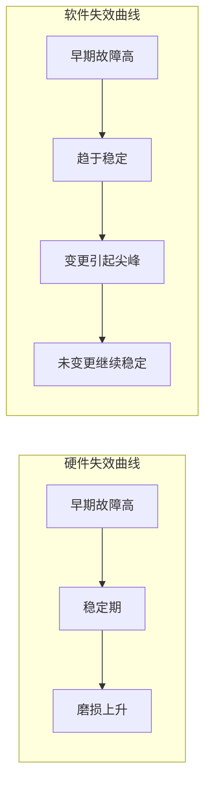

# 软件的本质与定义（What is Software）

## 软件的本质与定义

先从一个看似简单的问题入手：如果从电脑里删掉所有软件，剩下的硬件还能做什么？答案是——几乎什么也做不了。硬件只是“躯壳”，软件才是让计算机产生价值的“灵魂”。

### 软件是什么

教材给出的定义是：**软件是计算机程序、数据及相关文档的集合**。注意不仅仅是代码，还包括数据结构、用户手册、设计文档等。

> [!IMPORTANT]
> 软件的本质：软件既是**产品**，也是**交付产品的载体**。
>
> - 作为**产品**，软件是信息转换器——产生、管理、获取、修改、显示或传递信息；
> - 作为**载体**，软件是计算机控制的基础（操作系统）、信息通信的基础（网络）、其他程序创建与控制的基础（工具与环境）。

### 软件与硬件的本质区别

软件与硬件的差异不是“软”和“硬”的字面意思，而是**物理系统与逻辑系统**的根本分野：

| 对比维度 | 硬件 | 软件 |
|---------|------|------|
| 本质 | 物理实体 | 逻辑实体 |
| 生产方式 | 制造（manufactured） | 开发/工程化（engineered） |
| 失效规律 | 会磨损（wear out） | ==不会磨损，但会退化（deteriorate）== |
| 维修方式 | 更换零件 | 修改逻辑与数据 |

硬件失效曲线是经典的“浴缸曲线”：早期故障率高，中期平稳，后期因磨损上升。而软件的失效曲线完全不同：

软件不会因为“用久了”而损坏，但它会在**变更**时出现问题。每次修改都可能引入新缺陷，导致失效率出现“尖峰”。==软件工程方法的目标就是降低这些尖峰的幅度和后续曲线的斜率==——让变更更可控。

### 遗留系统：不可回避的现实

> [!WARNING]
> **遗留系统（Legacy Software）** 的特点是：维护成本高、演化风险大。它们往往有不可扩展的设计、混乱的代码、缺失的文档、从未归档的测试用例、管理不善的变更历史。

但遗留系统恰恰是**长寿且业务关键**的——银行核心系统、航空调度系统可能运行几十年。软件必须不断适应：

- 新的计算环境与技术
- 新的业务需求
- 与现代系统组件的互操作
- 网络环境下的重构

正因为如此，教材给出忠告：==每个软件工程师都必须认识到变更是常态，不要试图对抗它==。

### 一个典型判断题

> **Software doesn’t wear out, but it does deteriorate.**（软件不会磨损，但会退化。）

**答案：True。** 如果你理解为“软件不磨损就永不失效”，就错了。软件失效的真正来源是**变更引入的错误**和**环境的不适配**，而非时间的损耗。

### 软件危机：为什么需要软件工程

软件开发的长期困境——迟迟不能交付、维护成本远超开发成本、进度不可度量——催生了“软件危机”这一概念。解决之道在于把软件当作**工程**来对待：用系统的、规范的、可量化的方法进行开发、运行和维护，这正是下一节“软件工程的定义与层次”要展开的内容。

**易错提醒**：判断题“Software is a product and cannot be manufactured using the same technologies used for other engineering artifacts”的答案也是 **True**。软件的“制造”是编译、打包、部署，与硬件的车床加工完全不同——它属于**逻辑构建**，不是**物理制造**。
