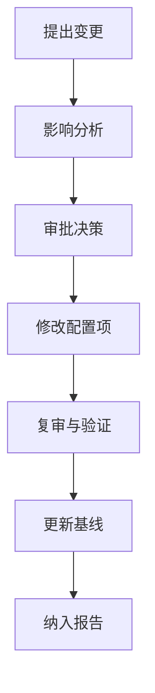
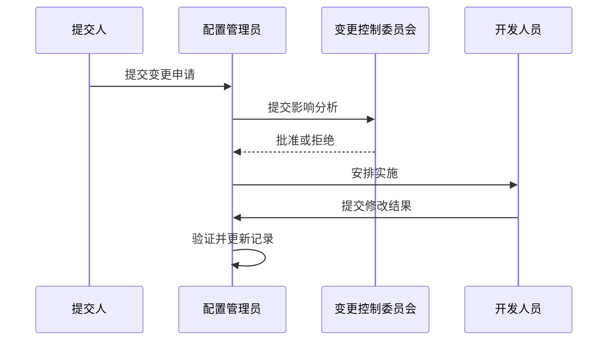

# 软件配置管理报告的撰写规范

## 是什么

软件配置管理报告（Software Configuration Management Report）是项目对**配置项及其状态**进行阶段性汇总的正式文档。它记录“交付了什么、当前处于什么状态、发生过哪些变化、是否达到基线要求”，常见内容包括：

- 本阶段完成的软件配置项及版本；
- 配置项的实际状态与计划状态；
- 基线建立、变更和发布情况；
- 评审、测试及质量保证结果；
- 遗留问题、风险与后续安排；
- 报告周期、编制人、审核人和批准人。

> [!IMPORTANT]
> 配置管理报告不是普通的项目进度表。它以**配置项、版本和基线**为主线，说明软件产品当前的受控状态。

## 为什么需要

大型软件项目中，同一份代码、文档或测试结果可能存在多个版本。若只说“系统已完成70%”，无法回答“完成的是不是被批准的版本”。配置管理报告因此用于：

1. **支持沟通**：让客户、管理者和开发人员对当前软件形成一致认识。
2. **支持追踪**：把需求、设计、代码、测试和发布版本关联起来。
3. **支持审计与验收**：证明交付物符合约定并经过评审、确认。
4. **支持变更控制**：记录变更是否提出、分析、批准、实施和验证。
5. **支持问题定位**：发现某个功能或缺陷究竟出现在哪个配置项、哪个版本中。

## 怎么做

### 明确报告对象

先确定本次报告覆盖哪些配置项，如需求规格说明书、系统设计、源程序、测试用例、测试结果、部署脚本和用户文档。每项应具有唯一标识，例如：

$$
\text{配置项编号}=\text{项目代号}-\text{类型}-\text{序号}
$$

同一配置项的不同状态用**版本号**区分，不要把版本号和配置项编号混为一谈。

### 按统一结构撰写

推荐采用以下结构：

| 部分 | 应回答的问题 |
|---|---|
| 报告概述 | 报告周期、项目阶段、覆盖范围 |
| 配置项状态 | 完成了什么，实际状态是什么 |
| 基线记录 | 何时建立了什么基线，由谁批准 |
| 变更记录 | 改了什么、为什么改、是否闭环 |
| 验证结果 | 评审和测试是否通过，证据在哪里 |
| 问题与风险 | 还有什么未解决，会造成什么影响 |
| 结论与建议 | 当前状态是否可接受，下一步做什么 |

状态应使用项目统一且可判定的术语，例如“已评审”“待评审”“已基线化”“已验证”。避免只写“基本完成”“差不多完成”。

### 做好可追踪性

报告中的结论应能追溯到实际证据。例如，“版本测试通过”应同时给出测试版本、测试范围、结果摘要及问题单号。变更应形成完整链条：

> [!TIP]
> 一条合格记录应能回答：**谁提出、改什么、为什么改、影响谁、谁批准、改后如何验证**。

## 与相近概念的区别

| 文档 | 主要关注点 | 与配置管理报告的区别 |
|---|---|---|
| 项目进度报告 | 任务完成率、工期和资源 | 侧重“计划执行得怎样” |
| 变更请求单 | 某一次变更的申请与审批 | 只描述一个变更事件 |
| 测试报告 | 测试过程、覆盖情况与缺陷 | 侧重质量验证证据 |
| 配置管理报告 | 全部配置项、版本、基线和状态 | 是阶段性综合状态报告 |
| 配置审计记录 | 检查配置项是否符合要求 | 是一种审计活动及其证据 |

一个配置管理报告可以引用测试报告和变更请求单，但不能用这些材料代替自身对配置状态的汇总。

## 常见坑

> [!WARNING]
> “报告写得很完整”不等于“配置受控”。报告必须与真实的版本库、基线记录、变更单和测试结果一致。

- **把目录或工作清单当报告**：只有任务列表，没有配置项状态、版本和基线。
- **版本名称混乱**：出现“最终版”“最终版2”“最新版本”，无法确定唯一对象。
- **只有结果，没有证据**：写“测试通过”，却不注明测试所用版本和结果来源。
- **状态不可判定**：“完成度较高”无法判断是否达到里程碑。
- **漏记基线变化**：代码已修改，但报告仍引用旧版本结论。
- **把变更请求写成变更事实**：申请中但尚未批准的变更不能写成“已实施”。
- **报告与实物脱节**：报告写的是 $V2.1$，仓库中实际交付的却是 $V2.0$。

> [!CAUTION]
> 报告发布前必须核对“报告中的版本、仓库中的版本、交付包的版本”三者是否一致。

## 算对了的例子

某软件项目要求提交 $V1.2$。配置清单如下：

| 配置项 | 当前版本 | 状态 | 验证证据 |
|---|---:|---|---|
| 需求规格说明书 | $R2.1$ | 已基线化 | 评审记录 CR-08 |
| 系统设计说明书 | $D1.4$ | 已评审 | 评审记录 CR-09 |
| 源程序 | $S1.2$ | 已验证 | 测试报告 TR-06 |
| 用户手册 | $U1.1$ | 待修改 | 问题单 IS-12 |

本周发生变更 CR-11：为修复登录缺陷，将源程序由 $S1.1$ 更新为 $S1.2$。该变更已经批准、修改和回归测试，测试报告为 TR-06；但用户手册尚未同步修改。

因此报告不能笼统写“项目全部完成”，而应写：

> 候选发布版本为 $S1.2$，登录缺陷已修复并通过回归测试；需求和设计保持基线状态。用户手册 $U1.1$ 尚有 IS-12 未关闭，因此当前配置**不具备正式发布条件**，下一阶段需修订用户手册并更新发布基线。

这个结论既交代了配置状态、版本、变更和验证证据，也明确指出了剩余问题及发布判断。
