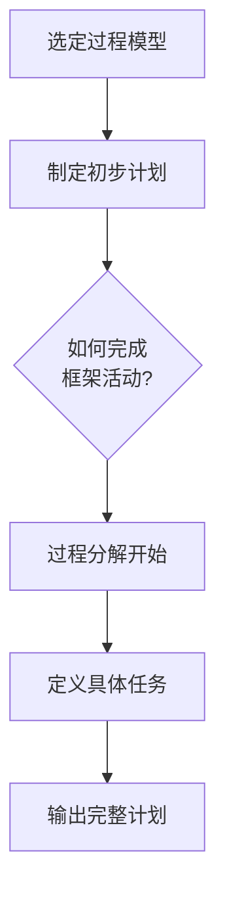

# 过程（Process）：过程分解与沟通活动的任务

---
requires: [软件工程（双语）/通用过程模型, 软件工程（双语）/项目范围界定]
---

当你拿到一个软件项目，确定了要用“增量模型”还是“统一过程（UP）”后，接下来该怎么把计划落地？选定过程模型只是第一步，==真正的计划制定始于过程分解==。

## 什么是过程分解

**过程（Process）** 定义了项目管理控制的框架，为技术方法的应用、工作产品的产出、里程碑的建立提供上下文。而 **过程分解（Process Decomposition）** 则是将这个宏观框架细化为具体可执行任务的动作。

当项目经理问出：“我们如何完成这个框架活动（Framework Activity）？”时，过程分解就开始了。团队必须基于选定的过程框架活动，制定完整计划，反映每个活动中需要完成的 ==Software Engineering Tasks（软件工程任务）==。

> [!IMPORTANT]
> 核心结论：不同案例的过程细节差别很大，但==框架活动是一致的==。过程分解就是把通用的框架活动映射为当前项目的具体任务序列。

## 为什么需要过程分解

如果不做分解，项目计划只是一句空话（如“我们要进行测试”）。通过分解，才能将 JUnit 和 Ant 结合实施增量开发这样的具体动作，易于集成到测试人员构建过程中。同时，产品分解与过程分解是同步进行的（Product and process decomposition occurs simultaneously as the project plan evolves）。

## 怎么做：沟通活动的任务分解

以通用过程模型的第一个框架活动——**沟通（Communication）** 为例。沟通活动的核心任务是需求获取，将其分解后的具体步骤如下：

1. 制定会议计划并邀请利益相关者。
2. 准备会议议程与相关材料。
3. 主持会议，引导利益相关者描述需求。
4. 记录需求并解决冲突（如 Boehm 定义的协商活动）。
5. 形成需求规格说明书（参考 Karl Wiegers 的 SRS 模板）。

> [!TIP]
> 记忆技巧：过程分解就是回答“How do we accomplish this framework activity?”，把大动词拆成小动作。

## 与相近概念的区别

初学者常混淆“问题分解”与“过程分解”。在项目范围界定（Project Scoping）阶段，两者密切相关但视角完全不同：

| 维度 | 问题分解（Problem Decomposition） | 过程分解（Process Decomposition） |
| :--- | :--- | :--- |
| **关注点** | 交付什么功能（What） | 怎么交付功能（How） |
| **分解对象** | 客户需求流、待交付的功能 | 用于交付功能的软件过程 |
| **发生阶段** | 贯穿计划演进全过程 | 选定过程模型后开始 |

> [!NOTE]
> 考题中常问项目范围界定期间问题分解的主要领域是什么？答案是 ==Functionality to be delivered 和 Process used to deliver functionality==（即选项 b 和 c），而不是客户工作流或过程模型本身。

## 常见的坑

> [!WARNING]
> 易错考点：在过程分解时，能不能因为项目太小就省略某些通用的框架活动？
> **绝对不行。** 选定的通用过程框架活动（Common Process Framework Activities）在任何情况下都==不能被省略==（never, the activities are invariant）。你可以缩减某个活动下的具体任务工作量，但框架活动本身是不可变的。

> [!CAUTION]
> 高危误区：为了快速让原型运行，开发人员常在实现中采用折衷手段（如不合适的操作系统或低效算法）。如果不在过程分解中规划好重构任务，这些临时选择最终会变成系统的永久组成部分。

## 真题实战

**题目：** When can selected common process framework activities be omitted during process decomposition?
A. when the project is extremely small in size
B. any time the software is mission critical
C. rapid prototyping does not require their use
D. never the activities are invariant

**解析：** 根据课件原则，通用过程框架活动适用于所有软件项目。无论项目多小、是否是关键任务或采用快速原型法，框架活动本身是不变的（invariant）。因此选 **D**。
