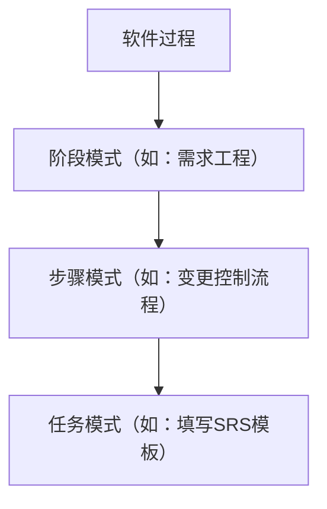

# 过程模式（Process Patterns）的类型与模板

## 什么是过程模式

在软件项目中，团队总会遇到一些反复出现的问题：需求模糊不清、变更管理混乱、或者是某个特定类型的评审总是低效。过程模式就是对这些常见问题及其经过验证的解决方案的抽象描述。

它像一份“问题处理说明书”，告诉你在某种情境下，面对某个问题时，可以采用什么样的步骤或策略来解决。过程模式让软件过程不再是空泛的框架，而是可以按需组合的实践单元。

> [!IMPORTANT]
> ==过程模式是一组软件过程活动的模板，帮助团队基于成熟经验构建适合当前项目的软件过程。==

## 为什么需要过程模式

标准过程模型（如瀑布、敏捷）是宏观的。但在实际操作中，团队会频繁提出：“这一步具体怎么做？先做什么后做什么？要什么输入产出什么？”

- **复用经验**：不用每次都从零开始摸索，直接借鉴已验证的流程。
- **沟通统一**：为团队成员提供一套共享的“过程词汇”，减少理解偏差。
- **灵活适应**：针对项目的特殊性（如需求不确定、高安全要求），把合适的过程模式像积木一样组装，构建属于本项目的软件过程。

课件里有一道典型判断题就直接考查了这个核心价值：

> **试题**：Software processes can be constructed out of pre-existing software patterns to best meet the needs of a software project.  
> **答案**：True — 软件过程确实可以由已有模式构建，以适应项目需求。

## 过程模式的三种类型

根据粒度从大到小，过程模式分为三级：

| 类型 | 含义 | 举例 |
| :--- | :--- | :--- |
| **阶段模式** | 定义软件过程中一个宏观阶段内的整体活动序列。 | “需求不清”的解决方案是一个阶段模式。 |
| **步骤模式** | 定义阶段中某个具体工作项的操作流程。 | 一个变更控制流程（提交、审核、批准、实施）就是步骤模式。 |
| **任务模式** | 定义执行某一步骤时的具体任务细节。 | 编写一份“软件需求规格说明书模板”就是任务模式。 |

## 过程模式的模板

为了准确传递过程信息，每个模式都应包含一组标准的描述元素，形成一个规范的记录模板。

| 模板项 | 描述 |
| :--- | :--- |
| **模式名称** | 清晰概括模式含义（如：`需求不清`）。 |
| **驱动力/目的** | 模式的使用环境及面临的核心问题。 |
| **类型** | 说明该模式属于阶段、步骤还是任务模式。 |
| **启动条件** | 应用该模式前必须满足的前提。 |
| **问题** | 该模式要解决的具体问题描述。 |
| **解决方案** | 如何实施该模式。 |
| **结果** | 模式成功执行后的产出和状态。 |
| **相关模式** | 与之协作或关联的其他过程模式。 |

## 实例解析：“需求不清”的模式

结合课件中的“信息栏过程模式实例”，我们套用模板看看一个最典型的场景——利益相关者对需求仅有模糊想法时的处理策略。

| 模板项 | 实例内容 |
| :--- | :--- |
| **模式名称** | 需求不清的解决方案 |
| **类型** | ==阶段模式== |
| **驱动力** | 利益相关者无法详细描述需求，但已认识到问题必须由软件解决。 |
| **启动条件** | ①已确定利益相关者；②已建立沟通渠道；③已明确主要问题；④已初步了解项目范围与约束。 |
| **问题** | 需求不存在或极度模糊，项目面临方向不明、范围蔓延的高风险。 |
| **解决方案** | 采用原型开发过程，快速构建一个可评估的软件原型。 |
| **结果** | 开发出软件原型，识别出基本需求（交互、计算、处理功能等），并获得利益相关者认可。后续有两种可能的结果：①原型增量演化成最终产品；②抛弃原型，根据已澄清的需求采用其他正式过程模式构建产品。 |

## 常见的坑与辨析

> [!WARNING]
> **不是一套“万能任务集”**  
> 课件选择题“好的团队总是在每个项目中使用相同的任务集以保证质量”一题答案为 **False**。这说明，==过程模式强调的是根据项目特点进行适配，而不是强制执行一成不变的步骤==。

> [!CAUTION]
> **与设计模式的混淆**  
> 过程模式描述的是 **做事的过程（how to do）**，如“原型开发阶段”。  
> 设计模式描述的是 **代码的结构（how to design）**，如“单例模式”。  
> 两者作用域完全不同：一个在流程层级，一个在代码层级。
