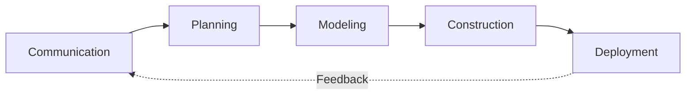

# 五个通用框架活动（Five Framework Activities）

## 五个通用框架活动是什么

如果让你从零开发一个软件，无论项目大小、采用何种过程模型（如瀑布、敏捷或并发模型），是否存在一套所有工程都必须经历的“最小公约数”步骤？这套步骤就是 ==五个通用框架活动==（Five Framework Activities）。它是软件工程过程的骨架，定义了从问题定义到产品交付的必经阶段。

> [!IMPORTANT]
> 核心定义：五个通用框架活动是**独立于具体过程模型**的抽象流程，包括沟通、策划、建模、构建和部署。任何合规的软件工程实践都必须包含这五项活动，区别仅在于执行的顺序、迭代频率与详细程度。

## 为什么需要框架活动

软件开发不是随意编码，而是有纪律的工程。框架活动解决了两个根本问题：

-   **避免混乱**：防止跳过需求直接写代码，或未经测试就交付。
-   **提供适配基线**：无论是传统的线性模型还是 Scrum 等敏捷框架，都以此为基础进行裁剪。例如在 Scrum 中，“Sprint Planning”对应策划，“Daily Scrum”贯穿沟通与构建反馈。

> [!NOTE]
> 框架活动 ≠ 僵化流程。课件强调 "Activities and tasks occur sequentially with defined guidelines for progress"，这里的 sequential 指逻辑依赖关系，而非严格的时间线性。在迭代模型中，这些活动会在每个周期内重复执行。

## 五大活动详解与执行要点

| 活动 | 核心任务 | 关键产出/目标 |
| :--- | :--- | :--- |
| Communication | 与客户/利益相关者协作，收集需求 | 需求规格、共识 |
| Planning | 制定计划、估算资源、识别风险 | 项目计划、里程碑 |
| Modeling | 创建分析与设计模型 | 需求模型、设计模型 |
| Construction | 编码实现 + 测试验证 | 可运行软件、测试报告 |
| Deployment | 交付、安装、培训与支持 | 用户可用系统、反馈 |

> [!TIP]
> 记忆口诀：**沟策建部模**（沟通→策划→建模→构建→部署）。注意“建模”位于策划之后、构建之前，体现了“先设计后编码”的工程原则。

## 与 Umbrella Activities 的区别

这是考试中最易混淆的点。框架活动是**主线流程**，而伞形活动（Umbrella Activities）是**贯穿始终的支撑性活动**，如配置管理、质量保证、风险管理等。

-   **框架活动**：按阶段推进，有明确输入输出。
-   **伞形活动**：不依附于特定阶段，在整个项目生命周期中持续发生。

> [!WARNING]
> 答题时切勿将“配置管理”或“技术评审”列为第六个框架活动。它们属于 Umbrella Activities，用于保障框架活动的质量与可控性。

## 结合并发模型的实例分析

回顾真题中关于 Concurrent Development Model 的提问：该模型如何体现五个框架活动？

假设开发一个嵌入式通信模块，团队分为硬件接口组与协议栈组：

-   **Communication**：两组同步确认接口规范（非一次性完成，随状态变迁持续）。
-   **Planning**：根据当前状态（如“原型验证中”）动态调整下一阶段计划。
-   **Modeling**：协议组建状态机模型时，硬件组并行建电路模型。
-   **Construction**：代码编写与单元测试在各自状态下并发进行。
-   **Deployment**：集成测试通过后触发部署状态，失败则回退至建模或构建状态。

> [!CAUTION]
> 常见误区：认为并发模型“没有顺序”。实际上，它只是将五个框架活动映射为**状态网络**而非线性序列。每个状态的转换仍需满足框架活动的逻辑约束，例如未通过“建模”评审不能进入“构建”状态。这正是 "defined guidelines for progress" 的体现。
