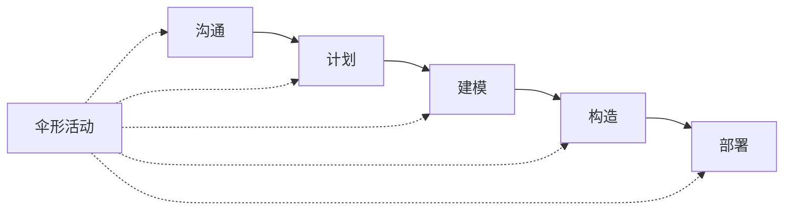
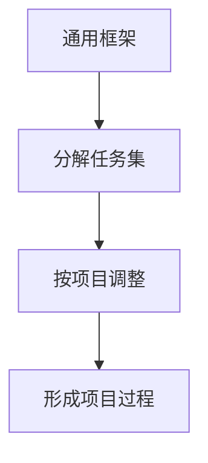

# 通用过程模型（A Generic Process Model）

## 它是什么

在软件工程里，==通用过程模型（generic process model）==是所有具体过程模型（瀑布、增量、螺旋、敏捷等）的共同抽象。课件把 Process 定义为：**framework = framework activities + umbrella activities**。其中 5 个**框架活动（framework activities）**是：

- **沟通（Communication）**：与用户/客户建立联系、收集需求、澄清并达成共识。
- **计划（Planning）**：估算成本/资源/进度，定义范围、里程碑与风险应对。
- **建模（Modeling）**：创建模型（analysis model / design model），帮助开发者和客户理解需求与软件设计。
- **构造（Construction）**：代码生成与测试，产出可运行产品。
- **部署（Deployment）**：交付、安装、培训、支持与反馈。

配套还有 **8 个伞形活动（umbrella activities）**（如变更管理、风险管理、质量保证、配置管理等），它们贯穿全过程。每个框架活动由若干软件工程**动作、任务集（task set）**组成。

## 为什么需要

没有通用模型，软件开发就是“凭感觉写代码”。通用过程模型给出：管理控制的基础、技术方法应用的语境、工作产品、里程碑、质量保障与变更管理的框架。先问一句：如果两个人各写各的，怎么知道第 3 周该产出什么？——所以需要统一“活动框架”。

## 怎么做：过程分解与适应性调整

项目经理问：“**How do we accomplish this framework activity?**” 于是把框架活动分解成任务集，这就是 **process decomposition**。但框架不是教条，要按项目做 **process adaptation**：

## 和相近概念的区别

| 概念 | 含义 |
|---|---|
| generic process model | 通用框架：5 框架活动 + 8 伞形活动 |
| prescriptive model |  predefined、可预测的具体模型（如瀑布） |
| agile process | 强调变化与迭代，如 XP、Scrum |
| process flow | 过程元素相互关联的方式（顺序/迭代） |

## 常见坑

> [!WARNING]
> 把“通用过程模型”当成某个具体模型（如瀑布）去背；它只是抽象框架。也不要以为 5 个活动只能线性走一次，增量/演化/敏捷中它们会反复出现。

## 算对了的例子

简答题问 5 个框架活动任务并谈调整（见上文考题）：
- 沟通=收集需求；计划=估算与排期；建模=建需求/设计模型；构造=编码与测试；部署=交付培训——这部分拿 6 分。
- 调整方面答：项目规模复杂度、技术风险、需求稳定性、团队文化/能力、行业合规性（如医疗航空要严格标准）——这 9 分就拿到了。

> [!IMPORTANT]
> ==框架活动 = 沟通/计划/建模/构造/部署；伞形活动贯穿全程；通用模型是抽象，不是瀑布。==

> [!TIP]
> 记忆口诀：“沟计建构部，五步走全程；伞形管变更，适配看项目。”
