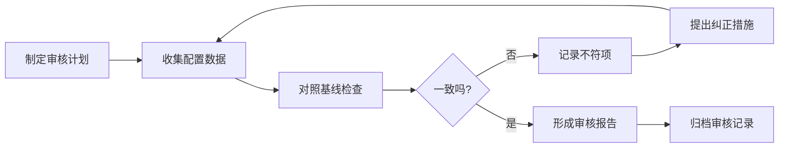

# SCM过程4：配置审核（Configuration Audit）

## 配置审核

先想一个问题：我们已经有版本控制和变更控制，为什么还需要“审核”这一步？变更申请经过审批、修改也完成了，但**审批同意的事，实际不一定被做到**。有人可能改了没走流程，有人可能在基线之外多改了一个文件，也有人改了 A 却忘了同步更新 B。配置审核就是为了回答这些问题而存在的。

> [!IMPORTANT]
> 配置审核（Configuration Audit）是 SCM 过程中的一项正式检查活动，目的是==验证配置项的实际状态与预期配置（基线、需求、变更记录）是否一致==，并确认变更流程被正确遵守。

### 它要回答什么问题

配置审核关注两类一致性。课件中归纳为两个基本问题：

| 审核类型 | 核心问题 | 关注点 |
|---|---|---|
| 功能配置审核（FCA） | “我们做的是不是该做的？” | 软件是否满足需求规格说明 |
| 物理配置审核（PCA） | “文档和代码是否与产品一致？” | 配置项是否齐全、版本是否正确、文档是否匹配实现 |

实际审核中，问题会具体化为：

- 配置项是否都已纳入管理？有没有“遗漏在仓库之外”的文件？
- 当前工作版本是否由受控版本演化而来？
- 基线中引用的每一配置项版本是否存在、正确？
- 变更是否按规定填写了变更请求、经过审批、有完整记录？
- 变更完成后，相关文档（需求、设计、用户手册）是否同步更新？

### 配置审核与相近概念的区别

| 概念 | 在配置管理中的角色 |
|---|---|
| 版本控制 | 记录“有哪些版本”，提供存取与回溯能力 |
| 变更控制 | 决定“能不能改、怎么改”，控制变更的生命周期 |
| ==配置审核== | 验证“是不是照规则改对了”，检查过程与结果的一致性 |
| 状态报告 | 把上述信息汇总，让管理人员“看得见”当前配置状态 |

> [!NOTE]
> 版本控制管“版本”，变更控制管“过程”，配置审核管“一致性”。三者互补，缺少任何一环，配置管理都只是“记录”而不是“管理”。

### 配置审核怎么做

一次配置审核通常在基线建立或发布之前进行，流程如下：

审核完成后要形成正式报告，记录“检查了什么、发现哪些不一致、如何纠正”。这就是课件中提到的 **Audit trails** 的价值——除了版本信息之外，还要能回答“**什么时候、为什么、由谁**”做了改动。

### 一个算对了的例子

假设某项目发布 2.0 版本前进行配置审核。预期基线包含 5 个配置项：

| SCIs | 预期版本 |
|---|---|
| 需求规格说明书 SRS | v2.1 |
| 设计文档 SDD | v2.0 |
| 源代码模块 A | v1.8 |
| 源代码模块 B | v1.5 |
| 用户手册 UM | v2.0 |

审核发现：

- 需求文档已变更为 v2.2，但变更请求（CR-041）未经过 CCB 审批。
- 设计文档内容与需求 v2.1 不符——因为需求改了但设计没有同步修改。
- 用户手册实际版本为 v1.9，但基线清单上写的是 v2.0。

检查结果：

- 预期通过项 $= 2$（模块 A 和模块 B 的版本一致）
- 不一致项 $= 3$（SRS 越权变更、SDD 未同步、UM 版本不符）
- 审核通过率 $= \frac{2}{5} = 40\%$

> [!WARNING]
> 越权变更（版本未走流程就更新）和“文档滞后”（代码改了文档没改）是配置审核中发现频率最高、对发布质量影响最大的两类问题。

> [!TIP]
> 考试时如果被问“configuration audit 问什么问题”，先答**功能一致性**（做得对不对）和**物理一致性**（文档代码对不对得上），再补充**过程一致性**（变更是否按流程走）。
