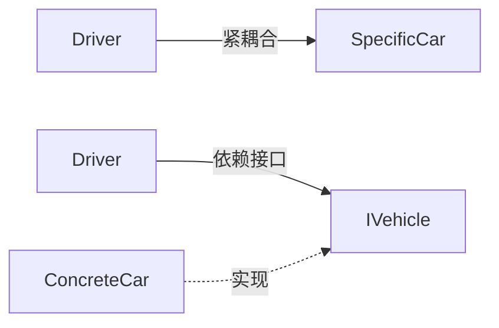

# 重构（Refactoring）

## 什么是设计重构

如果一段代码能跑但难以修改，你会选择推倒重来还是在保持功能不变的前提下优化内部结构？后者正是重构的核心思想。

> [!IMPORTANT]
> ==设计重构（Design Refactoring）是一种重组技术，在不改变软件外部功能和行为的前提下，简化设计或代码以改善其内部结构。==

它不是修复 Bug，也不是增加新需求，而是通过消除冗余、未使用的设计元素、低效算法或不当数据结构，使软件==更容易集成、测试和维护==。在双语教学中，务必区分 **Refactor**（重构）与 **Rewrite**（重写）：前者保持接口契约不变，后者可能破坏原有行为。

## 为什么需要重构

随着迭代推进，设计会逐渐腐化。课件中提到的“司机驾车”案例便是典型反面教材：若 `Driver` 类直接耦合具体 `Car` 实现，一旦更换车型就必须修改 `Driver` 代码，这违反了单一职责原则。

通过重构将具体依赖转为接口依赖，不仅符合 ==SRP==，还为后续扩展留出空间。重构后的设计在应对变更时，修改范围更小、回归测试成本更低，这正是 CBSE（基于构件的软件工程）所追求的模块化与高内聚。

## 如何执行设计重构

重构并非随意改动，需遵循严格步骤：

1.  **识别坏味道**：检查是否存在冗余逻辑、过长方法、过大类或不合理的数据结构。
2.  **保证接口不变**：对外暴露的功能签名、返回值及异常行为必须保持一致。
3.  **小步修改+验证**：每次只调整一个点，立即运行测试确保行为未变。
4.  **应用设计原则**：如利用多态（Polymorphism）替换条件判断，用 CRC 卡片重新梳理类-职责-协作者关系。

> [!TIP]
> 记忆口诀：**外稳内优，小步快跑**。接口是契约，算法可替换；每改一步必测试，避免引入新缺陷。

## 重构与相近概念辨析

| 概念 | 目标 | 是否改变外部行为 | 典型场景 |
| :--- | :--- | :--- | :--- |
| 重构 Refactor | 改善内部结构 | 否 | 消除坏味道、提升可维护性 |
| 原型 Prototyping | 验证需求与设计 | 是（探索性） | 早期风险评估、用户反馈 |
| 重写 Rewrite | 从头实现功能 | 可能改变 | 技术栈迁移、架构彻底升级 |

> [!WARNING]
> 常见误区：把“加新功能”当作重构。若在重构过程中混入需求变更，极易引入隐蔽 Bug。==重构与功能开发应严格分离==，这也是结对编程（Pair Programming）中一人设计、一人把关质量的意义所在。

## 真题示例解析

判断题：“Software designs are refactored to allow the creation of software that is easier to integrate, easier to test, and easier to maintain.” 答案为 **True**。

此题直接对应课件 P150 定义。解题关键在于抓住三个“easier”：集成、测试、维护。只要题干强调“不改变外部行为而改善内部质量”，即为重构的正确描述。若题目暗示“提升性能”或“增加特性”，则不属于重构范畴——尽管重构可能间接带来性能收益，但其==首要目标始终是结构优化而非功能增强==。
