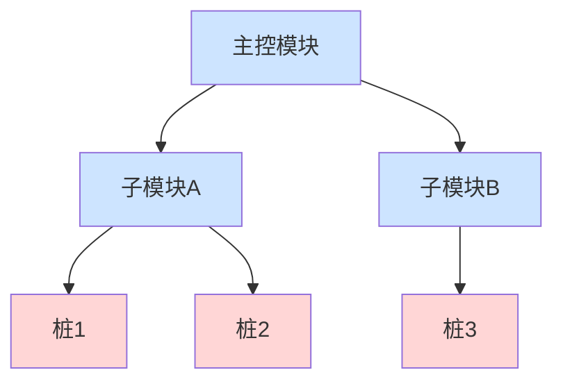
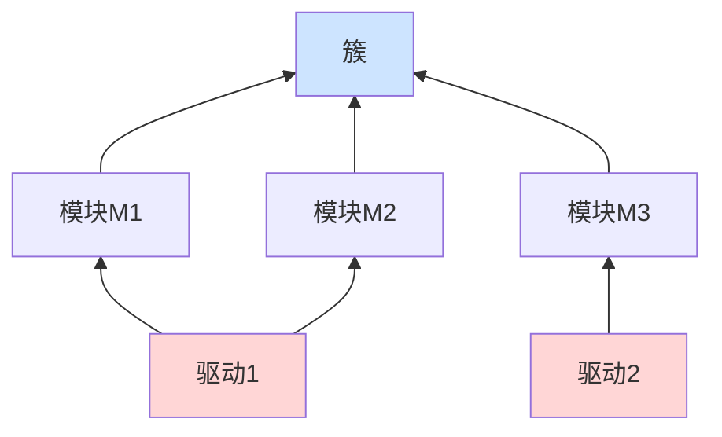

# 集成测试（Integration Testing）：自顶向下、自底向上、三明治混合增量式

在单元测试把每个模块（组件、类）单独验证过之后，我们手里有一堆各自为政的“零件”。它们能单独跑，但拼起来还能正常工作吗？接口对不上、数据传错、调用时序混乱——这些**模块间**的问题正是集成测试（Integration Testing）要抓的。它是测试螺旋向外推进的第二环，焦点从“代码实现”转向“软件体系结构（概要设计）”。

## 两种增量式路径

集成测试通常每次只并入一两个模块，逐步扩大范围。怎么选下一个被测模块？主流有两种策略：

| 维度 | 自顶向下（Top-Down） | 自底向上（Bottom-Up） |
|---|---|---|
| 起点 | 主控模块（顶层） | 原子模块（底层叶子） |
| 替身 | 用**桩（Stubs）**模拟未就绪的低层模块 | 用**驱动（Drivers）**模拟未就绪的高层调用 |
| 早期可见性 | 很快能看到程序骨架和主要控制流程 | 底层算法、工具类先被夯实 |
| 对概要设计的验证 | 早、充分（接口即概要设计） | 晚，需等到上层拼合 |
| 典型风险 | 底层桩可能掩盖真实数据问题 | 顶层集成过晚，整体风险后置 |

### 自顶向下：先搭骨架

步骤（也是常考简答）：

1. 测试主控模块；
2. 沿控制层次逐步下移，每次选一个子模块并入；
3. 对尚未就绪的低层模块，用**桩**代替——桩只返回预设值或打印入口信息，不做真实计算；
4. 用真实模块逐步替换桩；
5. 每次集成后做**回归测试（Regression Testing）**，确认新代码没破坏旧功能；
6. 全部集成完毕后，转入系统级测试。

> [!IMPORTANT]
> 自顶向下选路时，**深度优先通常优于宽度优先**：它会先把一条控制路径走通到叶子，让某个软件功能/分量先完全可运行，再处理旁支。这样更早暴露接口与调用时序问题，也便于演示。

### 自底向上：先夯地基

步骤：

1. 把最底层的原子模块按功能分组，组成**簇（Cluster）**；
2. 为每个簇写驱动程序，模拟上层调用；
3. 逐个测试簇；
4. 拆掉驱动，把簇向上合并成更大的子系统；
5. 同样每步做回归测试。

## 三明治混合策略

纯自顶向下：底层桩太多，可能漏掉真实数据流问题；纯自底向上：顶层接口验证太晚。于是有了**三明治/混合增量式**：上层用自顶向下，下层用自底向上，在中间某层“会师”。桩和驱动的数量都减少，能并行推进，是大型项目常用折中。

## 回归测试为何不可或缺

每并入一个新模块，都可能破坏已通过的接口约定。回归测试就是重跑以前的用例（XP 里甚至要求单元测试每天执行），用最小成本守住“旧功能没坏”这条底线。没有它，集成越深，定位缺陷越像大海捞针。

> [!WARNING]
> 别把集成测试和确认测试混为一谈：集成测试看**设计/体系结构**是否被正确构造；确认测试看**需求规格**是否被满足，是客户验收的前奏。桩、驱动只用于集成阶段，确认测试时它们必须已被真实模块替换。

> [!TIP]
> 记步骤就记“替身”二字：自顶向下用**桩**往下打桩，自底向上用**驱动**往上抬；两者都靠**回归测试**保驾护航。
