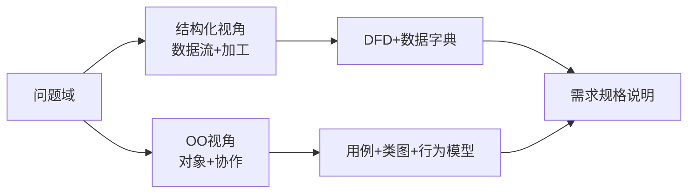

# 需求分析的总体目标、哲学与两种方法学（结构化与OO）

## 总体目标与哲学

需求分析要回答的不是“怎么实现”，而是==系统必须为用户解决什么问题==。Boehm 强调：需求要找到一种**用户和软件人员双方都接受、无二义性**的表达方式，为后续设计和实现提供依据。

> [!IMPORTANT]
> 需求分析三原则：侧重表达**数据域和功能域**；问题应**分解细化、建立层次**；必须**建立模型**。

可以把需求分析想成给系统画“世界观地图”：先确定边界，再描述系统与环境如何交互，最后把这些描述写成双方都能确认的规格说明。

## 两种方法学：同一目标的两条路

方法学不是信仰，而是看待问题域的**取景框**。结构化方法学（SA）从“数据和功能”切入，OO 方法学从“对象及其协作”切入——两者服务于同一目标：把需求说清楚。

| 对比维度 | 结构化方法（SA） | 面向对象方法（OOA） |
|---|---|---|
| 基本视角 | 面向**数据流** | 面向**对象/类** |
| 核心公式 | 数据流 + 加工 + 数据存储 + 端点 + 处理说明 + 数据字典 | 类 + 属性 + 操作 + 关联/协作 |
| 指导思想 | 自顶向下、逐步求精；抽象与分解 | 封装、继承、多态、抽象 |
| 建模结果 | DFD、数据字典、加工说明 | 用例模型、类图、CRC、行为模型 |
| 优势领域 | 数据处理、过程控制类系统 | 交互密集、演化频繁的系统 |

> [!WARNING]
> 两种方法学**并非完全对立**，也不能把其中任何一种当作超越一切的哲学理念套用到所有软件工作。实际分析常常需要**结合 SA 与 OOA 的特征**，例如用 DFD 梳理数据流、用类图表达领域结构。

## 领域分析：OOA 的复用前提

OOA 有一个独特的增值动作——**领域分析**（domain analysis）：

> [!NOTE]
> 领域分析：在特定应用域中，识别、分析和规约**公共的、可复用的能力**，以公共对象、类、子装配和框架的形式表达。

它回答的问题是：这个领域里哪些类、哪些协作模式是反复出现的？识别出来就能复用，避免每个项目从零开始建模。

## 算对了的例子：计算两个数的平均数

用两种方法学分别建模同一需求，感受视角差异：

- **结构化思维**：输入数据 $a, b$ → 加工 `求和` → 加工 `除以2` → 输出结果。核心是**数据流经过加工变换**。
- **OO 思维**：定义类 `Calculator`，属性 `a`、`b`，操作 `average() = (a+b)/2`；创建对象并调用操作。核心是**数据与操作被封装在同一个内聚单元中**。

两者都能得到正确结果，但关注点不同：SA 关注“数据怎么流”，OO 关注“谁负责做这件事”。

## 常见坑

> [!CAUTION]
> - **坑一**：把方法学当教条。选 SA 还是 OOA 取决于问题域特征，不是个人偏好。
> - **坑二**：OOA 阶段就写代码细节。分析类的属性和操作是**需求侧描述**，不是设计决策，更不是 OOP 语法。
> - **坑三**：忽略领域分析，导致每个项目重复识别相同的类，丧失复用价值。
> - **坑四**：用例写成功能列表。用例应描述用户活动的**顺序序列**（场景），用非正式描述风格或结构化形式编写，而非罗列函数名。
