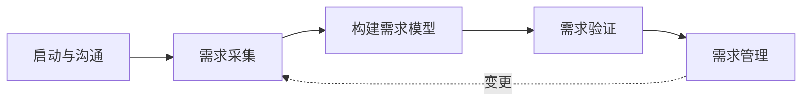
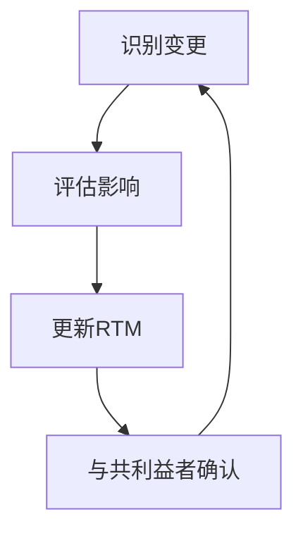

# 需求工程（Requirements Engineering）的任务步骤

## 需求工程的任务步骤

需求工程要回答的核心问题是：**我们到底要造一个什么样的系统？** 如果连“做什么”都没搞清楚就开始写代码，后面大概率会返工。IEEE 对需求的经典定义是：系统必须满足的能力或条件。

需求工程提供了==一个有组织的获取需求的过程==。缺少这个过程，软件很可能无法满足用户需要。下面把它拆成四个步骤来理解。

### 需求采集：找到真正的共利益者

需求不会自动跑到文档里。需求工程师需要先列出==共利益者（stakeholder）==清单——不仅是付钱的客户，还包括最终用户、运维、合规、市场等所有会受到系统影响的人。

采集的主要手段是**协作需求采集会议**。会上要追问三类问题：

- **经济效益类**：成功的方案能带来什么商业价值？（决定优先级和成本约束）
- **输出特征类**：怎样才算“好的”输出？（把模糊期望转化为可测指标）
- **人选确认类**：你是回答这个问题的合适人选吗？（防止收集到错误或过时的信息）

一个常见的坑是把用户说的每句话都当成需求。不同共利益者可能给出==相互矛盾==的需求，工程师需要分类整理、标记来源、记录优先级。

> [!WARNING]
> 只记录显式需求（用户明确说出的功能）而忽略隐式需求（非功能性需求，如性能、安全、易用性）会让验收阶段措手不及。FURPS 属性中的性能、可用性等都属于问题的一部分。

### 构建需求模型

采集到的原始需求是零散的，需要转化为结构化的制品：

| 制品 | 作用 |
|------|------|
| 需求规格说明书（SRS） | 详细描述功能需求与非功能需求，是后续设计/测试的基准 |
| 需求跟踪矩阵（RTM） | 记录每个需求的来源、优先级、实现状态，支持追踪 |

> [!TIP]
> 分析模型和 SRS 不止服务于开发——==它们为软件建成后的质量评估提供了依据==。RTM 则是应对变更的骨架：当某个需求变化时，能快速定位受影响的模块。

### 需求验证

验证要回答：**这条需求真的是用户要的吗？** 而不是“我们理解得对不对吗”。常见做法是评审会，让共利益者逐条确认 SRS 内容。验证关注一致性（无内部矛盾）、完整性（没有遗漏关键场景）、可测性（能用测试用例验证）。

### 需求管理

需求不会静止不动。==需求管理==是一组活动，帮助团队在项目进行中==识别、控制和跟踪需求及其变更==。没有管理，每次客户临时加需求就可能直接打乱开发节奏。

### 小结与易错点

需求工程不是需求分析的一个别名。==需求工程是包含采集、建模、验证、管理在内的完整过程==，而需求分析更侧重建模环节。

> [!CAUTION]
> 考试里容易把“需求规格说明书”与“需求跟踪矩阵”的用途互换。记住：SRS 描述**是什么**，RTM 记录**状态与来源**。
