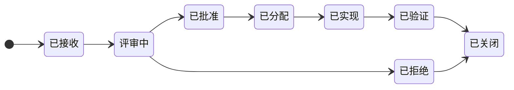

# 需求管理（Requirements Management）

## 需求管理

### 它是什么？

做项目时，需求几乎不可能一成不变。客户今天说“登录要用人脸识别”，明天可能改成“还是指纹更方便”。==需求管理（Requirements Management）== 就是一套系统性的活动，帮助团队在项目推进的任何时刻，去 **识别、控制、跟踪** 这些变化的需求。

它不是指“不让需求变”，而是指“就算需求变了，整个项目也不会乱成一团”。

> [!IMPORTANT]
> 需求管理的核心目标不是冻结需求，而是让需求的变化**受控且可见**。

---

### 为什么需要它？

你可能会问：“需求变了，直接让程序员改代码不就行了？”

这就是最容易掉进去的坑。如果直接改而不走管理流程，后果通常是：测试人员不知道功能已经调整，文档里写的还是旧版逻辑，项目经理无法判断改动是否会影响工期。

> [!WARNING]
> 跳过需求管理去改代码，最常见的后果是 **软件设计与需求脱节**，最终交付的软件与客户期望“长得很像，但用起来完全不对”。

所以，需求管理其实是在做三件事：
1. 随时知道“现在到底有多少需求”。
2. 任意一个需求发生变化时，能评估影响范围。
3. 保证设计、代码、测试用例里与之相关的部分都同步更新。

---

### 怎么做到的？

需求管理通常依托于两个核心工具：**需求规格说明书（SRS）** 和 **需求跟踪矩阵（RTM）**。

**SRS** 是需求的“基准线”——当前这一刻，所有人对需求认识的唯一共识文档。  
**RTM** 则是需求的“关系网”，它记录的是：

| 需求编号 | 需求描述 | 来源 | 优先级 | 对应设计模块 | 对应测试用例 | 当前状态 |
|---------|------|----|-------|------------|-----------|--------|
|...|...|...|...|...|...|...|

这个矩阵能让你在需求变更时快速回答：
- 如果改动这条需求，会连带影响哪些模块？
- 有没有测试用例需要重新跑一遍？

---

### 一个直观的例子

假设团队正在开发“视频监控系统”，需求编号 R-01 是 **“支持按时间范围回放录像”**。

某天客户要求：回放不能只按时间，还必须支持 **按摄像头分组检索**。  
如果团队有基本的需求管理流程，大概的步骤是这样的：

1. 更新 SRS，将变更请求（CR）明确写进需求文档。  
2. 查看 RTM，发现 R-01 关联了：
   - 后端 `VideoManagement` 接口的 `queryRecords()` 方法
   - 前端“回放设置”组件
   - 测试用例 TC-12“回放时间筛选”  
3. 在 RTM 中标注这些关联项状态变为“待修改”。  
4. 所有相关模块修改完毕后，RTM 状态同步更新为“已验证”。

下图展示了一次典型的需求变更在处理流程中可能经过的关键状态：

这个过程里，需求的变化对于全团队都是透明的。无论项目经理还是测试，都能在 RTM 里看清当前进度和受影响的模块。

---

### 它与其他概念的辨析

- **需求工程（Requirements Engineering）** 是更大的“锅”，包含：起始、获取、精化、协商、规约、确认和管理七个阶段。
- **需求管理** 只是这口锅里的最后一个阶段，聚焦于“需求出来之后怎么管控变化”。
- **需求获取（Elicitation）** 关注的是如何让客户说清楚要什么；**需求管理** 关注的是客户说完以后、甚至已经开发了一半时，又想要改点什么。
- **需求确认（Validation）** 确认的是“需求本身写得对不对”；需求管理控制的是“变动的过程对不对”。

---

### 敏捷环境下的理解

敏捷宣言提倡 **“响应变化高于遵循计划”**，但这不等于可以不要需求管理。  
在敏捷里，需求管理是内嵌在每个迭代（Sprint）的入口处的：Product Owner 会维护 **产品待办列表（Product Backlog）**，每个条目有自己的优先级和验收条件。这些条目的变更、细化、删除，本身就是对需求的持续管理。

所以在判断题里看到的这句话是成立的：

> In agile development it is more important to build software that meets the customers' needs today than worry about features that might be needed in the future.  
> **答案：True**

敏捷不是不管变化，而是用“短周期可交付”的方式，让变化被更快地吸收，而不是被压制。
