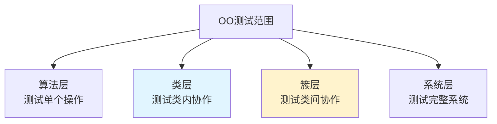
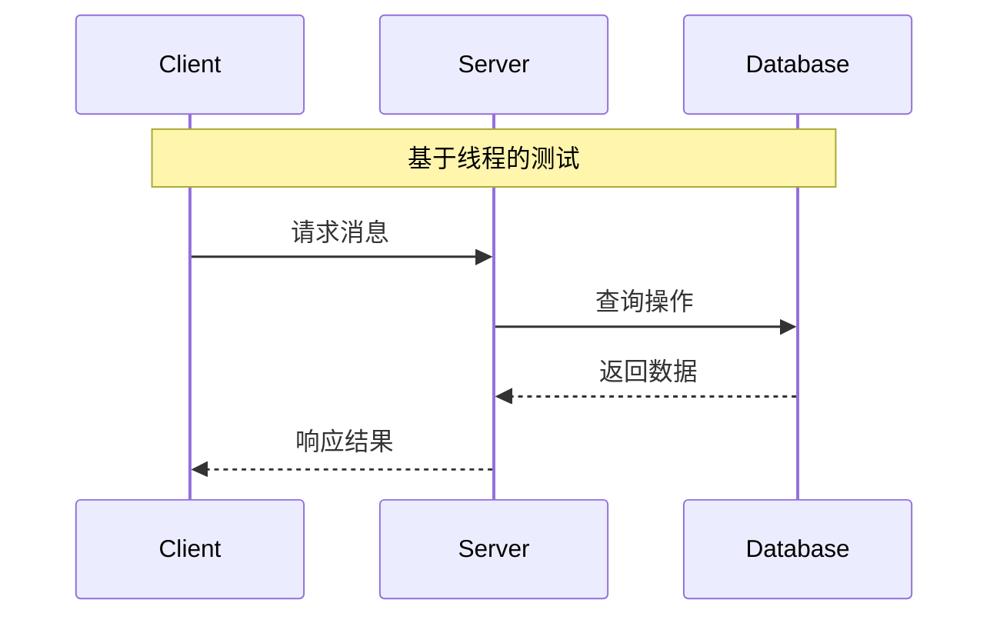

# 面向对象测试（OO Testing）：拓宽测试视野、测试CRC模型、OO测试策略

## 面向对象测试 (OO Testing)

面向对象测试的核心挑战在于：**类（Class）是组织单元，但操作（Operation）是基本测试单元**。与传统软件不同，==孤立地测试单个操作（传统单元测试方法）在OO环境中往往无效==。因为多态性使得不同子类具有不同的属性和操作逻辑，操作的具体行为依赖于其所在的类上下文（Context）。

> [!IMPORTANT]
> **OO测试的四个层次**：算法层（操作）→ 类层（类作为单元）→ 簇层（协作类组）→ 系统层。其中==类测试（Class Testing）== 是OO单元测试的等价物，但必须考虑继承带来的上下文差异。

## 拓宽测试视野 (Broadening the View)

OO测试始于对**OOA（分析）和OOD（设计）模型**的测试，而非等到编码完成。测试用例应在编程完成前的设计阶段创建（参考XP Testing理念：单元测试每日执行，验收测试由客户定义）。

**测试CRC模型**（Class-Responsibility-Collaborator）是设计阶段的测试手段：
- **Class（类）**：检查类定义是否完整
- **Responsibility（职责）**：检查操作是否覆盖所有职责
- **Collaborator（协作者）**：检查类间交互是否正确实现

通过评审CRC卡片，可以在早期发现遗漏的协作关系或职责分配错误。

## 类级测试方法 (Class-Level Testing)

> [!TIP]
> **三种划分策略**（记忆：**状态-属性-类别**）：
> 1. **基于状态划分**：根据操作改变对象状态的能力划分
> 2. **基于属性划分**：根据操作使用的属性划分  
> 3. **基于类别划分**：根据操作完成的功能划分

**基于状态的测试**示例（源自状态图）：
- 改变状态的操作：测试状态转换是否正确
- 非改变状态的操作：验证除最小测试序列外，状态保持不变

## OO集成测试策略

OO集成测试关注**线程（Thread）**和**簇（Cluster）**：

| 策略 | 定义 | 适用场景 |
|------|------|----------|
| **基于线程的测试** (Thread-based) | 测试响应一个输入/事件所需的类集合 | 验证单一功能路径 |
| **基于簇的测试** (Cluster-based) | 测试一组协作类（通常通过消息交互） | 验证子系统功能 |
| **基于使用的测试** (Use-based) | 按依赖关系分层集成 | 处理复杂依赖 |

> [!WARNING]
> **常见误区**：不要试图在超类中测试所有继承操作。由于多态性，==操作X在每个子类中的上下文不同==，必须在每个子类的特定环境中重新测试。

## 场景测试 (Scenario-Based Testing)

这是OO系统测试的主要方法，基于**用例（Use Case）**设计测试用例。通过捕获用户交互场景，测试类之间的消息连接和协作是否正确。

**操作调用与消息连接中的故障类型**：
- 消息传递错误（参数不匹配、类型错误）
- 意外的交互（对象间副作用）
- 不正确的操作调用序列

**示例**：测试银行账户类层次  
基类 `Account` 定义操作 `withdraw()`，子类 `SavingsAccount` 和 `CheckingAccount` 继承该操作但具有不同的余额检查逻辑。测试时必须：
1. 在每个子类上下文中分别测试 `withdraw()`
2. 验证多态调用时，正确执行了子类特定的属性检查（如储蓄账户的最低余额限制）

> [!NOTE]
> **OO测试 vs 传统测试**：传统单元测试可独立测试模块；OO类测试必须考虑封装、继承和多态带来的上下文依赖性。集成测试从"接口测试"转变为"协作测试"。
