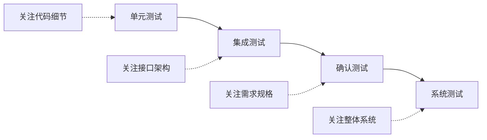
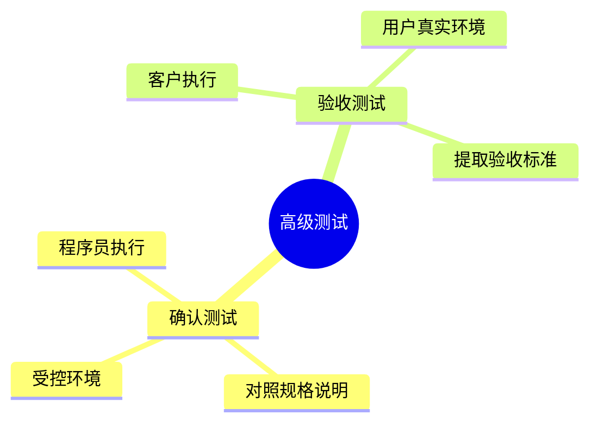

# 高级测试（High Order Testing）：确认测试/软件合格性测试、系统测试

软件测试走到集成测试之后，各个模块拼在一起能跑了，接下来该问两个问题：写出来的软件功能跟需求规格说明一致吗？放到整个系统（硬件、数据库、人员）里还能正常工作吗？

回答这两个问题的阶段，就是==高级测试（High Order Testing）==。

## 测试的宏观步骤

先回顾测试在“螺旋”上向外转的过程：

> [!IMPORTANT]
> 核心流程：单元测试（unit testing）——> 集成测试（integration testing）——> 确认测试（validation testing）——> 系统测试（system testing）。

单元测试对应详细设计，保证模块内无问题；集成测试对应概要设计，重点测接口（推荐深度优先 depth-first，确保一个分量 fully operational 再往下走）。而高级测试则站在更高的视角。

## 确认测试 / 软件合格性测试

**它是什么？**
确认测试（Validation Testing）是验证已构建的软件是否满足==需求建模阶段确立的各项要求==。简单说：看写出来的软件功能和需求的软件功能是否一致。

**怎么做？**
依据《软件需求规格说明书》逐条设计测试用例。注意课件中的原则：测试用例应在编程完成前的设计过程中创建（test cases created during design process before programming was completed）。

**谁来做？**
由开发团队主导，最终交由==软件需求团队验收==。

> [!TIP]
> 记忆口诀：“单元查代码，集成查接口，确认查需求，系统查全局。”

## 系统测试

**它是什么？**
系统测试（System Testing）不再只盯着软件，而是把软件和其他系统元素（硬件、网络、数据库、人工操作等）作为一个整体来测试。看写出的软件在整个系统下的情况。

**谁来做？**
由==客户验收==。

**四种常见类型（常考填空/简答）：**

| 类型 | 英文 | 目的 |
| :--- | :--- | :--- |
| 恢复测试 | Recovery testing | 强制软件发生故障，验证其能否恢复到正常状态 |
| 安全测试 | Security testing | 验证系统防护机制能否抵御攻击 |
| 压力测试 | Stress testing | 在极端负载下检查系统表现 |
| 性能测试 | Performance testing | 评估系统在真实环境下的运行效率 |

> [!NOTE]
> 实时应用（Real-time applications）会给测试带来新难题。如真题所示：Real-time applications add a new and potentially difficult element to the testing mix，答案是 **D. time**。因为实时系统的正确性不仅依赖计算结果，还严格依赖时间约束。

## 确认测试 vs 验收测试

这是极易混淆的考点。两者地位平行，但目标和执行者不同：

| 对比维度 | 确认测试（Validation） | 验收测试（Acceptance） |
| :--- | :--- | :--- |
| **目标** | 确保每个功能/性能特征符合规格说明 | 确保软件在目标用户的正常工作环境中正确运行 |
| **执行者** | 程序员 / 测试团队 | 客户 / 最终用户 |
| **依据** | 软件需求规格说明 | 从用户需求中提取的验收标准 |

> [!WARNING]
> 常见坑：误以为“确认=验收”。记住：验收是客户做的，确认是程序员做的。XP 实践中，acceptance tests defined by customer，且 unit tests executed daily，体现了客户在验收测试中的核心地位。

## 常见误区与总结

> [!CAUTION]
> 高危误区：Testing occurs late in the process. 很多人因此觉得高级测试不重要或可以压缩。实际上，如果跳过确认测试直接交付，会导致极高的 rejection likelihood。

**算对了的例子（历年真题解析）：**
**题目**：Recovery testing (P351) 旨在验证什么？
**解答**：根据教材定义，恢复测试（Recovery testing）属于系统测试的一种。做法是人为制造故障（如断电、进程崩溃），观察系统是否能在规定时间内自动或通过干预恢复到正常状态。填空题若考查此概念，直接答出“验证系统在发生故障后能否恢复到正常状态”即可得分。
