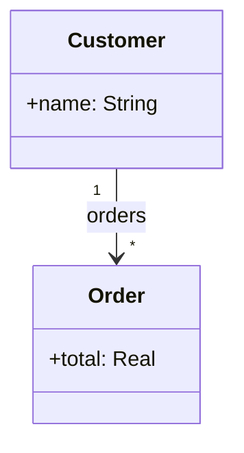

# OCL导航表达式（Navigation Expression）

## 什么是OCL导航表达式

在UML类图中，关联线仅能表达“存在关系”，却无法描述“如何从一端精确到达另一端”。当我们需要在约束中引用特定对象或属性时，就必须使用==OCL导航表达式==。它本质上是沿着类图关联路径进行遍历的语法结构，用于在不变量、前置/后置条件中定位目标元素。

> [!IMPORTANT]
> 导航表达式不是代码查询语句，而是==基于模型结构的声明式路径描述==，其合法性完全取决于类图中的关联定义。

## 为什么需要简单导航

若没有导航表达式，我们只能笼统地说“某个订单属于某客户”，但无法表达“该客户所有已发货订单的总金额大于1000”这类精确约束。简单导航正是解决这一问题的基础工具，它允许我们从上下文对象出发，通过角色名（role name）逐跳访问关联对象或其属性。

## 如何正确书写简单导航

简单导航的基本形式为 `source.roleName`，其中 `roleName` 必须是类图中明确标注的角色名。若未标注，则默认使用目标类名首字母小写作为隐式角色名。



以上图中，从 `Customer` 导航到 `Order` 的表达式为 `self.orders`；若要获取订单总额，则写为 `self.orders.total`。注意：当多重性为多值（如 `*`）时，`.total` 返回的是集合而非单个值。

> [!WARNING]
> 多值导航结果自动成为集合类型，后续操作必须使用集合运算符（如 `->sum()`），不可直接当作标量处理。

## 与属性访问的区别

| 特征         | 属性访问             | 导航表达式               |
|--------------|----------------------|--------------------------|
| 依据         | 类内部定义的属性     | 类间关联的角色名         |
| 返回值       | 基本类型或对象       | 对象或对象集合           |
| 是否依赖关联 | 否                   | 是                       |
| 示例         | `self.name`          | `self.orders`            |

> [!NOTE]
> 即使目标类有同名属性，只要路径经过关联，就必须用角色名导航，不能混淆为属性访问。

## 常见错误与规避

- **角色名拼写错误**：OCL区分大小写且严格匹配类图，`Orders` ≠ `orders`。
- **忽略多重性语义**：对多值导航结果直接使用 `.attribute` 而未意识到其为集合。
- **跨层跳跃**：试图跳过中间关联直接访问深层属性（如 `self.orderItems.price` 而缺少 `orders` 环节）。

> [!TIP]
> 解题口诀：==一看角色名，二判多重性，三查路径连==。

## 正确示例解析

设类图含 `Customer —[orders]→ Order`，约束要求“客户所有订单总额 ≥ 0”。正确OCL为：

```ocl
context Customer inv: self.orders->sum(total) >= 0
```

此处 `self.orders` 是简单导航，返回 `Set(Order)`；`->sum(total)` 是集合操作，合法作用于多值导航结果。若误写为 `self.orders.total >= 0`，则因类型不匹配导致约束无效——这正是考试中高频失分点。
