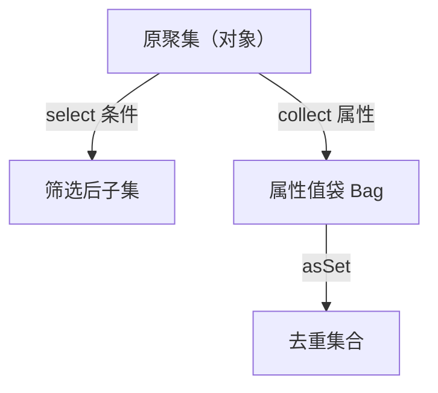

# OCL数据类型与操作

## 为什么需要 OCL 的数据类型与操作

画 UML 类图时，属性和操作的**语法**很好表达，但很多**语义约束**写不出来。比如：

- “某门课的选修人数不能超过 120”
- “订单总价 = 所有订单项小计之和”
- “一个班级的班长必须是该班的学生”

这些约束用自然语言描述有歧义，用代码写又太重。OCL（Object Constraint Language）就是为了在这一层做**精确、无副作用**的约束描述。

在写约束之前，必须先知道 OCL 里能操作哪些**数据类型**，以及能对它们做哪些**操作**——这正是本节的核心。

> [!IMPORTANT]
> OCL 是**声明式语言**，表达式只取值、==不改变对象状态==。它回答“是什么”，不回答“怎么办”。

## 基本数据类型

OCL 定义了与 UML 模型无关的内置类型，约束表达式中直接使用。常用的有：

| OCL 类型 | 含义 | 示例 |
|---|---|---|
| `Boolean` | 布尔值 | `true`, `false` |
| `Integer` | 整数 | `120`, `-3` |
| `Real` | 实数 | `3.14` |
| `String` | 字符串 | `'NJUPT'` |
| `UnlimitedNatural` | 自然数含“无限” | `*` 表示无上限 |

这些类型上都定义了常用操作。例如 `Integer` 支持 `+`、`-`、`*`、`/`、`abs()`、`max()` 等；`String` 支持 `size()`、`concat()`、`toUpper()` 等；`Boolean` 支持 `and`、`or`、`xor`、`not`、`implies`。

在 UML 模型中定义的**类本身也是 OCL 的类型**。导航到对象后，可以用 `.` 访问其属性和操作。

## 聚集类型与操作

约束大量出现在“对一组对象做判断”的场景，所以聚集类型是 OCL 的重点。

| 聚集类型 | 特点 |
|---|---|
| `Set` | 无序、不重复 |
| `Bag` | 无序、可重复 |
| `Sequence` | 有序、可重复 |

导航表达式的多重性决定了结果类型：`0..1` 得到单个对象，`*` 得到 `Set` 或 `Bag`（取决于关联端是否有序）。

## 核心操作：`select` 与 `collect`



### `select`：筛选

```ocl
context Course
inv: self.students->select(s | s.age < 20)->size() <= 30
```

含义：所有学生中，年龄小于 20 的人数不超过 30。`->` 是 OCL 对集合操作的专用箭头，`|` 前是迭代变量，`|` 后是布尔条件。

### `collect`：收集属性

```ocl
context Course
inv: self.students->collect(s | s.name)->size() = self.students->size()
```

含义：收集所有学生的姓名，数量应等于学生数量（即没有人为空名）。`collect` 的结果是一个 `Bag`。

> [!TIP]
> `collect(s | s.name)` 与 `student.name`（属性简写）等价，前者更正式，后者更简洁。

## 其他常用聚集操作

- `size()`：元素个数
- `isEmpty()` / `notEmpty()`：判空
- `includes(x)` / `excludes(x)`：是否包含某元素
- `includesAll(c)`：是否包含另一集合全部元素
- `sum()`：数值聚集求和
- `forAll(x | 条件)`：全称量词，所有元素满足条件
- `exists(x | 条件)`：存在量词，至少一个满足

`forAll` 和 `exists` 可以直接表达很多业务规则。

## 一个完整例子

**需求**：班级的班长必须来自该班的学生名单。

模型：`Class` 类有属性 `monitor`（类型 `Student`）和关联到 `Student` 的 `students` 多重性 `*`。

```ocl
context Class
inv MonitorIsStudent:
    self.students->includes(self.monitor)
```

这个约束在 UML 图上无法直接画出来，但 OCL 一句话就精确表达了。

> [!WARNING]
> 写法 `self.monitor->includes(self.students)` 方向反了：是对**单个对象**用 `->` 集合操作。`self.monitor` 是单个对象，不能直接 `->includes`，必须先考虑谁是多值端。

## 常见坑

- **对单值用 `->`**：只有聚集才有 `->` 操作；单值对象直接用 `.`。
- **`select` 和 `collect` 混淆**：前者返回对象子集，后者返回属性值集合。
- **`size` 与求和混用**：`students->size()` 是人数，`students.grade->sum()` 才是总和。
- **`=` 是比较不是赋值**：OCL 中 `=` 表示相等判断，没有赋值概念。
