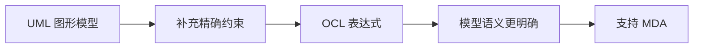

# 对象约束语言（OCL）的概念与用途

## 它是什么

对象约束语言（Object Constraint Language，OCL）用于表示 UML 模型中施加于模型元素上的约束，是一种形式化语言，可以表达精确的、一般性的约束，使模型语义更加精确，较好支持 MDA。

OCL 的定位可概括为：

- 是一种**纯表达式语言**，用表达式表示约束；
- 表达式求值返回一个值，==没有副作用，不改变系统模型状态==；
- 是一种**规格说明语言**，不描述具体实现；
- 不是程序设计语言，不能编写程序逻辑和控制流程。

## 为什么需要 OCL

UML 图形直观、易掌握，但仅靠图形和自然语言注释，有些规则难以精确表达。例如：

> 一个学生的年龄必须不小于 18 岁；  
> 一个订单的折扣必须大于等于 0；  
> 一个员工不能同时属于两个互斥角色。

这些约束涉及属性取值、对象之间的关系以及集合运算。OCL 可以把它们写成无歧义的表达式，补充 UML 图形的表达能力。



## 怎么写：上下文与导航

每个 OCL 约束都有一个**上下文（Context）**，它把 OCL 表达式和被约束的模型元素连接起来。常见写法是：

```ocl
context Student
inv: self.age >= 18
```

其中：

- `Student` 是约束的上下文；
- `inv` 表示不变量，即对象处于有效状态时必须满足；
- `self` 指当前被约束的 `Student` 对象；
- `self.age >= 18` 是约束表达式。

OCL 还可以通过关联进行**导航**。例如，`Person` 与 `Company` 存在工作关系，可写：

```ocl
context Person
inv: self.employer->notEmpty() implies self.salary > 0
```

含义是：如果一个人有雇主，那么其工资必须大于 0。导航得到多个对象时形成聚集，可使用 `size()`、`isEmpty()`、`notEmpty()`、`includes()` 等操作。

## 数据类型与标准约束

OCL 基本类型包括 `Boolean`、`Integer`、`Real`、`String`；UML 类可产生相应的 OCL 模型类型。OCL 定义三种聚集：

| 聚集 | 是否有序 | 是否允许重复 |
|---|---|---|
| `Set` | 否 | 否 |
| `Bag` | 否 | 是 |
| `Sequence` | 是 | 是 |

课件中的标准约束还包括：

- **xor 约束**：多个关联中只能选择一个，体现“互斥或”；
- **subset 约束**：一个关联对应的集合必须是另一个关联集合的子集。

## 一个写对的例子

若课程先修课程不能包含自身，可写：

```ocl
context Course
inv: not self.prerequisite->includes(self)
```

对某门课程 `c` 求值：若其先修课程集合中不含 `c`，表达式返回 `true`，约束满足；否则返回 `false`。求值过程只检查结果，==不会修改 `c` 或其先修课程集合==。

## 和相近概念的区别

| 概念 | 主要作用 | 是否改变系统状态 |
|---|---|---|
| OCL 约束 | 精确规定模型必须满足的条件 | 否 |
| 自然语言注释 | 便于人阅读，但可能含糊 | 否 |
| 程序代码 | 描述算法、控制流程和具体实现 | 可能 |
| UML 图形 | 展示结构与行为，表达直观 | 否 |

> [!WARNING]
> 不要把 OCL 当成编程语言。`self.age = 18` 在约束中通常表示**相等比较**，不是给年龄赋值；OCL 表达式也不能用来描述“先判断、再循环、最后更新数据库”这类实现过程。

> [!TIP]
> 答题时抓住四个关键词：**约束、表达式、无副作用、规格说明**。看到“编写控制流程”“修改对象状态”“描述具体实现”，通常都不属于 OCL 的用途。
