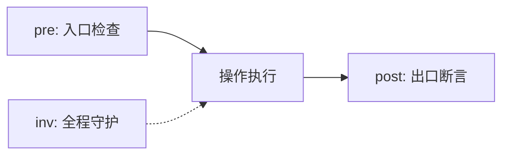

# OCL约束类型（不变量、前置条件、后置条件）

## 为什么自然语言约束不够用？

在用例规约中，我们常用自然语言描述“前置条件”和“后置条件”。但当系统逻辑变复杂时，“用户余额充足”这种描述是否包含冻结金额？“订单状态更新”具体指哪个属性变为哪个值？自然语言的歧义性会导致开发与测试的理解偏差。OCL（Object Constraint Language）正是为了==精确、无歧义地形式化表达约束==而生，它作为UML的补充，不改变模型结构，只附加语义规则。

## 三种核心约束类型辨析

OCL约束根据作用时机分为三类，对应软件生命周期中不同的验证阶段：

| 约束类型 | OCL关键字 | 绑定点 | 验证时机 | 典型场景 |
| :--- | :--- | :--- | :--- | :--- |
| 不变量 | `inv` | 类/关联 | 对象整个生命周期 | 年龄≥0、账户余额非负 |
| 前置条件 | `pre` | 操作/消息 | 操作执行前 | 用户已登录、库存>0 |
| 后置条件 | `post` | 操作/消息 | 操作执行后 | 余额减少、新书已建档 |



> [!IMPORTANT]
> ==不变量是全局真理==，无论何时访问对象都必须成立；而前后置条件仅围绕特定操作的调用边界生效。

## 如何正确书写与绑定

书写OCL需明确上下文（context）。以课件中图书管理系统为例，若为“录入新书”消息添加形式化约束：

-   **前置条件**：`context Librarian::addNewBook() pre: self.system.loggedIn = true`，确保操作员已进入系统。
-   **后置条件**：`context Librarian::addNewBook() post: Book.allInstances()->exists(b | b.isbn = isbn and b.status = #ARCHIVED)`，保证新书信息完成存储建档。
-   **不变量**：`context Book inv: self.isbn <> ''`，任何时刻书籍ISBN不可为空。

> [!TIP]
> 记忆口诀：==inv守状态，pre卡入口，post验结果==。写`post`时善用`@pre`引用操作前的旧值，如`self.balance = self.balance@pre - amount`。

## 常见误区与避坑指南

> [!WARNING]
> OCL是==声明式==而非命令式语言。严禁在约束中使用赋值语句（如`x = 5`），应使用等号`=`表示逻辑相等。OCL只描述“是什么”，不规定“怎么做”。

> [!CAUTION]
> 混淆用例级与OCL级约束。课件表格中的“前置/后置条件”是用例文本描述，面向需求沟通；OCL的`pre/post`是绑定到类图操作的形式化规约，面向精确验证。==两者粒度不同，不可直接等同替换==。

## 一个算对的完整示例

针对“读者借阅图书”操作，正确的OCL约束如下：

```ocl
context Reader::borrow(b: Book)
pre: self.active = true and b.available > 0
post: b.available = b.available@pre - 1 and
      self.borrowedBooks->includes(b)
```

此例中，`pre`同时校验读者资格与图书可用性；`post`通过`@pre`精确表达库存递减关系，并用集合操作`includes`确认借阅关系建立。整个表达式无副作用，纯粹描述状态变迁的逻辑真值，这正是OCL约束区别于程序代码的核心特征。
