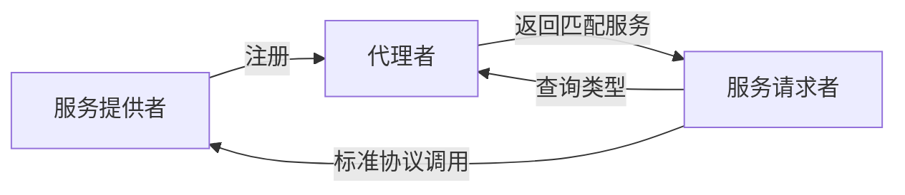

# 面向服务架构（SOA）的概念与核心原则

## 什么是面向服务架构

如果软件组件被绑定在特定的服务器或代码库中，当业务需求变更时该如何灵活调整？SOA 正是为了解决这种“硬编码”耦合而生。

> [!IMPORTANT]
> SOA 是由多个==自治服务==组成的分布式软件体系结构。
> 其核心在于服务是独立部署、独立演进的单元，而非固定配置的服务器程序。

与传统的客户端/服务器（C/S）架构相比，SOA 最大的区别在于==松耦合==与==动态发现==。传统 C/S 往往依赖固定的服务器配置和专有协议，而 SOA 强调使用标准协议通信，客户端通过代理者动态发现并连接服务，而非预先绑定。

| 特性 | 传统 C/S 架构 | SOA 架构 |
| :--- | :--- | :--- |
| 耦合度 | 紧耦合，固定配置 | 松耦合，动态绑定 |
| 服务发现 | 静态地址配置 | 通过代理者注册发现 |
| 通信协议 | 常为私有协议 | 标准化协议 |
| 复用性 | 代码级复用 | 服务级复用 |

## 核心原则与服务特征

理解 SOA 必须把握服务的四大关键特征：==可复用==、==可发现==、==自治==、==非固定==。其中“非固定”是考试高频易错点，服务的位置、实现甚至提供者都可以动态变化，这正是 SOA 灵活性的来源。

> [!TIP]
> 记忆口诀：**自复可发非固定**。
> 自治是基础，复用是目的，可发现是手段，非固定是本质属性。

服务为何要向代理者注册？答案是为了==使服务请求者能够发现它==。代理者充当了服务黄页的角色，当请求者知道所需服务的类型但不知道确切实例时，代理者的价值最为突出。若请求者已知确切服务实例，则无需经过代理者查询。

## 协商模式与交互机制

在服务交互中，协商模式定义了客户主体与服务主体之间的提议与响应规则。这里存在一个关键的逻辑边界：==报价只能响应提议，不能响应请求==。

> [!WARNING]
> 常见误区：认为服务主体可以对“服务请求”直接提供报价。
> 正确逻辑：报价是对“服务提议”的响应；对“服务请求”的响应应是具体的服务执行结果或拒绝。

**真题解析示例**：
题目问“关于协商模式，以下哪一个说法不正确？”
- A. 客户发出服务提议 ✅
- B. 服务以报价响应提议 ✅
- C. 客户请求服务 ✅
- D. 服务以报价响应请求 ❌

选项 D 混淆了“提议”与“请求”的语义。提议是协商阶段的试探性动作，可被报价回应；而请求是执行阶段的确定性动作，不应再以报价作为响应。因此 ==D 为正确答案==。

> [!NOTE]
> UML 建模支持：SOA 中的参与者是虚拟角色概念，可使用组合状态和顺序子状态进行精确建模，这也使得 SOA 能较好地支持模型驱动架构（MDA）。
