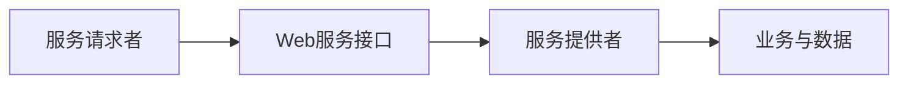
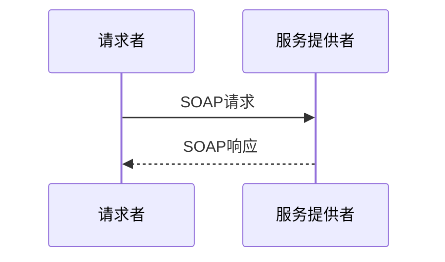
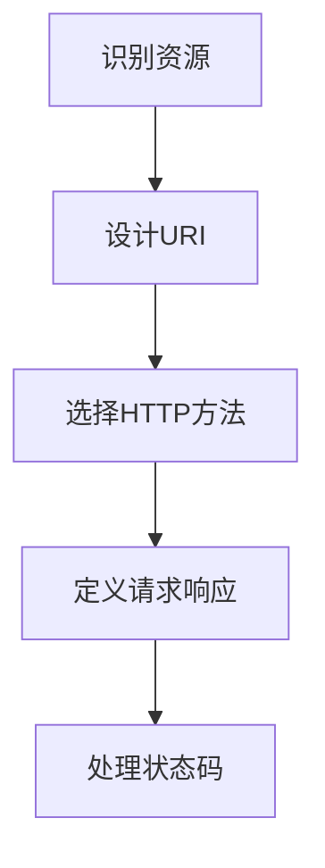

# Web服务技术（SOAP、REST）基础

## 什么是 Web 服务

Web 服务（Web Service）是一种让不同系统通过网络进行通信的分布式服务。服务提供者在网络上发布业务能力，服务请求者根据公开的接口描述调用它。它是==面向服务的软件体系结构==在 Web 环境中的典型实现。

常见技术包括：

- **SOAP**：以 XML 承载消息，接口契约和消息规范较严格。
- **REST**：以资源及 HTTP 方法表达业务操作，强调轻量、简单和可伸缩。

## 为什么需要 Web 服务

不同系统可能使用不同编程语言、操作系统和数据格式。如果每个系统都与另一个系统直接集成，容易形成大量点对点依赖。

Web 服务通过统一的通信协议、服务契约和消息格式降低耦合：

SOAP 适合接口规范严格、企业系统互操作要求较高的场景；REST 适合互联网应用、移动端与轻量接口。

## SOAP 基础

SOAP 使用 XML 定义消息，常见组成包括：

- `Envelope`：SOAP 消息的外层信封；
- `Header`：可选的消息头信息；
- `Body`：实际请求或响应内容；
- `Fault`：发生错误时的标准故障信息。

SOAP 通常借助 WSDL 发布服务契约。WSDL 描述服务提供的信息、可用的操作以及消息格式。

SOAP 可以运行在多种传输协议上，但学习时要注意：==SOAP 本身是消息协议，并不等于 HTTP；HTTP 只是其常见承载方式==。

## REST 基础

REST 是基于**资源**设计接口的一组架构约束。资源通常使用 URI 标识，通过 HTTP 方法表达操作意图：

| HTTP 方法 | 常见含义 | 示例 |
|---|---|---|
| GET | 查询资源 | `GET /students/12` |
| POST | 创建资源或提交操作 | `POST /orders` |
| PUT | 整体更新 | `PUT /students/12` |
| PATCH | 局部更新 | `PATCH /students/12` |
| DELETE | 删除资源 | `DELETE /students/12` |

REST 通常使用 JSON 作为数据交换格式，并通过状态码表达结果。例如：

- `200`：请求成功；
- `201`：资源已创建；
- `400`：请求格式或参数错误；
- `404`：资源不存在；
- `500`：服务器内部错误。

## SOAP 与 REST 的区别

| 对比项 | SOAP | REST |
|---|---|---|
| 核心抽象 | 方法与消息 | 资源与 URI |
| 数据格式 | 传统上以 XML 为主 | 常用 JSON |
| 契约方式 | WSDL 描述较严格 | 通常依赖接口文档或 OpenAPI |
| 传输方式 | 可搭配多种协议 | 主要基于 HTTP |
| 风格特点 | 规范、封装强 | 轻量、通用、易缓存 |
| 适用场景 | 企业集成、严格要求互操作 | Web、移动端和公开 API |

二者不是简单的“谁替代谁”：SOAP 更强调标准化消息契约，REST 更强调资源建模与 HTTP 语义。

## 服务代理与题目中的条件

在面向服务体系结构中，**服务请求者（Service Requester）**是希望获得服务能力的系统；**服务代理（Service Broker/Agent）**负责帮助请求者查找合适的服务。

代理在请求者满足以下条件时最有用：

> [!IMPORTANT]
> 请求者知道所需要的服务类型，但不知道能够提供该服务的具体提供者。

例如，请求者需要“天气查询服务”，却不知道哪个服务提供方可用。此时代理可以根据服务类型完成发现和匹配。

若请求者已经知道确切服务，一般可直接调用；需要“发现代理者”也不是判断代理是否有用的标准条件。因此选择题答案为 **B**。

## 常见误区

> [!WARNING]
> REST 的“状态码”描述 HTTP 操作结果，不应与 SOAP 的 `Fault` 体混为一谈。

还要避免把“使用 HTTP”直接等同于“符合 REST”。真正的 REST 还应正确使用资源标识、HTTP 方法、状态码和无状态交互等约束。
