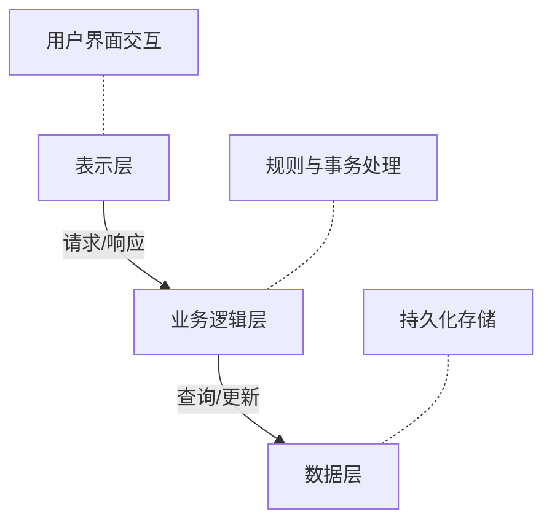

# 三层C/S体系结构（表示层、业务逻辑层、数据层）

## 三层C/S体系结构是什么

如果所有业务规则都写在客户端，一旦需求变更，是否需要重新部署成百上千台终端？为了解决两层C/S“胖客户端”维护难、扩展差的问题，==三层C/S体系结构==在表示层与数据层之间抽离出独立的**业务逻辑层**，形成“瘦客户端+应用服务器+数据库服务器”的分工模式。

> [!IMPORTANT]
> 三层C/S的核心价值在于==业务逻辑独立==，使界面修改不影响数据处理，数据库更换不波及前端展示。

## 各层职责与协作机制

- **表示层**：负责用户交互、数据格式化与输入校验，不含任何业务规则。
- **业务逻辑层**：封装核心算法、事务控制与权限验证，是系统的“大脑”。
- **数据层**：仅响应SQL或ORM调用，执行增删改查，不包含业务判断。

> [!TIP]
> 记忆口诀：“界面只管显，数据只管存，逻辑居中连”。

## 与相近概念的区别

| 对比维度 | 两层C/S | 三层C/S | MVC模式 |
| :--- | :--- | :--- | :--- |
| 业务逻辑位置 | 客户端或数据库 | 独立中间层 | Controller/Model |
| 客户端负载 | 重（胖客户端） | 轻（瘦客户端） | 视实现而定 |
| 可维护性 | 低 | 高 | 中高 |
| 适用场景 | 小型局域网系统 | 企业级分布式系统 | Web/桌面应用内部 |

> [!NOTE]
> MVC是代码级设计模式，三层C/S是==物理/逻辑部署架构==；MVC常作为三层中表示层或业务层的内部实现方式，二者不在同一抽象层级。

## 常见误区与真题辨析

> [!WARNING]
> 切勿将“实体类”等同于“数据表映射对象”。在OOA/D中，实体类是对问题域中事物的抽象，强调==数据抽象==而非单纯存储。

以南邮历年真题为例：

> 下面哪一种类是实体类？
> A. 信息隐藏类  B. 子类  C. 控制类  D. 数据抽象类

正确答案为 **D**。解析：实体类的本质是==对现实世界对象的数据与行为封装==，即“数据抽象类”；控制类负责协调流程，信息隐藏类是实现原则，子类是继承关系，均非实体类定义本体。此题虽考UML分类，但深刻关联三层结构中业务逻辑层的建模基础——若混淆实体类与控制类，会导致业务逻辑错误地渗入数据层或表示层。

> [!CAUTION]
> 考试中若选项出现“数据库表类”“DTO”等，需警惕：它们属于数据层实现细节，==不等于分析阶段的实体类==。
